# Assignment 1: Set up your Azure environment and first automation

Welcome to the first assignment of the course! In this exercise you will set up the **Azure working environment** you will use throughout the course. You will learn to sign in with the **Azure CLI**, create a **resource group** using the course naming convention and **tags**, set a **budget with email alerts** before any paid resources exist, and finally publish the included **Campus Events API** (.NET 10) to **App Service**.

The exercise proceeds **step by step**: each section adds one new piece to the environment, and after every step you can verify the result yourself. Type the commands **yourself** (do not copy blindly) — every command is explained: what it does and why.

> **Note:** This course builds on Azure Fundamentals knowledge. Concepts such as subscription, resource group, and PaaS are assumed to be familiar — here they become **practical tools**.

> **Course principle from day one:** In the cloud, every resource can cost money. That is why the first thing we build is not an application — it is a **budget alert**. This is the same order professionals follow in real projects.

---

## Additional material

**Theory materials:**
- [Cloud Concepts](https://github.com/xamk-mire/Xamk-wiki/blob/main/Cloud%20technologies/Cloud-Concepts.md) - IaaS/PaaS/SaaS, shared responsibility, CapEx vs. OpEx, scalability
- [Cost Management](https://github.com/xamk-mire/Xamk-wiki/blob/main/Cloud%20technologies/Azure/Cost-Management.md) - CapEx vs. OpEx on the Azure bill
- [Azure App Service](https://github.com/xamk-mire/Xamk-wiki/blob/main/Cloud%20technologies/Azure/App-Service.md) - App Service Plan tiers and deployment
- [Azure services (overview)](https://github.com/xamk-mire/Xamk-wiki/blob/main/Cloud%20technologies/Azure/README.md)

**External links:**
- [Azure CLI documentation](https://learn.microsoft.com/en-us/cli/azure/)
- [Azure Cost Management: Budgets](https://learn.microsoft.com/en-us/azure/cost-management-billing/costs/tutorial-acm-create-budgets)
- [Azure: Resource naming conventions](https://learn.microsoft.com/en-us/azure/cloud-adoption-framework/ready/azure-best-practices/resource-naming)
- [Azure: Using tags](https://learn.microsoft.com/en-us/azure/azure-resource-manager/management/tag-resources)
- [az webapp up command](https://learn.microsoft.com/en-us/cli/azure/webapp#az-webapp-up)

---

## What do you need?

**Starter code:** Use the included [StarterCode/CampusEvents](StarterCode/CampusEvents) project. It is a small but realistic **campus workshop registration API** built with ASP.NET Core Minimal APIs on **.NET 10**. Data is stored in memory for this assignment (no database yet — that comes later).

Also required:

- **Azure subscription** — e.g. [Azure for Students](https://azure.microsoft.com/free/students/) ($100 credit, no credit card). If you do not have a subscription yet, create one with your school email before starting.
- **Azure CLI** — installation instructions in Step 1
- **.NET 10 SDK** — verify with `dotnet --version` (should start with `10.`)
- **VS Code** or Visual Studio
- **HTTP client** — VS Code REST Client, Visual Studio `.http` support, or curl/Postman

Example pictures in this lab are real CLI output. Portal steps (resource group, budget, Cost analysis) have no example image — screenshot **your** blade for the return.

---

## What are we building?

After this assignment you will have the course **base environment** in Azure, with a real application running:

```
Your Azure subscription
│
└── rg-cloud26-<your-name>-dev          ← Resource group (all course resources go here)
    │   Tags: Application, Environment, Owner, Course
    │
    ├── 💰 Budget + email alert         ← Notifies you if spending exceeds the limit
    │      (50% / 80% / 100% thresholds)
    │
    ├── App Service Plan (F1, free)     ← The "machine" your app runs on
    └── Web App                         ← Campus Events API (.NET 10)
           https://<your-app>.azurewebsites.net
           ├── GET  /api/events
           ├── POST /api/events/{id}/registrations
           └── GET  /health , /info
```

> **If a diagram shows as code** (`flowchart …` instead of boxes): the VS Code / Cursor Markdown preview does not draw Mermaid. Open the file on GitHub, or install the **Markdown Preview Mermaid Support** extension and reopen the preview.

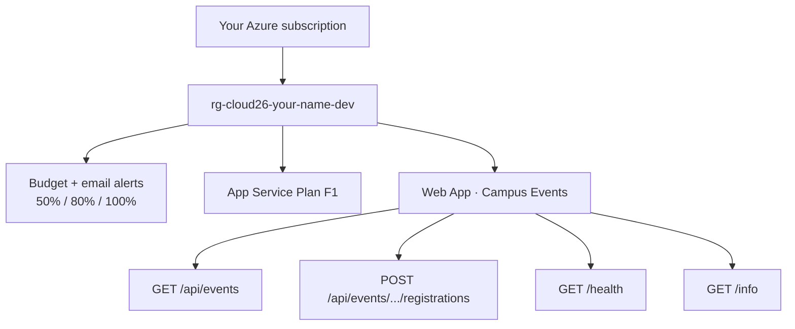

### Campus Events API (starter)

A small API for campus workshops and meetups:

| Method | Path | Description |
|--------|------|-------------|
| `GET` | `/` | App overview |
| `GET` | `/health` | Health check |
| `GET` | `/info` | Runtime info (environment, machine name) |
| `GET` | `/api/events` | List events (seeded sample data included) |
| `GET` | `/api/events/{id}` | Get one event |
| `POST` | `/api/events` | Create an event |
| `PUT` | `/api/events/{id}` | Update an event |
| `DELETE` | `/api/events/{id}` | Delete an event |
| `POST` | `/api/events/{id}/registrations` | Register an attendee (capacity + duplicate checks) |
| `GET` | `/api/events/{id}/registrations` | List registrations |

#### Why a `/health` endpoint? (cloud viewpoint)

**What it does:** `/health` is a simple GET endpoint that returns a success response (e.g. `200 OK` + `{ "status": "Healthy" }`) when the app process is up and able to answer HTTP requests. It does not list events, register attendees, or change any data — it only reports readiness.

A health endpoint answers one question: **is this instance ready to take traffic?** That matters far more in the cloud than on a single local machine.

| Cloud need | How `/health` helps |
|------------|---------------------|
| **Platform probes** | App Service, Container Apps, load balancers, and orchestrators can ping `/health` to decide if an instance is alive. Unhealthy instances can be restarted or removed from rotation automatically. |
| **Rolling deploys & scale-out** | When you publish a new version or add instances, the platform waits until health succeeds before sending users there — fewer half-dead releases. |
| **Monitoring & alerts** | Availability tests (later on this course) hit `/health` on a schedule. If it fails, Azure can email you — without depending on a heavy business endpoint. |
| **Cheap and stable signal** | `/api/events` might fail because of bad data or a full store. `/health` should stay simple (and later: also check DB connectivity) so ops can tell *infrastructure/process problems* from *application logic problems*. |

> **Rule of thumb:** Always ship a health endpoint with a cloud app. Keep it lightweight, unauthenticated, and free of side effects. You will wire it to Azure Monitor availability tests and alerts in a later assignment.

```
StarterCode/
├── .gitignore
└── CampusEvents/
    ├── CampusEvents.csproj      ← .NET 10 web project
    ├── Program.cs               ← Minimal API endpoints
    ├── CampusEvents.http        ← Ready-made HTTP requests for local testing
    ├── Models/                  ← Event, Registration, request/response DTOs
    ├── Services/                ← In-memory store (replaced by a DB later)
    └── Properties/
```

> **Why in-memory?** Assignment 1 focuses on the Azure environment, not databases. The store resets when the app restarts — that is expected. Later assignments add a real database, IaC, and CI/CD on top of this same app.

**Target state at the end of the assignment:**

1. You sign in to Azure from the command line (`az login`)
2. A resource group exists with the correct name and tags
3. A budget alert emails you when spending approaches the limit
4. Campus Events responds at a public `https://....azurewebsites.net` URL
5. You know how to check what your environment costs — and how to clean up paid resources

---

## Why the command line instead of the Portal?

On this course we do as much as possible with the **Azure CLI** (command line) instead of the Portal. The reason is simple:

| | Portal (clicking) | Azure CLI (commands) |
|---|---|---|
| **Repeatability** | Clicks are forgotten — nobody remembers what was done | Commands can be saved as a script and run again |
| **Documentation** | "Go there, click this..." | The command **is** the documentation |
| **Automation** | Not possible | Direct path toward IaC and CI/CD (upcoming assignments) |
| **Speed** | Slow for repeated actions | Fast once commands are familiar |

We use the Portal when it is genuinely better: visual exploration, cost views, and creating budgets.

> **Course rule:** Everything you create with the CLI, write down (e.g. `notes.md` or a script file). Assignment by assignment you build your own "runbook", and later you convert it into Bicep code.

---

# Guided section

## Guided section A — Tools and sign-in

### Why this step?

Before we can create anything, we need a working connection to Azure from the command line. At the same time we make sure you are using the **correct subscription** — this matters if your machine has multiple Azure accounts.

### Step 1: Install Azure CLI

**Windows (PowerShell, as administrator):**

```powershell
winget install --exact --id Microsoft.AzureCLI
```

Alternatively download the installer: [Install Azure CLI on Windows](https://learn.microsoft.com/en-us/cli/azure/install-azure-cli-windows).

**Close and reopen the terminal** after installation and verify:

```powershell
az version
```

The output should show `azure-cli` and a version number (e.g. `2.x.x`).

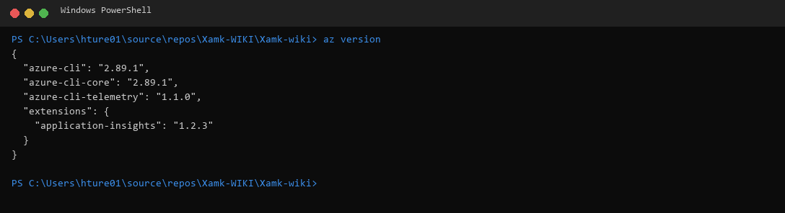

*Your names and IDs will differ. Match the field names, not the pixels.*

### Step 2: Sign in to Azure

```powershell
az login
```

A browser opens — sign in with your **school account** (the same one you used for Azure for Students). After a successful sign-in, the terminal lists your subscriptions.

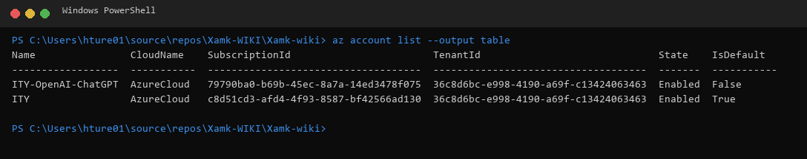

*This example is a school subscription named ITY. Yours is often "Azure for Students". Match `State` = Enabled and `IsDefault` = True on the one you will use.*

### Step 3: Verify the active subscription

**What a subscription is:** The billing and permission boundary for Azure. Resources (and their costs) always belong to one subscription. Student credit lives on your subscription — everything you create here draws from that credit.

```powershell
az account show --output table
```

Check the output:

| Field | What to verify |
|--------|----------------|
| `Name` | Is this the correct subscription? (e.g. "Azure for Students") |
| `State` | Must be `Enabled` |
| `IsDefault` | Must be `True` |

If the wrong subscription is active, switch it:

```powershell
az account list --output table
az account set --subscription "Azure for Students"
```

> **Why does this matter?** All `az` commands target the **active subscription**. If the wrong one is active (e.g. a work account), you create resources — and costs — in the wrong place.

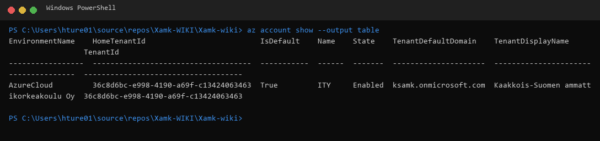

*The Name here is ITY (a school subscription). Students usually see "Azure for Students". Match `State` and `IsDefault`, not the subscription title.*

---

## Guided section B — Resource group, naming, and tags

### Why this step?

**What a resource group does:** It is Azure's logical container ("folder") for related resources. You create, bill, lock, and delete them as one unit. Putting the whole course in one group means one cost view and one cleanup command later.

**What tags do:** Tags are metadata labels (`key=value`) on resources — e.g. `Environment=dev`, `Owner=you@school.fi`. They do **not** change how the resource runs. They exist so you (and Cost Management) can filter, group, and find resources: whose is this? which project? which environment? In real organisations tags are often mandatory.

**What a naming convention does:** A shared name pattern so you can read a resource's purpose from its name alone (`rg-…`, `app-…`, `plan-…`). In a subscription with dozens of resources, consistent names prevent "mystery apps" and accidental deletes.

### Course naming convention

We follow Microsoft's [recommended naming convention](https://learn.microsoft.com/en-us/azure/cloud-adoption-framework/ready/azure-best-practices/resource-naming):

```
<resource-type>-<project>-<your-name>-<environment>

Examples:
rg-cloud26-matti-dev        ← resource group
app-cloud26-matti-dev       ← web app
plan-cloud26-matti-dev      ← app service plan
```

| Part | Meaning | Example |
|-----|----------|-----------|
| `rg`, `app`, `plan` | Resource type abbreviation | `rg` = resource group |
| `cloud26` | Project/course | — |
| `matti` | Your first name (lowercase, no special characters) | `matti`, `jenna` |
| `dev` | Environment | `dev`, `test`, `prod` |

> **Reminder — environment in the name:** `dev` / `test` / `prod` in the name (and in the `Environment` tag) tells everyone this is not production. On this course everything stays `dev` unless a later assignment says otherwise.

### Step 4: Create a resource group with tags

Replace `<your-name>` with your name and `<your-email>` with your school email:

```powershell
az group create `
  --name rg-cloud26-<your-name>-dev `
  --location northeurope `
  --tags Application=cloud26 Environment=dev Owner=<your-email> Course=Cloud26
```

> **PowerShell tip:** The line continuation character in PowerShell is a **backtick** (`` ` ``). If the multi-line command fails, write it on one line.

**What does the command do?**

| Parameter | Explanation |
|-----------|---------|
| `--name` | Resource group name (following the naming convention) |
| `--location` | Azure datacenter region. `northeurope` = Ireland — a commonly available nearby region |
| `--tags` | Key=value pairs separated by spaces |

> **Reminder — region (`--location`):** Resources live in a physical Azure region. Prefer one region for the whole app (here: `northeurope`) so networking stays simple and you do not pay for unexpected cross-region traffic later. Changing region later usually means recreating resources.

> **Reminder — course tags:** Always set at least `Application`, `Environment`, `Owner`, and `Course`. `Owner` is who gets contacted about cost or cleanup; without it, orphan resources are hard to attribute.

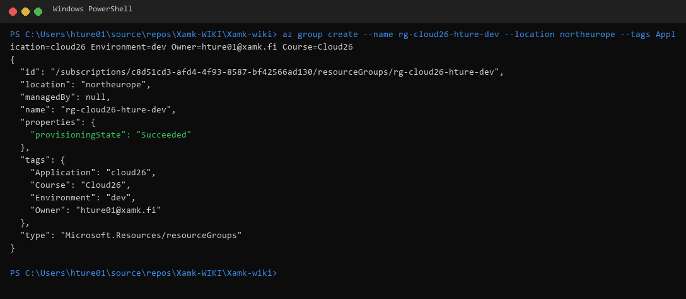

*Your names and IDs will differ. Match the field names, not the pixels.*

### Step 5: Verify the result

```powershell
az group show --name rg-cloud26-<your-name>-dev --output json
```

Check that the output shows:
- `"provisioningState": "Succeeded"`
- All four tags under `tags`

Also view the same in the Portal: [portal.azure.com](https://portal.azure.com) → **Resource groups** → your group → notice the tags at the top.

> **Rule of thumb:** Whenever you create something with the CLI, practise verifying the result both with the CLI (`show`/`list`) and in the Portal. That way the CLI does not stay a "black box".

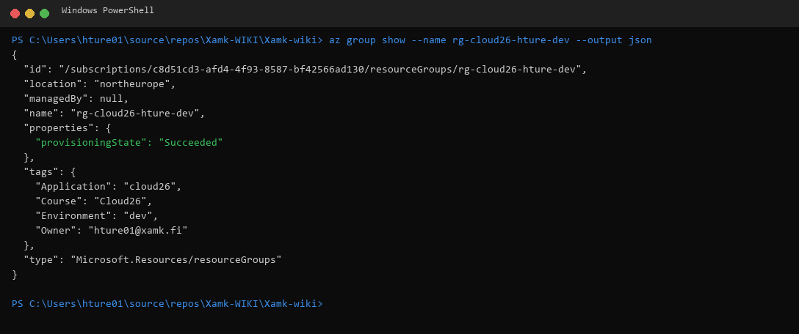

*Your names and IDs will differ. Match the field names, not the pixels.*

---

## Guided section C — Budget and email alert

### Why this step?

**What a budget does:** A budget is a spending limit you define for a scope (resource group or subscription), plus optional **alert thresholds**. Azure compares actual (and optionally forecasted) cost to that limit and can **email you**. It does **not** freeze or delete resources by itself — it is a watchdog, not a hard stop.

Now we build the course's **first automation**: Azure monitors your spending for you and **sends email** if costs exceed the limits you set. We do this **before** any application exists — so a mistake (wrong SKU, forgotten resource) cannot surprise you.

A budget does **not stop** spending — it only alerts. It is still the most important single safety net on a student subscription.

> **The budget is created in the Portal.** You can create a budget with the CLI too, but the Portal form is clearer here and you also see the cost views. This is a good example of when the Portal is the right tool.

### Step 6: Open the budget view

1. Open [portal.azure.com](https://portal.azure.com)
2. Go to your resource group (**Resource groups** → `rg-cloud26-<your-name>-dev`)
3. From the left menu choose **Cost Management** → **Budgets**
4. Click **+ Add**

> **Why a budget on the resource group instead of the whole subscription?** When the budget scope is the resource group, it monitors course costs only. You can optionally create a second budget for the whole subscription (independent exercise 3).

### Step 7: Configure the budget

Fill in the form:

| Field | Value | Reason |
|--------|------|-----------|
| **Name** | `budget-cloud26-<your-name>` | Naming convention |
| **Reset period** | Monthly | Budget resets every month |
| **Creation date** | current month | — |
| **Expiration date** | end of course + 1 month | — |
| **Amount** | `10` | €10 is enough for the course dev environment |

Click **Next**.

### Step 8: Set alert thresholds and email

Add **three alert conditions**:

| Type | % of budget | Meaning |
|------|------------|----------|
| **Actual** | 50% | Half the budget used — wake up now at the latest |
| **Actual** | 80% | Almost at the limit — find out immediately what is consuming |
| **Forecasted** | 100% | Azure **predicts** the limit will be exceeded — react before it actually happens |

Enter your email address in **Alert recipients (email)** and click **Create**.

> **Actual vs. Forecasted:** *Actual* alerts when money has actually been spent. *Forecasted* alerts early when Azure predicts the month's spend will exceed the limit at the current rate. The forecast alert is the most valuable — it gives you time to react.

### Step 9: Verify the result

The budget should now appear in the **Budgets** list. Spend will initially show as zero (€0) — that is correct, because we have not created anything paid yet.

**Your environment's first automation is ready:** Azure monitors your costs 24/7 and emails you if something runs away. You do not need to remember to check anything yourself.

---

## Guided section D — Publish Campus Events to Azure

### Why this step?

**What App Service is (PaaS):** You deploy your app code; Azure runs it on managed compute. Microsoft handles the OS, patching, HTTPS front end, and scaling features. You do **not** manage VMs.

**App Service Plan vs Web App (reminder):**

| Piece | Role |
|-------|------|
| **App Service Plan** (`plan-…`) | The compute "hosting plan" — SKU, region, how much CPU/memory you pay for. Several web apps can share one plan. |
| **Web App** (`app-…`) | Your application instance (URL, settings, deployments) that runs **on** that plan. |

**What a SKU is:** The pricing/performance tier of the plan (e.g. `F1` free, `B1` basic). Higher SKUs = more power and more cost. Always pick the cheapest SKU that meets the need — on this course, **F1** unless an assignment says otherwise.

Now that the safety net is in place, we publish the starter application. We use **App Service** — Azure's PaaS offering that handles the server, OS, and HTTPS for you. You only bring the code.

The goal is not to rewrite the app, but to **experience the full publish path end to end**: code on your machine → a public HTTPS URL on the internet.

### Step 10: Explore the starter project

Open the starter project and read through the structure:

```powershell
cd "StarterCode/CampusEvents"
code .   # or open the folder in Visual Studio
```

Skim these files so you know what you are deploying:

| File | What to notice |
|------|----------------|
| `Program.cs` | Minimal API endpoints for events and registrations |
| `Services/InMemoryEventStore.cs` | Seeded sample events + business rules (capacity, duplicate email) |
| `Models/` | Domain model and request DTOs with validation attributes |
| `CampusEvents.http` | Ready-made requests for local testing |

### Step 11: Run and test locally

```powershell
dotnet run
```

Open `http://localhost:5080/api/events` in a browser — you should see three seeded campus events.

Also try:

- `http://localhost:5080/health` → `Healthy`
- `http://localhost:5080/info` → JSON with `machine` = **your computer's name**
- Open `CampusEvents.http` and run **Register for an event** (VS Code REST Client / Visual Studio)

> **Reminder — `/info` vs `/health`:** `/health` = "can this instance take traffic?" `/info` = diagnostic details (environment, machine, framework) useful for you when comparing local vs Azure. Prefer `/health` for probes and alerts; use `/info` when debugging.

Press `Ctrl+C` to stop when done.

> **Tip:** If port 5080 is busy, `dotnet run` prints the URL it actually uses — use that instead.

> **Cloud reminder:** After you deploy, check `/health` on the public URL first. If health is down, there is no point debugging business endpoints yet — the platform (or your process) is not ready.

### Step 12: Deploy to Azure — az webapp up

Publish from the project folder (`StarterCode/CampusEvents`). Replace `<your-name>` — the web app name must be **globally unique**, because it becomes part of the public URL:

```powershell
az webapp up `
  --name app-cloud26-<your-name>-dev `
  --resource-group rg-cloud26-<your-name>-dev `
  --plan plan-cloud26-<your-name>-dev `
  --location northeurope `
  --sku F1 `
  --os-type Linux `
  --runtime "DOTNETCORE:10.0"
```

> If the name is taken (error "Website with given name already exists"), append a number: `app-cloud26-matti-dev-42`.

Current Azure CLI prints a deprecation warning (`use webapp create and webapp deploy instead`). For this course, keep using `az webapp up` — it still works. **`--os-type Linux` is required**: without it the CLI defaults .NET to Windows and `DOTNETCORE:10.0` fails.

**What does the command do?** `az webapp up` is an "all-in-one" command that:

1. Creates an **App Service Plan** (`--plan`) — the compute capacity the app runs on
2. Creates a **Web App** (`--name`) — the application's "shell"
3. **Builds and packages** your .NET 10 project (zip)
4. **Uploads the package** to Azure and starts the app

| Parameter | Explanation |
|-----------|---------|
| `--sku F1` | **Free tier** — free, limited (60 min CPU/day). Enough for this assignment |
| `--os-type Linux` | Linux-based runtime (cheaper and more common than Windows) |
| `--runtime "DOTNETCORE:10.0"` | Tells App Service this is a .NET 10 app |

> **Reminder — F1 limits:** Free tier is fine for learning, but it can sleep, has CPU quotas, and is not for real load. If the site feels slow or stops after idle time, that is often the SKU — not necessarily a bug in your code.

The command takes 1–3 minutes. At the end it prints the app URL:

```
You can launch the app at http://app-cloud26-<your-name>-dev.azurewebsites.net
```

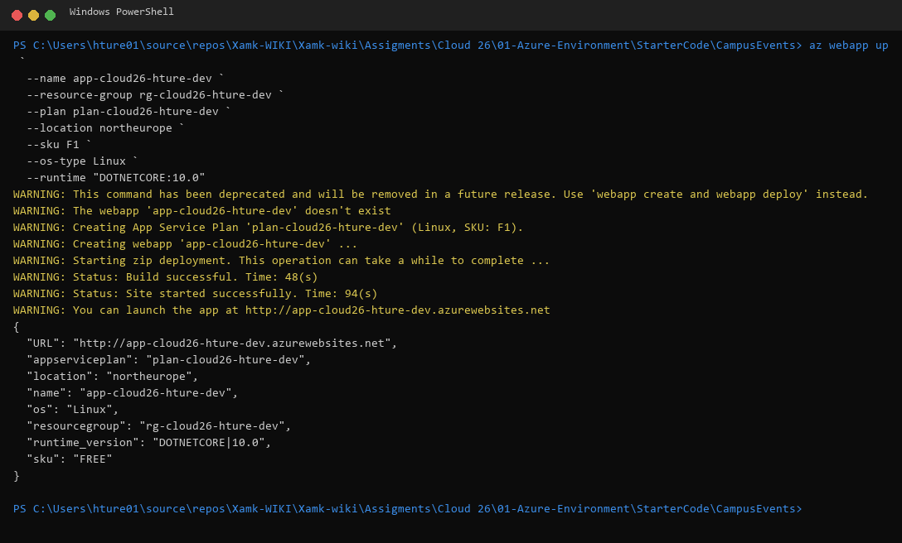

*Yellow WARNING lines (including the deprecation notice) are normal. Success is the launch URL and `"sku": "FREE"`. If the web app already exists from a previous run, Azure says it will deploy to the existing app — that is also success, not an error.*

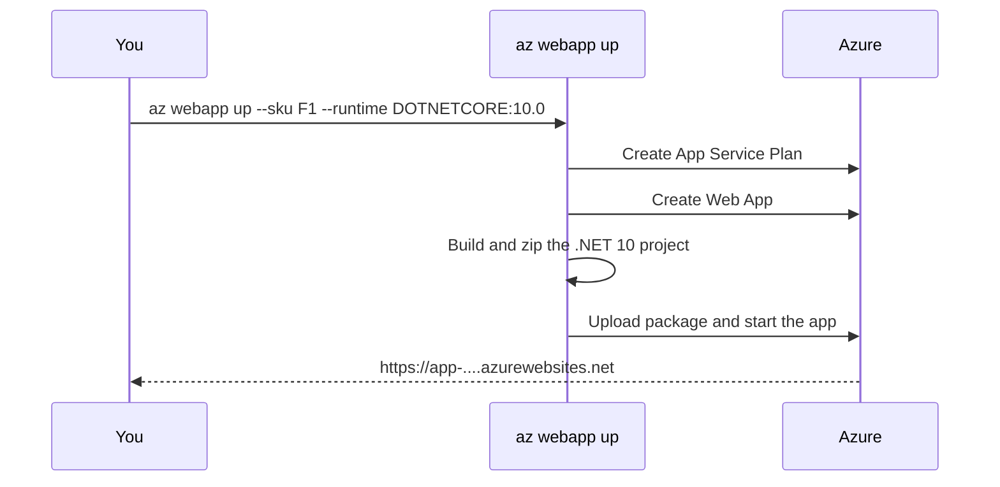

**If the name is already taken** (someone else on the internet already has that URL), Azure stops with an error. Append a number and run the same `az webapp up` again. This is **not** what you see when you re-run the command on **your** app — that just deploys again.

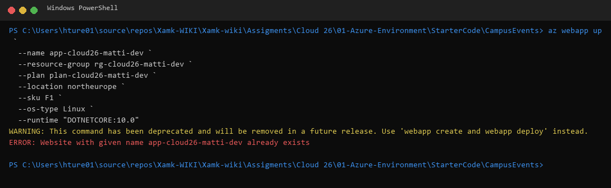

*Example uses `matti`. Your names will differ. The line to match is `ERROR: Website with given name … already exists`.*

### Step 13: Verify the deployment

Open these URLs in a browser (replace with your app name):

| URL | Expected |
|-----|----------|
| `https://app-cloud26-<your-name>-dev.azurewebsites.net/` | App overview JSON |
| `https://app-cloud26-<your-name>-dev.azurewebsites.net/api/events` | Seeded events list |
| `https://app-cloud26-<your-name>-dev.azurewebsites.net/health` | `Healthy` |
| `https://app-cloud26-<your-name>-dev.azurewebsites.net/info` | Runtime info |

Compare `/info` to the local run:

| Field | Locally | In Azure |
|--------|---------------|----------|
| `machine` | Your computer's name | Azure container/instance name (e.g. `a1b2c3...`) |
| `environment` | `Development` | `Production` |
| `framework` | .NET 10.x | .NET 10.x |

Same code — different environment. This is the core of PaaS: **you do not manage the machine the code runs on**.

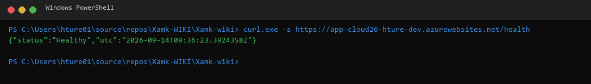

*Your names and IDs will differ. Match the field names, not the pixels.*

Optionally register for an event against the Azure URL with curl or by changing `@host` in `CampusEvents.http`:

```powershell
$body = @{ attendeeName = "Your Name"; attendeeEmail = "you@example.com" } | ConvertTo-Json
Invoke-RestMethod -Method Post `
  -Uri "https://app-cloud26-<your-name>-dev.azurewebsites.net/api/events/11111111-1111-1111-1111-111111111111/registrations" `
  -ContentType "application/json" `
  -Body $body
```

> **Note:** Because storage is in-memory, registrations disappear when the App Service restarts. That is fine for Assignment 1.

### Step 14: Inspect what was created in Azure

```powershell
az resource list --resource-group rg-cloud26-<your-name>-dev --output table
```

You will see two resources:

| Resource | Type | Role |
|----------|--------|---------|
| `plan-cloud26-...` | `Microsoft.Web/serverFarms` | App Service Plan — capacity (F1 = free) |
| `app-cloud26-...` | `Microsoft.Web/sites` | Web App — Campus Events API |

Also view the Web App in the Portal: resource group → web app → notice the **Overview** page (URL, status, location) and the left menu (Deployment, Monitoring, Settings — we return to these in later assignments).

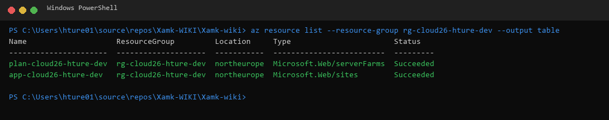

*Your names and IDs will differ. Match the field names, not the pixels.*

### Step 15: Add tags to the application resources too

`az webapp up` did not add tags automatically. Fix that — the course rule is that **every resource has tags**:

```powershell
az webapp update `
  --name app-cloud26-<your-name>-dev `
  --resource-group rg-cloud26-<your-name>-dev `
  --set tags.Application=cloud26 tags.Environment=dev tags.Owner=<your-email> tags.Course=Cloud26

az appservice plan update `
  --name plan-cloud26-<your-name>-dev `
  --resource-group rg-cloud26-<your-name>-dev `
  --set tags.Application=cloud26 tags.Environment=dev tags.Owner=<your-email> tags.Course=Cloud26
```

Verify:

```powershell
az resource list --resource-group rg-cloud26-<your-name>-dev --query "[].{Name:name, Tags:tags}" --output json
```

> **Note the difference:** Resource group tags do **not inherit** automatically to resources inside it. Tags must be set on each resource separately — or automated (IaC will handle this for us in later assignments).

> **Reminder — tag every billable resource:** Cost analysis can group by tag. If the Web App and Plan have no tags, course spend is harder to filter from other experiments in the same subscription. Treat "create resource → set tags" as one habit.

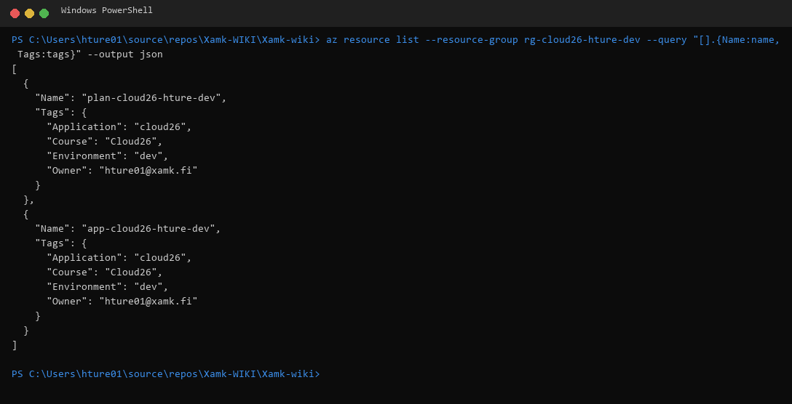

*Your names and IDs will differ. Match the field names, not the pixels.*

---

## Guided section E — Costs and cleanup

### Why this step?

The last step is the course's most important routine: **know what your environment costs, and clean up what you do not need**. The F1 tier is free, so there is no bill this time — but we learn the routine correctly from the start.

### Step 16: Explore the cost view

1. Portal → your resource group → **Cost Management** → **Cost analysis**
2. Examine the view: total spend, forecast, breakdown by resource

Spend will likely show as zero (F1 is free). What matters is that **you know where this view is** — you will return to it in every assignment.

> **Tip:** Try the **Group by** control at the top: group costs by **Resource** or **Tag**. Tags → `Environment` shows the dev/test/prod split — that is exactly why tags exist.

### Step 17: Check the price of B1

Before cleanup, see what the environment **would cost** if F1 were replaced by a production-level SKU:

1. Open the official [App Service Linux pricing table](https://azure.microsoft.com/en-us/pricing/details/app-service/linux/) — set **Region: North Europe**, **Currency: EUR**, **Display: Hour**
2. Also open the [Azure Pricing Calculator](https://azure.microsoft.com/pricing/calculator/), add **App Service**: Linux, North Europe, **Basic B1**, and note the monthly estimate
3. Compare **Free F1** (€0) with **Basic B1** (about €0.016/hour in North Europe — prices move)

Write the prices down — you will need them for the theory questions.

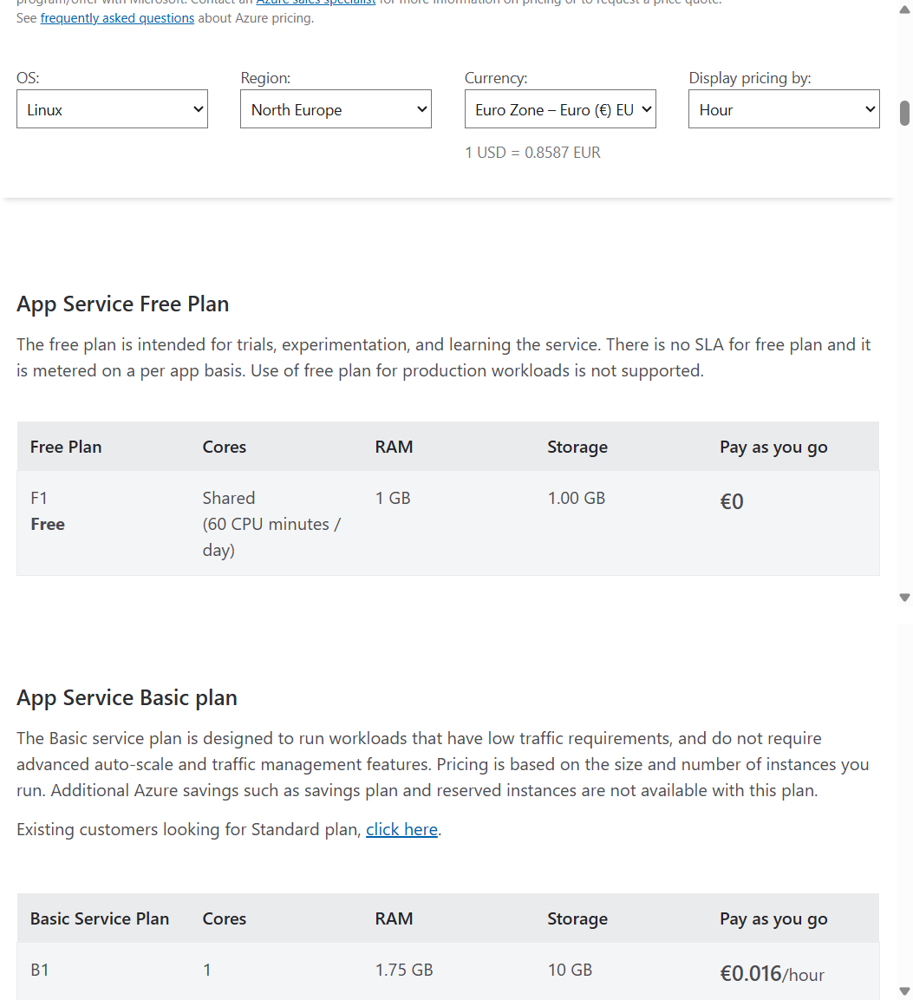

*Prices change. Match the SKU row (F1 vs B1) and the region, not the exact euro amount.*

> **Reminder — always check price before raising SKU:** Moving `F1` → `B1` (or adding a database) can turn a free lab into a real bill overnight. Pricing Calculator first, deploy second.

### Step 18: Clean up cost risk — but keep the foundation

**What cleanup means in the cloud:** Unlike a lab PC you shut down at the end of the day, Azure resources keep existing (and often billing) until you delete them. "Finished coding" ≠ "stopped paying." Cleanup is part of the job.

Course cleanup principle: **delete what you do not need; keep what is free and necessary.**

In this assignment:

| Resource | Action | Reason |
|----------|------------|-----------|
| Resource group | **Keep** | Free — home for the course |
| Budget + alert | **Keep** | Free — safety net |
| Web App + App Service Plan (F1) | **Keep** (or delete, your choice) | F1 is free. If you delete it, you know how to recreate it |

If you want to delete the app resources (and leave the resource group + budget):

```powershell
az webapp delete --name app-cloud26-<your-name>-dev --resource-group rg-cloud26-<your-name>-dev
az appservice plan delete --name plan-cloud26-<your-name>-dev --resource-group rg-cloud26-<your-name>-dev --yes
```

And if you ever want to destroy **everything** at once (do not run this now!):

```powershell
# DESTROYS the resource group AND EVERYTHING inside it. Use with care!
az group delete --name rg-cloud26-<your-name>-dev --yes
```

> **Rule of thumb:** `az group delete` is the end-of-course command. Its existence is also why everything is created in one resource group — cleanup is a single command.

---

## Guided section F — AI as a helper: mastering commands

### Why this step?

On this course AI (GitHub Copilot, Cursor, ChatGPT, etc.) is a tool just like the Azure CLI. First use case: **AI as an explainer and script drafter**. The rule is the same throughout the course: *AI output is a suggestion — you are responsible for what you run*.

### Step 19: Ask AI to explain a command

Copy the Step 12 `az webapp up` command into your AI tool. **Example prompt:**

```
Explain this Azure CLI command parameter by parameter.
What resources does it create, and what would happen if --sku were B1 instead of F1?
```

Compare the AI explanation to this assignment's table. Did you notice something the assignment did not cover? Did the AI miss anything?

### Step 20: Generate a status script with AI

Ask AI to draft a PowerShell script. **Example prompt** (replace `<your-name>`):

```
Write a PowerShell script (check.ps1) that uses Azure CLI to:
1. Show the active subscription name
2. List the resources in resource group rg-cloud26-<your-name>-dev as a table
3. Show each resource's tags
4. Print the web app status (running/stopped) and URL
The script must work even if the web app does not exist (clear message, no crash).
```

**Before you run the script:**

| Check | Why |
|--------------------|-------|
| Does the script use only **read** commands (`show`, `list`)? | A read-only script cannot break anything — a good first AI script |
| Is the resource group name correct? | AI guesses names — verify yours |
| Do you understand every line? | If not, ask AI to explain — do not run it blind |

Run the script and save it for submission.

### Step 21: Generate the provisioning script with AI

Exercise 1 asks for `provision.ps1` — the script that rebuilds the whole Assignment 1 environment. Use this prompt (replace `<your-name>` and `<your-email>`):

```
Write a PowerShell script named provision.ps1 for a student Azure lab.

Variables at the top:
- $YourName = "<your-name>"
- $YourEmail = "<your-email>"
- $ResourceGroup = "rg-cloud26-<your-name>-dev"
- $AppName = "app-cloud26-<your-name>-dev"
- $PlanName = "plan-cloud26-<your-name>-dev"

The script must:
1. Fail with a clear message if az account show does not work (user must az login).
2. Create the resource group in northeurope with tags Application=cloud26 Environment=dev Owner=$YourEmail Course=Cloud26 — only if az group exists is false.
3. Run az webapp up from folder StarterCode/CampusEvents next to the script:
   --name $AppName --resource-group $ResourceGroup --plan $PlanName
   --location northeurope --sku F1 --os-type Linux --runtime "DOTNETCORE:10.0"
   (--os-type Linux is required; without it .NET 10 fails on Windows).
4. Set the same four tags on the web app and the App Service Plan.
5. Print the https://$AppName.azurewebsites.net URL at the end.

Must be idempotent: safe to run twice. No az group delete. No hardcoded passwords.
Comment each block in English so I can explain every line.
```

**Before you run it:** same checks as Step 20, plus every `create` / `up` / `update` line. AI often drops `--os-type Linux` or invents a Windows runtime — fix that before you execute.

> **Rule of thumb:** Read commands (`show`, `list`, `--what-if`) may be run from an AI suggestion after a quick check. Mutating and deleting commands (`create`, `update`, `delete`) you always review line by line before running.

---

# Independent exercises

## Exercise 1: Provisioning script

In the guided section you created the environment one command at a time. Now combine **the whole setup into one script** `provision.ps1`, placed next to `StarterCode/`, that:

1. Checks that the user is signed in (`az account show`) — if not, instructs them to sign in
2. Creates the resource group with tags **if it does not already exist** (hint: `az group exists`)
3. Deploys Campus Events from `StarterCode/CampusEvents` with `az webapp up` (F1, .NET 10 runtime) — creating or updating the plan and web app
4. Sets tags on all resources
5. Prints the web app URL at the end

Requirements:

- The script must be **idempotent**: you can run it multiple times in a row without errors or duplicate resources
- Put names and email as variables at the top of the script (`$YourName`, `$YourEmail`)
- Run `az webapp up` from the correct project directory (or pass the project path explicitly)

You may use AI — start from the **Step 21** prompt, then change anything that is wrong. In your answers document: what you asked, what AI suggested, what you changed.

> **Reminder — idempotency:** Running the same provisioning twice should leave you with one environment, not duplicates or errors. That is the behaviour you will later get from Bicep `what-if` / deploy — practise it in the script now.

> **Stuck?** A model answer is available at [Solution/provision.ps1](Solution/provision.ps1). Try to write your own version first — then compare: did you handle sign-in checking, `az group exists`, the project path, and tags the same way? It is fine if your script looks different, as long as it meets the requirements and you can explain every line.

## Exercise 2: Improve the API and redeploy

Make a small change to Campus Events and publish it again:

1. Add a new endpoint `GET /api/stats` that returns total events, total registrations, and how many events are full
2. Deploy the change from `StarterCode/CampusEvents` (`az webapp up` with the same parameters — it updates the existing app)
3. Verify in the browser that `/api/stats` works on Azure

Note how long the manual publish took and how many steps it involved. We will return to this in the CI/CD assignment — then the same thing happens automatically on every git push.

## Exercise 3: Subscription-level budget

You created a budget for the resource group. Now create a **second budget for the whole subscription** (scope: subscription):

- Amount e.g. €20/month
- Alert thresholds: Actual 80% and Forecasted 100%
- Email notification to yourself

This gives you a two-layer safety net: the course resource group budget + a subscription budget (which also alerts for costs outside the course).

## Exercise 4: Theory questions

Read the questions in [questions.md](questions.md) and answer them **in your own words first**. **Do not submit the answers** — they are not part of the Learn return. They are training for the exam, and they are useful knowledge in the software industry. Similar questions will appear in the exam. When you have tried, compare with [example-answers.md](example-answers.md). The lab text and the Additional material links are enough to answer every question.

---

# Summary — what did we learn?

| Concept | What we learned |
|--------|--------------|
| **Azure CLI** | `az login`, `az account`, `az group`, `az webapp up` — a repeatable alternative to Portal clicking |
| **Resource group** | "Home" for course resources — one place for costs and cleanup |
| **Naming convention** | `<type>-<project>-<name>-<environment>` — purpose visible from the name |
| **Tags** | Key–value pairs for grouping costs and resources — do not inherit automatically |
| **Budget + alert** | First automation: Azure monitors spending and sends email (Actual vs. Forecasted) |
| **App Service (PaaS)** | .NET 10 Campus Events API published without managing servers — `az webapp up` handles build and deploy |
| **SKU choice** | F1 (free) is enough for practice — B1+ costs money; prices come from the Pricing Calculator |
| **Cleanup routine** | Delete what you do not need; `az group delete` destroys everything at once at course end |
| **AI as a tool** | AI explains commands and drafts scripts — you review and own the result |

---

## Submission

**All returns go to the Learn platform.** Submit only the items below — relevant screenshots, your answers, and links to your working Azure app. Do not upload code or script files; screenshots of code and terminal output are enough.

The screenshot and link list is also in [questions.md](questions.md) under **What to return**. Theory questions in that file are **not submitted** — exam training and industry knowledge (try first, then [example-answers.md](example-answers.md)).

- [ ] Screenshot: resource group in the Portal, tags visible
- [ ] Screenshot: budget and alert thresholds (Budgets view)
- [ ] **Link:** your app's `/api/events` URL on `azurewebsites.net` (the teacher will open it)
- [ ] Screenshot: `/api/stats` response from your Azure URL (exercise 2)
- [ ] Screenshot: `check.ps1` output (guided section F) and `provision.ps1` run output (exercise 1)
- [ ] In your answers document: short description of AI use in exercise 1 — what you asked, what AI suggested, what you changed

**Checklist before submitting:**

- [ ] `az account show` shows the correct subscription
- [ ] All resources have the course tags
- [ ] Budget alert is set to your email (3 thresholds: 50/80/100)
- [ ] The app responds on `/`, `/health`, `/info`, and `/api/events`
- [ ] The environment has no paid resources you do not need (F1 is OK)

---

## Support and useful links

If you need help:
1. Read the error message — Azure CLI errors are usually plain language (e.g. name taken, wrong subscription)
2. Ask AI to explain the error message (paste the whole message, not a fragment)
3. Ask classmates or the teacher

**Common problems:**

| Problem | Solution |
|---------|----------|
| `az: command not found` / not recognised | Close and reopen the terminal after installation |
| "Website with given name already exists" | Web app name is taken globally — append a number |
| "The subscription is not registered to use namespace Microsoft.Web" | Run `az provider register --namespace Microsoft.Web` and wait a few minutes |
| F1 tier creation fails | Try another region (`--location swedencentral` or `westeurope`) |
| Budgets menu missing | Make sure you are in the resource group's **Cost Management** section, and that your subscription supports Cost Management (Azure for Students does) |
| `Windows runtime 'DOTNETCORE\|10.0' is not supported` | You omitted `--os-type Linux`. Current Azure CLI defaults .NET to Windows. Re-run the Step 12 command as written. |

**Wiki materials:**
- [Cloud Concepts](https://github.com/xamk-mire/Xamk-wiki/blob/main/Cloud%20technologies/Cloud-Concepts.md)
- [Azure App Service](https://github.com/xamk-mire/Xamk-wiki/blob/main/Cloud%20technologies/Azure/App-Service.md)

**External links:**
- [Azure CLI reference](https://learn.microsoft.com/en-us/cli/azure/)
- [Cost Management: Budgets](https://learn.microsoft.com/en-us/azure/cost-management-billing/costs/tutorial-acm-create-budgets)
- [Azure Pricing Calculator](https://azure.microsoft.com/pricing/calculator/)
- [App Service Plan tiers](https://learn.microsoft.com/en-us/azure/app-service/overview-hosting-plans)
