# Assignment 2: Cloud architecture paradigms and scaling — breaking the app on purpose

Welcome to the second assignment! In this exercise you will learn the **most common cloud architecture paradigms** and then experience the single most important architecture rule in the cloud **hands-on**: you will scale the Campus Events API to **two instances** and watch it break — because it stores state in memory. Finally you will scale it back down, explain what happened, and write your first **Architecture Decision Record (ADR)**.

The exercise proceeds **step by step**: first a compact theory block, then experiments against your real Azure environment from Assignment 1. Type the commands **yourself** — every command is explained: what it does and why.

> **Note:** This assignment uses the environment you built in [Assignment 1](../01-Azure-Environment/README.md): the resource group, budget alert, and the deployed Campus Events API. If you deleted the app resources, re-deploy first (your `provision.ps1` does it in one run).

> **Cost note:** This assignment temporarily scales the App Service Plan from **F1 (free)** to **B1 (paid)**. B1 costs a few cents per hour, and we scale back down at the end. Your budget alert from Assignment 1 is the safety net — this is exactly the situation it exists for. Total cost of this assignment, done in one sitting: **well under €1**.

---

## Additional material

**Theory materials:**
- [Cloud Concepts](https://github.com/xamk-mire/Xamk-wiki/blob/main/Cloud%20technologies/Cloud-Concepts.md) - Vertical vs. horizontal scaling, High Availability
- [Azure App Service](https://github.com/xamk-mire/Xamk-wiki/blob/main/Cloud%20technologies/Azure/App-Service.md) - App Service Plan tiers
- [Azure Functions](https://github.com/xamk-mire/Xamk-wiki/blob/main/Cloud%20technologies/Azure/Azure-Functions.md) - Serverless architecture and when to use it (theory question 2)

**External links:**
- [Azure Architecture Center: Architecture styles](https://learn.microsoft.com/en-us/azure/architecture/guide/architecture-styles/)
- [Azure Well-Architected Framework](https://learn.microsoft.com/en-us/azure/well-architected/)
- [App Service: Scale up / scale out](https://learn.microsoft.com/en-us/azure/app-service/manage-scale-up)
- [Stateless applications (12-factor: processes)](https://12factor.net/processes)
- [Architecture Decision Records (ADR)](https://adr.github.io/)

---

## What do you need?

- The **Assignment 1 environment**: resource group, budget alert, and Campus Events deployed (F1)
- **Azure CLI**, signed in (`az account show`)
- A terminal and a browser — no new code is written in the guided section

Example pictures in this lab are real CLI output. Cost analysis is **your** Portal screenshot. Azure may list `workers: 2` but start only one instance — that is a valid return if you document `list-instances`.

---

## What are we building (and breaking)?

```
Before (Assignment 1):                     During this assignment:

plan-cloud26-<name>-dev (F1)               plan-cloud26-<name>-dev (B1) ← scale UP
└── Web App (1 instance)                   └── Web App (2 instances)   ← scale OUT
    └── in-memory store ✅ works               ├── instance A: its own in-memory store
                                               └── instance B: its own in-memory store
                                                   → same URL, DIFFERENT data ❌
```

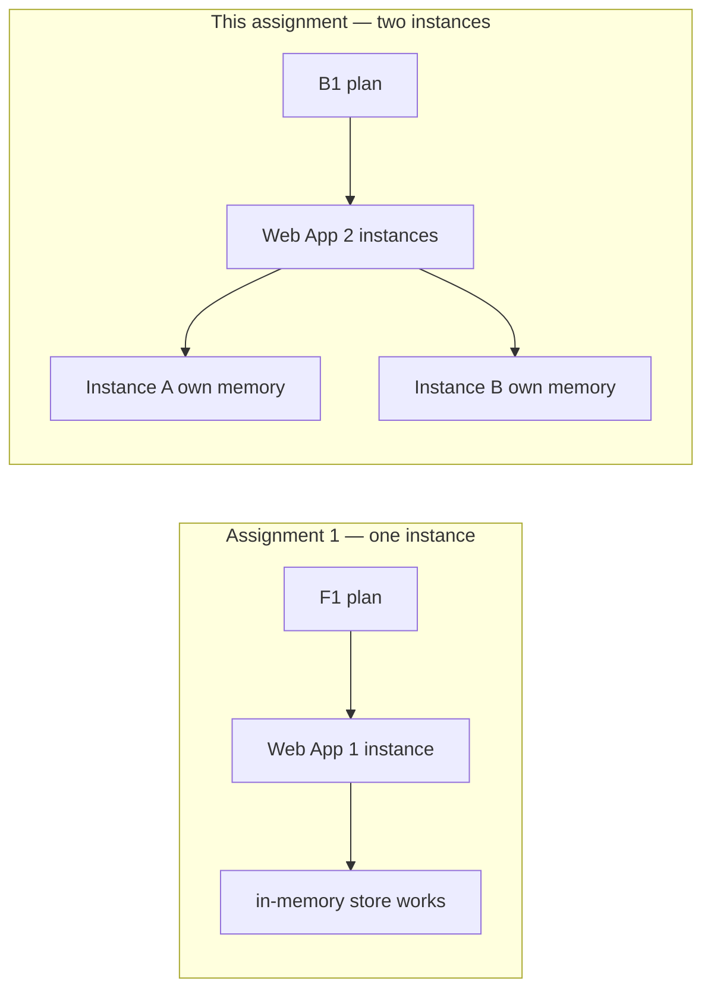

**Target state at the end of the assignment:**

1. You can name the common cloud architecture paradigms and give an Azure example of each
2. You have scaled an app **up** (F1 → B1) and **out** (1 → 2 instances) with the CLI
3. You have **seen with your own eyes** why in-memory state breaks horizontal scaling
4. The plan is scaled back to F1 and costs are back to zero
5. You have written an ADR that chooses the next architecture step for Campus Events

---

# Guided section

## Guided section A — Architecture paradigms in 20 minutes

### Why this step?

Before touching Azure, you need names for the things you are about to see. This is a **compact reference** — the goal is recognition, not memorisation. You will return to this table in every remaining assignment.

### The five paradigms

| Paradigm | Idea | Azure example | Best when | Watch out |
|----------|------|---------------|-----------|-----------|
| **Monolith** | One deployable unit: UI + logic + data access together | One App Service Web App | Small team, small app, fast start | Scaling is all-or-nothing; big codebase gets tangled |
| **N-tier** | Layers as separate deployables: web / API / database | App Service + App Service + Azure SQL | Clear separation of concerns, classic business apps | Layers often scale together anyway; still fairly monolithic |
| **Microservices** | Many small independent services, each with its own data | Container Apps / AKS + per-service DBs | Large teams, independent release cycles | Operational complexity explodes; do not start here |
| **Serverless** | Code runs only when triggered; platform manages everything | Azure Functions + Storage/Service Bus | Spiky or rare workloads, event processing, glue code | Cold starts; execution time limits; harder local story |
| **Event-driven** | Components communicate via events/messages, not direct calls | Service Bus / Event Grid / Queue Storage between services | Decoupling producers from consumers, buffering load spikes | Eventual consistency; debugging spans multiple hops |

> **Reminder — paradigms combine:** Real systems mix these. A "monolith" API + a serverless background job + a queue between them is a completely normal, healthy architecture. The paradigms are vocabulary, not team jerseys.

### The rule that connects them all: stateless compute

Whatever paradigm you pick, cloud platforms assume your **compute is stateless**: any instance can serve any request, because state (data, sessions, files) lives **outside** the compute — in a database, cache, or storage service.

```
Stateful (breaks when scaled):          Stateless (scales freely):

┌─────────────┐                        ┌─────────────┐   ┌─────────────┐
│ Instance A  │                        │ Instance A  │   │ Instance B  │
│  data: X=1  │ ← state trapped        │  (no state) │   │  (no state) │
└─────────────┘   inside               └──────┬──────┘   └──────┬──────┘
                                              └────────┬────────┘
                                                       ▼
                                              ┌─────────────────┐
                                              │  Database/Cache │ ← state shared
                                              └─────────────────┘
```

> **If a diagram shows as code** (`flowchart …` instead of boxes): the VS Code / Cursor Markdown preview does not draw Mermaid. Open the file on GitHub, or install the **Markdown Preview Mermaid Support** extension and reopen the preview.

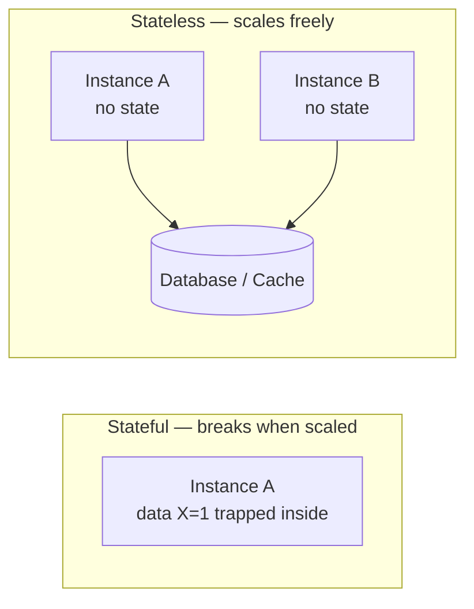

Campus Events currently keeps its events **in memory**, inside the process. With one instance nobody notices. In sections C–D you will see what happens with two.

### Scale up vs. scale out

| | Scale **up** (vertical) | Scale **out** (horizontal) |
|---|---|---|
| **What changes** | Bigger machine (more CPU/RAM) — SKU change | More machines (more instances) |
| **CLI** | `az appservice plan update --sku B1` | `az appservice plan update --number-of-workers 2` |
| **Limit** | There is always a biggest machine | Practically unlimited — **if the app is stateless** |
| **Downtime** | Possible brief restart | None — instances added alongside |
| **Cloud preference** | Fine as a first move | The cloud-native way; enables autoscale |

> **Reminder — why the cloud prefers scale-out:** One huge machine is expensive and a single point of failure. Many small instances can be added/removed to follow load (autoscale) and survive an instance dying. This is why statelessness matters so much.

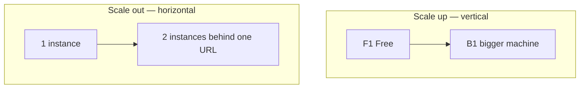

---

## Guided section B — Analyze the app you already run

### Why this step?

Architecture analysis starts from what exists, not from a whiteboard. You deployed Campus Events in Assignment 1 — now classify it.

### Step 1: Classify Campus Events

Open `StarterCode/CampusEvents` from Assignment 1 and answer for yourself (you will need these in the theory questions):

1. Which paradigm is it? (Hint: one deployable, all logic together)
monolith, one deployable application containing the API, business logic and data-access-logic.
2. Where does its state live? (Look at `Services/InMemoryEventStore.cs` — the `List<CampusEvent>` field)
In the application processes in-memory state.
3. Is it stateless or stateful compute?
Stateful, because the running application instance holds mutable event and registration data in memory. 

**Answer:** It is a **monolith** with **stateful compute** — the event list lives inside the process. This was a deliberate choice for Assignment 1 (no database complexity), and now it becomes our teaching tool.

### Step 2: Verify the current environment

```powershell
az appservice plan show `
  --name plan-cloud26-<your-name>-dev `
  --resource-group rg-cloud26-<your-name>-dev `
  --query "{sku:sku.name, workers:sku.capacity}" `
  --output table
```

Expected: `sku: F1`, `workers: 1`. Also confirm the app answers:

```powershell
curl https://app-cloud26-<your-name>-dev.azurewebsites.net/health
```

> If the app is gone (you deleted it in Assignment 1 cleanup), run your `provision.ps1` — this is exactly why idempotent provisioning exists.


*Your names and IDs will differ. Match the field names, not the pixels.*

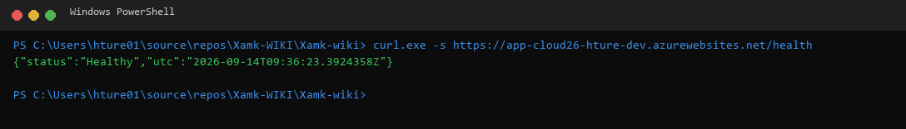

*Your names and IDs will differ. Match the field names, not the pixels.*

---

## Guided section C — Scale up: F1 → B1

### Why this step?

F1 (Free) cannot scale out at all — Azure allows only one instance. To run the two-instance experiment we need at least **B1 (Basic)**. This is also your first real **SKU decision with a price tag**: you check the cost first, change the SKU, and scale back when done.

**What changes with B1:** dedicated compute (no daily CPU quota), Always On available, up to 3 instances, custom domains. And a price: about **€0.016/hour** in North Europe (official App Service Linux table — prices move). Confirm the monthly estimate in the [Pricing Calculator](https://azure.microsoft.com/pricing/calculator/) before you change the SKU.

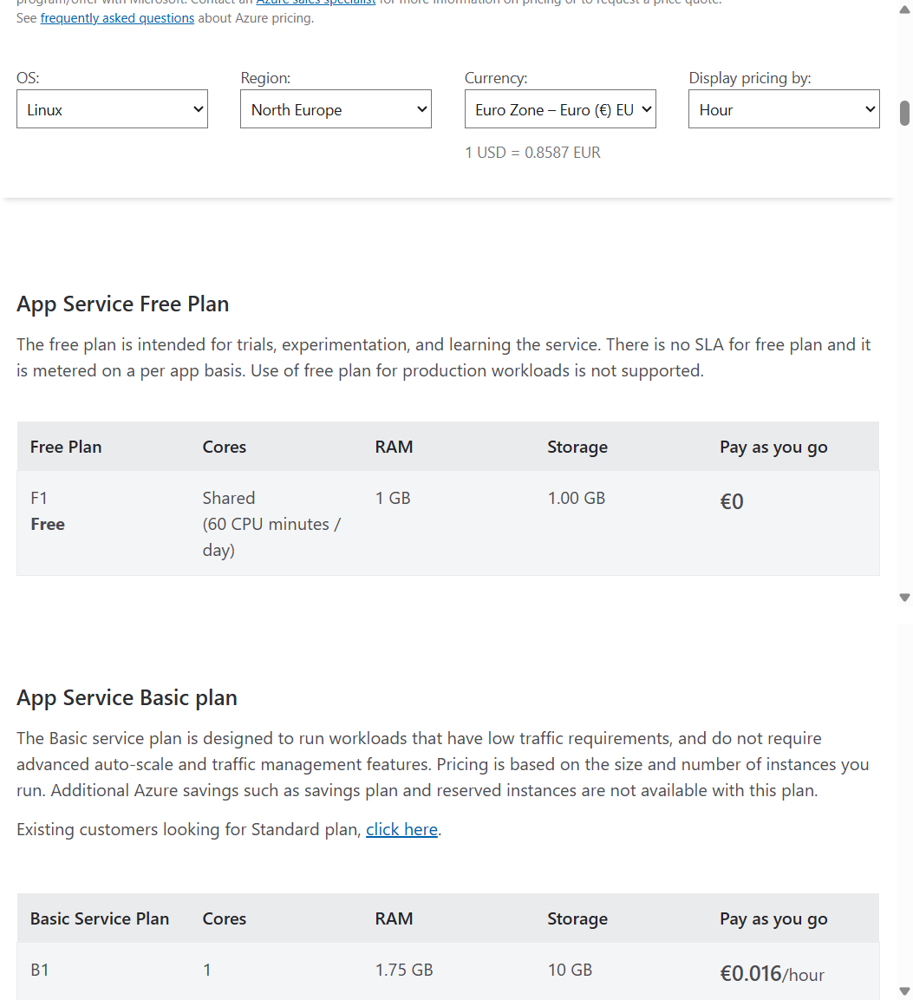

*Prices change. Match the SKU row (F1 vs B1) and the region, not the exact euro amount.*

### Step 3: Scale up with the CLI

```powershell
az appservice plan update `
  --name plan-cloud26-<your-name>-dev `
  --resource-group rg-cloud26-<your-name>-dev `
  --sku B1
```

**What does the command do?** It changes the plan's SKU in place. The web app keeps running (a brief restart is possible). Billing for B1 starts **now** — per second, until you scale back.

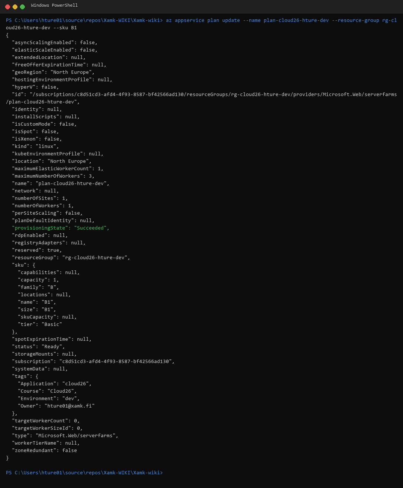

*Your names and IDs will differ. Match the field names, not the pixels.*

### Step 4: Verify

```powershell
az appservice plan show `
  --name plan-cloud26-<your-name>-dev `
  --resource-group rg-cloud26-<your-name>-dev `
  --query "{sku:sku.name, workers:sku.capacity}" `
  --output table
```

Expected: `sku: B1`, `workers: 1`. Check the app still answers (`/health`).

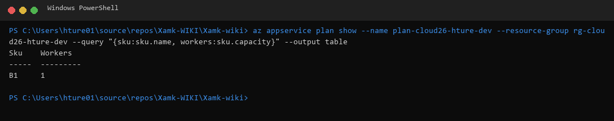

*Your names and IDs will differ. Match the field names, not the pixels.*

> **Reminder — the clock is ticking:** From this step until Step 12 (scale back), the plan costs money. That is fine — it is a few cents — but notice the habit: **know when the meter starts and when it stops.** If you have to stop mid-assignment, jump to Step 12 first.

---

## Guided section D — Scale out and break the app

### Why this step?

This is the heart of the assignment. We add a second instance and demonstrate that a stateful app behind one URL becomes **two different apps** that disagree with each other.

### Step 5: Disable session stickiness (ARR affinity)

By default App Service pins each browser session to one instance with a cookie (`ARRAffinity`). That would hide the problem we want to see, so turn it off:

```powershell
az webapp update `
  --name app-cloud26-<your-name>-dev `
  --resource-group rg-cloud26-<your-name>-dev `
  --client-affinity-enabled false
```

> **What is ARR affinity?** "Sticky sessions" — the load balancer sends the same client back to the same instance. It is a **workaround** that lets stateful apps limp along behind a load balancer. It also concentrates load unevenly and breaks when an instance dies. Stateless design removes the need for it.

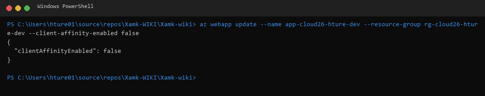

*Your names and IDs will differ. Match the field names, not the pixels.*

### Step 6: Scale out to 2 instances

```powershell
az appservice plan update `
  --name plan-cloud26-<your-name>-dev `
  --resource-group rg-cloud26-<your-name>-dev `
  --number-of-workers 2
```

Verify:

```powershell
az appservice plan show `
  --name plan-cloud26-<your-name>-dev `
  --resource-group rg-cloud26-<your-name>-dev `
  --query "{sku:sku.name, workers:sku.capacity}" `
  --output table
```

Expected: `sku: B1`, `workers: 2`. The second instance often takes **3–5 minutes**, not 30 seconds. Do not call `/info` until Azure lists two instances:

```powershell
az webapp list-instances `
  --name app-cloud26-<your-name>-dev `
  --resource-group rg-cloud26-<your-name>-dev `
  --output table
```

Wait until that table has **two rows**. Then continue.


*This is `plan show`, not `list-instances`. `workers: 2` means Azure accepted the count. Confirm two rows with `list-instances` before you call `/info`.*

### Step 7: See two machines behind one URL

Call `/info` repeatedly and watch the `machine` field:

```powershell
# curl.exe (not the curl alias) and no cookies — otherwise you can stick to one instance
1..8 | ForEach-Object {
    curl.exe -s https://app-cloud26-<your-name>-dev.azurewebsites.net/info
    Write-Host ""
}
```

Look at the `machine` field. You should see **two different machine names** (not necessarily strictly alternating — the load balancer decides). One URL, two computers. This is horizontal scaling working as designed.

> If you only ever see one name: `list-instances` must already show two rows, ARR affinity must be off (`clientAffinityEnabled: false`), and use `curl.exe` so PowerShell does not reuse a sticky session.

Your screenshot is the return for this step — two different `machine` values. If `list-instances` stays at one row after five minutes, screenshot that table plus `plan show` (`B1` / `workers: 2`) and explain what Azure did; do not invent a second name.

### Step 8: Break consistency with a registration

Now the demonstration. Register an attendee — the POST lands on **one** of the two instances and is stored only in **that instance's memory**:

```powershell
$body = @{ attendeeName = "Scale Test"; attendeeEmail = "scale.test@example.com" } | ConvertTo-Json
Invoke-RestMethod -Method Post `
  -Uri "https://app-cloud26-<your-name>-dev.azurewebsites.net/api/events/22222222-2222-2222-2222-222222222222/registrations" `
  -ContentType "application/json" `
  -Body $body
```

Then read the event several times and watch `seatsTaken`:

```powershell
1..8 | ForEach-Object {
    $e = Invoke-RestMethod "https://app-cloud26-<your-name>-dev.azurewebsites.net/api/events/22222222-2222-2222-2222-222222222222"
    "$($e.seatsTaken) seats taken"
}
```

**Expected result:** the answer **flip-flops** — sometimes `1`, sometimes `2` (the seeded registration exists on both, yours on only one). The same URL gives different answers depending on which instance the load balancer picks.

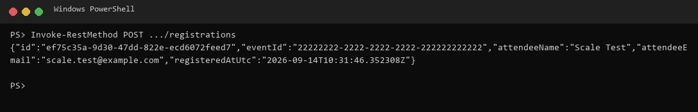

*`Invoke-RestMethod` prints the body, not `HTTP 201`. Match `attendeeName` / `attendeeEmail`.*

Your screenshot is the return for this step **if** `list-instances` already showed two rows. You should then see at least two different `seatsTaken` values.

If `list-instances` stayed at one row after five minutes, do **not** invent a flip-flop. Submit that table plus `plan show` (`B1` / `workers: 2`) and one sentence in your answers document: Azure accepted the worker count but did not start a second instance. You still need to be able to **explain** the flip-flop in the exam — two in-memory stores behind one URL.

### Step 9: Name what you saw

| Observation | Architecture term |
|-------------|-------------------|
| Two machines behind one URL | Horizontal scaling / load balancing |
| Different data per instance | **State trapped in compute** — the anti-pattern |
| Answers vary per request | Inconsistency visible to users |
| Would get worse with autoscale | Autoscale multiplies instances — and copies of wrong state |

This tiny flip-flop is the same class of bug as "user adds item to cart, cart is empty on next page load" in real e-commerce systems. It is the most common way scaling exposes an architecture mistake.

> **Reminder — the fix is not stickiness:** ARR affinity would hide this from a single browser, but the data is still wrong across instances (and lost on every restart). The real fix is moving state **out** of the process — a database. You will do exactly that later on this course.

---

## Guided section E — Scale back and stop the meter

### Why this step?

Experiment done, evidence collected. Now the most important operational habit of the course: **return the environment to its cheap state immediately**, not "later".

### Step 10: Scale in to 1 instance

```powershell
az appservice plan update `
  --name plan-cloud26-<your-name>-dev `
  --resource-group rg-cloud26-<your-name>-dev `
  --number-of-workers 1
```

### Step 11: Re-enable ARR affinity (default state)

```powershell
az webapp update `
  --name app-cloud26-<your-name>-dev `
  --resource-group rg-cloud26-<your-name>-dev `
  --client-affinity-enabled true
```

### Step 12: Scale down to F1

```powershell
az appservice plan update `
  --name plan-cloud26-<your-name>-dev `
  --resource-group rg-cloud26-<your-name>-dev `
  --sku F1
```

Verify everything is back:

```powershell
az appservice plan show `
  --name plan-cloud26-<your-name>-dev `
  --resource-group rg-cloud26-<your-name>-dev `
  --query "{sku:sku.name, workers:sku.capacity}" `
  --output table

curl https://app-cloud26-<your-name>-dev.azurewebsites.net/health
```

Expected: `sku: F1`, `workers: 1`, health `Healthy`.

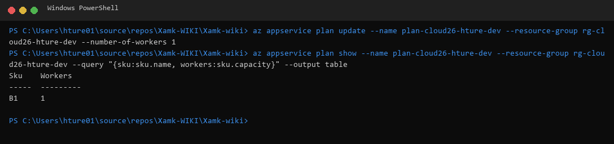

*Scale-in does not change the SKU. You should still see `B1` until Step 12 (`--sku F1`).*

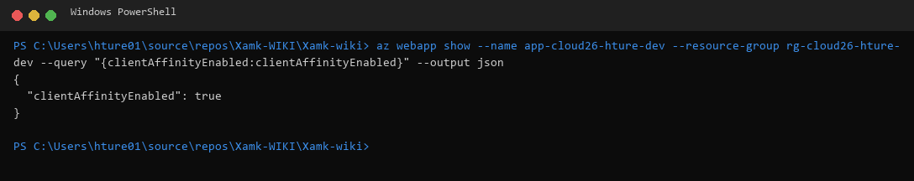

*Your names and IDs will differ. Match the field names, not the pixels.*


*Your names will differ. Also confirm `/health` is Healthy — that check is in the command above, not in this picture.*

### Step 13: Check the damage in Cost analysis

Portal → your resource group → **Cost Management** → **Cost analysis**. Costs can take up to 24 h to appear, so check again tomorrow: you should see a tiny charge for the B1 hours. Take a screenshot of **your** Cost analysis when it appears — it goes in your submission.

> **Reminder — this was the whole cost lesson in miniature:** know the price before changing SKU, know when the meter starts, stop it deliberately, verify on the bill. Every production incident postmortem involving cloud cost is some version of skipping one of these.

---

## Guided section F — AI as an architecture sparring partner

### Why this step?

Architecture work is trade-off analysis, and AI is genuinely useful for it — as a **sparring partner that proposes options you then judge**, not as the decision maker.

### Step 14: Have AI argue both sides

Give your AI tool this **example prompt** (adjust freely):

```
Campus Events is a small .NET 10 API (events + registrations) currently
running as a single App Service instance with an in-memory store.
We just demonstrated that horizontal scaling breaks it.

Argue BOTH sides:
1) The case for simply adding a managed PostgreSQL database and staying a monolith.
2) The case for splitting registrations into a serverless function with a queue.

For each: complexity, cost for a student project, scaling behaviour, what could go wrong.
Finish with a recommendation for a 5-credit course project.
```

Read the answer critically:

| Check | Why |
|-------|-----|
| Does it invent Azure services or prices? | AI fabricates details confidently — verify anything you would repeat |
| Does the recommendation fit **your** context (student project, F1 budget)? | AI defaults to enterprise-scale advice |
| Could you defend the recommendation to the class without the AI? | If not, ask follow-up questions until you can |

### Step 15: Draft an ADR with AI, then own it

An **Architecture Decision Record** is a one-page document: context → decision → consequences. **Example prompt** for a draft:

```
Write a one-page ADR titled "Move Campus Events state out of process".
Context: in-memory store breaks with >1 instance (we demonstrated this).
Decision: adopt a managed database before enabling any scale-out.
Use sections: Status, Context, Decision, Consequences (positive and negative).
Keep it under 300 words.
```

Then **edit it yourself**: fix anything that does not match what you actually observed in section D, and add one sentence of your own evidence (the flip-flopping `seatsTaken`, or `list-instances` staying at one row). The edited ADR goes in your submission — and yes, the edit matters: an unedited AI ADR is easy to spot and easy to fail.

### Step 16: Generate the scale-and-return script with AI

The guided steps are meant to be typed by hand the first time. After that, a script that **always ends on F1** is the safe way to repeat the experiment. Example prompt (replace `<your-name>`):

```
Write a PowerShell script named scale-lab.ps1 for Azure App Service.

Variables at the top:
- $ResourceGroup = "rg-cloud26-<your-name>-dev"
- $AppName = "app-cloud26-<your-name>-dev"
- $PlanName = "plan-cloud26-<your-name>-dev"
- $BaseUrl = "https://app-cloud26-<your-name>-dev.azurewebsites.net"

The script must, in this order:
1. az appservice plan update --sku B1
2. az webapp update --client-affinity-enabled false
3. az appservice plan update --number-of-workers 2
4. Loop az webapp list-instances --output table until it has two rows, or 5 minutes pass. Print the table either way. Do not invent a second instance name.
5. Call $BaseUrl/info eight times with curl.exe -s (not the curl alias, no cookies). Print each body.
6. POST a registration with Invoke-RestMethod + ConvertTo-Json to
   $BaseUrl/api/events/22222222-2222-2222-2222-222222222222/registrations
   (PowerShell curl -d strips JSON quotes — do not use it).
7. GET that event eight times and print seatsTaken.
8. ALWAYS finish with: workers 1, client-affinity-enabled true, sku F1.
   Put the scale-back in a try/finally so a failed /info still returns to F1.

Comment each step. I will review every mutating command before I run the script.
```

**Before you run it:** confirm the `finally` block really sets `F1` and `workers: 1`. A script that stops on B1 is a cost bug. If `list-instances` stays at one row, that is valid evidence — do not ask AI to fake a second hostname.

---

# Independent exercises

## Exercise 1: Paradigm mapping

For each scenario below, choose the **most fitting paradigm** (monolith / N-tier / microservices / serverless / event-driven) and justify in 2–3 sentences. There is no single right answer — the justification is what is graded.

1. A course feedback form used heavily for two weeks per semester, idle otherwise
2. A national e-commerce platform with 40 developers in 6 teams
3. A student club website with events, news, and ~200 users
4. A system that receives IoT temperature readings from 5 000 sensors and must never lose a reading during traffic spikes
5. An internal tool that converts uploaded PDF timetables to calendar entries

## Exercise 2: Sticky-session experiment

Repeat the section D experiment, but **with ARR affinity enabled** (`--client-affinity-enabled true`, 2 instances):

1. Call `/info` repeatedly from **the same browser** — which instance do you get?
2. Call it via `curl` (no cookies) — what changes?
3. Write 3–5 sentences: what problem does stickiness solve, what problems does it hide, and why is it not the real fix?

**Remember to scale back to 1 instance and F1 afterwards.**

## Exercise 3: Well-Architected mini-review

Pick **two pillars** of the [Azure Well-Architected Framework](https://learn.microsoft.com/en-us/azure/well-architected/) (e.g. Reliability and Cost Optimization) and write, for the current Campus Events setup, one paragraph per pillar: what is currently good, what is the biggest gap? Use the observations from this assignment as evidence.

## Exercise 4: Theory questions

Read the questions in [questions.md](questions.md) and answer them **in your own words first**. **Do not submit the answers** — they are not part of the Learn return. They are training for the exam, and they are useful knowledge in the software industry. Similar questions will appear in the exam. You will be asked to explain the Step 8 flip-flop. When you have tried, compare with [example-answers.md](example-answers.md). The lab text (especially section A and Steps 5–15) and the Additional material links are enough to answer every question.

---

# Summary — what did we learn?

| Concept | What we learned |
|--------|--------------|
| **Architecture paradigms** | Monolith, N-tier, microservices, serverless, event-driven — vocabulary + Azure mapping, and they combine |
| **Stateless compute** | The rule that makes cloud scaling work: state lives outside the process |
| **Scale up vs. scale out** | SKU change vs. instance count; the cloud favours out — if the app allows it |
| **The demonstration** | Two instances + in-memory store = same URL, different answers (`seatsTaken` flip-flop). If Azure starts only one instance, document that and still explain the architecture. |
| **ARR affinity** | Sticky sessions hide the symptom, do not fix the cause |
| **SKU + cost discipline** | Meter starts at scale-up, stops at scale-down; verify in Cost analysis |
| **ADR** | Architecture decisions get written down: context → decision → consequences |
| **AI in architecture** | Great for arguing both sides and drafting ADRs; you own the judgement and the final text |

---

## Submission

**All returns go to the Learn platform.** Submit only the items below — relevant screenshots and your answers (written parts go in your answers document).

The screenshot list is also in [questions.md](questions.md) under **What to return**. Theory questions in that file are **not submitted** — exam training and industry knowledge (try first, then [example-answers.md](example-answers.md)).

- [ ] Screenshot: Step 7 — two different `machine` values **or**, if Azure stayed at one instance after five minutes, `az webapp list-instances` (one row) plus `plan show` (`B1` / `workers: 2`)
- [ ] Screenshot: Step 8 — the `seatsTaken` flip-flop **or**, if you only had one live instance, the constant `seatsTaken` loop plus a one-sentence explanation in your answers document
- [ ] Screenshot: plan back on `F1` with `workers: 1` (Step 12 verification)
- [ ] Screenshot: Cost analysis showing the B1 charge (can be submitted a day later)
- [ ] In your answers document: the edited ADR from Step 15 (mark or describe what you changed from the AI draft)
- [ ] In your answers document: exercise 1 paradigm mappings with justifications
- [ ] In your answers document: exercise 2 sticky-session write-up
- [ ] In your answers document: exercise 3 Well-Architected paragraphs

**Checklist before submitting:**

- [ ] Plan is `F1`, workers `1`, ARR affinity back to default (enabled)
- [ ] App responds on `/health`
- [ ] No other paid resources were left behind (`az resource list ... --output table`)
- [ ] You can explain the flip-flop in Step 8 in your own words — you will be asked

---

## Support and useful links

If you need help:
1. Read the error message first; paste the whole message to AI if it is unclear
2. `az appservice plan update` errors about F1 usually mean workers > 1 — scale in to 1 first
3. Ask classmates or the teacher

**Common problems:**

| Problem | Solution |
|---------|----------|
| Only one machine name in Step 7 | Run `az webapp list-instances` — if it has one row, wait up to 5 minutes. Confirm ARR is off. Use `curl.exe`, not `Invoke-RestMethod` (session cookies can pin you to one instance). After five minutes, one row is acceptable evidence — do not invent a second hostname. Scale back to F1 anyway. |
| `seatsTaken` never flips | You only have one live instance (same as above), or every GET hit the instance that took the POST. Register a second attendee and retry. Confirm the app is still the **in-memory** Assignment 1 code — once the app gets a real database later on this course, the flip-flop becomes impossible on purpose. One live instance is a valid return if you documented `list-instances`. |
| Cannot scale back to F1 | Scale in to 1 worker first (`--number-of-workers 1`), then `--sku F1` |
| "Cannot use number-of-workers with Free SKU" | F1 does not support scale-out — this is expected; scale up to B1 first |
| Cost analysis shows nothing | Cost data lags up to 24 h — check tomorrow |

**Wiki materials:**
- [Cloud Concepts](https://github.com/xamk-mire/Xamk-wiki/blob/main/Cloud%20technologies/Cloud-Concepts.md)
- [Azure App Service](https://github.com/xamk-mire/Xamk-wiki/blob/main/Cloud%20technologies/Azure/App-Service.md)
- [Azure Functions](https://github.com/xamk-mire/Xamk-wiki/blob/main/Cloud%20technologies/Azure/Azure-Functions.md)

**External links:**
- [Azure Architecture Center: Architecture styles](https://learn.microsoft.com/en-us/azure/architecture/guide/architecture-styles/)
- [Azure Well-Architected Framework](https://learn.microsoft.com/en-us/azure/well-architected/)
- [App Service: Scale up / scale out](https://learn.microsoft.com/en-us/azure/app-service/manage-scale-up)
- [ADR templates](https://adr.github.io/)
