# Assignment 3: Moving state out of the process — a managed database

Welcome to the third assignment! In Assignment 2 you **proved** that Campus Events breaks when scaled out, because its state lives in memory. In this assignment you fix the root cause: you move the state into a **managed PostgreSQL database** (Azure Database for PostgreSQL – Flexible Server), make the app **stateless**, and then re-run the Assignment 2 experiment — this time it works.

The exercise proceeds **step by step**: first the theory of managed databases, then code changes (EF Core), then provisioning the database in Azure, and finally the payoff experiment. Type the commands and code **yourself** — every step is explained: what it does and why.

> **Note:** This assignment builds directly on [Assignment 1](../01-Azure-Environment/README.md) (environment + app) and [Assignment 2](../02-Architecture-and-Scaling/README.md) (the broken scale-out demonstration). You need both done.

> **Cost note:** This assignment creates the first resource that **costs real money while it exists**: a PostgreSQL Flexible Server (Burstable B1ms ≈ €0.016/hour compute + ≈ €4/month storage). Done in one sitting the cost is cents — but unlike the F1 web app, the database bills **around the clock** until you stop or delete it. Section H handles this properly. Your €10 budget alert from Assignment 1 is the safety net: if you forget the database running for weeks, you will get the email. That is the system working.

---

## Additional material

**Theory materials:**
- [Azure Database for PostgreSQL](https://github.com/xamk-mire/Xamk-wiki/blob/main/Cloud%20technologies/Azure/Azure-Database-PostgreSQL.md) - Managed databases, SKUs, firewall, connection strings — **read this first**
- [Azure Blob Storage](https://github.com/xamk-mire/Xamk-wiki/blob/main/Cloud%20technologies/Azure/Blob-Storage.md) - Object storage, private containers, **SAS links** (theory question 12)
- [Azure App Service](https://github.com/xamk-mire/Xamk-wiki/blob/main/Cloud%20technologies/Azure/App-Service.md) - Application Settings and environment variables
- [Cloud Concepts](https://github.com/xamk-mire/Xamk-wiki/blob/main/Cloud%20technologies/Cloud-Concepts.md) - IaaS vs. PaaS, shared responsibility

**External links:**
- [Azure Database for PostgreSQL – Flexible Server docs](https://learn.microsoft.com/en-us/azure/postgresql/flexible-server/)
- [EF Core documentation](https://learn.microsoft.com/en-us/ef/core/)
- [Npgsql EF Core provider](https://www.npgsql.org/efcore/)
- [12-factor: Backing services](https://12factor.net/backing-services)
- [12-factor: Config](https://12factor.net/config)

---

## What do you need?

- The **Assignment 1 environment**: resource group, budget alert, Campus Events deployed (F1)
- **Azure CLI**, signed in (`az account show`)
- **.NET 10 SDK** (`dotnet --version`)
- **Docker Desktop** for the local PostgreSQL (recommended; a no-Docker alternative is given in section C)
- An editor and a terminal

Example pictures in this lab are real CLI output. Cost analysis is **your** Portal screenshot.

---

## What are we building?

```
Assignment 2 (broken):                     This assignment (fixed):

┌────────────┐  ┌────────────┐             ┌────────────┐  ┌────────────┐
│ Instance A │  │ Instance B │             │ Instance A │  │ Instance B │
│ own memory │  │ own memory │             │ (stateless)│  │ (stateless)│
│ store ❌   │  │ store ❌   │             └─────┬──────┘  └─────┬──────┘
└────────────┘  └────────────┘                   └───┬───────┬───┘
 same URL, different answers                         ▼       ▼
                                        ┌──────────────┐ ┌──────────────┐
                                        │ PostgreSQL   │ │ Blob Storage │
                                        │ (Flexible)   │ │ (posters)    │
                                        │ rows ✅      │ │ files ✅     │
                                        └──────────────┘ └──────────────┘
```

> **If a diagram shows as code** (`flowchart …` instead of boxes): the VS Code / Cursor Markdown preview does not draw Mermaid. Open the file on GitHub, or install the **Markdown Preview Mermaid Support** extension and reopen the preview.

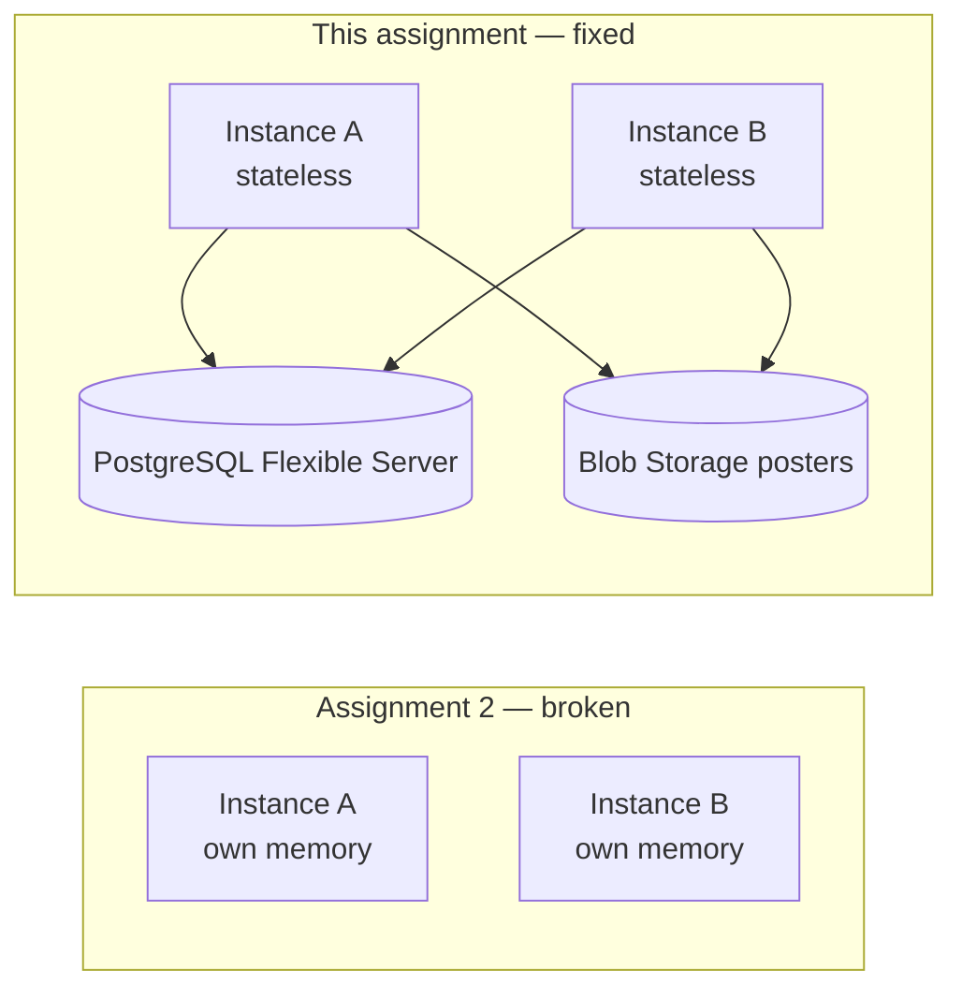

**Target state at the end of the assignment:**

1. Campus Events stores events and registrations in PostgreSQL via **EF Core**
2. The connection string lives in **App Service Application Settings** — not in code, not in the repo
3. `/health` now checks the database connection — a real readiness signal
4. The Assignment 2 experiment re-run shows **consistent answers with 2 instances**
5. Data **survives an app restart** (it did not in Assignment 1 — verify the difference)
6. Event posters (uploaded files) live in **Blob Storage** — files are state too, and the same rule applies
7. The database is stopped or deleted when you are not working — cost habit intact

---

# Guided section

## Guided section A — Why a managed database?

### Why this step?

You already know *that* state must leave the process (Assignment 2 proved it). This section covers *where it goes* and *who runs it*.

### Where can state live?

| Option | Azure service | Best for | For Campus Events? |
|--------|---------------|----------|--------------------|
| **Relational database** | Azure SQL, **PostgreSQL Flexible Server** | Structured data, relations, transactions | ✅ Events + registrations are exactly this |
| Document database | Cosmos DB | Flexible schema, global scale | Overkill here |
| Cache | Azure Cache for Redis | Sessions, hot data, speed | A complement, not the source of truth |
| Object storage | Blob Storage | Files, images, backups | Wrong shape for our data |

We choose **PostgreSQL Flexible Server**: it is a full, standard PostgreSQL that Azure operates for you — a **managed (PaaS) database**.

### Managed vs. do-it-yourself

| Concern | PostgreSQL on your own VM (IaaS) | Flexible Server (PaaS) |
|---------|----------------------------------|------------------------|
| Install, patch, upgrade | You | Azure |
| Backups | You (and you *will* forget) | Automatic, 7-day point-in-time restore |
| OS security | You | Azure |
| Schema, queries, indexes | You | You |
| Connection security, firewall | You | You (configure, but Azure enforces) |

This is the **shared responsibility model** from Assignment 1 applied to databases: the platform takes the undifferentiated heavy lifting, you keep the parts that are actually your application.

> **Reminder — backing services (12-factor):** a database is a *backing service*: an external resource your app talks to over the network, addressed **only by configuration** (the connection string). Swap local PostgreSQL for Azure PostgreSQL and the code does not change — only config does. You will see this concretely in sections C–E.

### What it costs

| Item | Price (approx.) | Note |
|------|------------------|------|
| Compute: Burstable **B1ms** (1 vCore, 2 GB) | ≈ €12/month ≈ €0.016/hour | Billed only while the server **runs** |
| Storage: 32 GB (minimum) | ≈ €4/month | Billed **even when stopped** |

> **Reminder — check the price before creating:** open the official [PostgreSQL Flexible Server pricing table](https://azure.microsoft.com/en-us/pricing/details/postgresql/flexible-server/) (North Europe, EUR, hourly) **and** the [Azure Pricing Calculator](https://azure.microsoft.com/en-us/pricing/calculator/). Add *Azure Database for PostgreSQL*, pick Flexible Server / Burstable / B1ms / 32 GB / North Europe, and confirm the monthly estimate yourself (compute + storage). Knowing the number *before* `az ... create` is the habit — this is the first assignment where it genuinely matters.

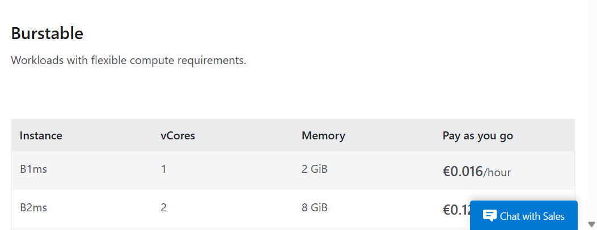

*Prices change. Match the B1ms row, not the exact euro amount. The official table is compute only — add 32 GB storage in the calculator yourself.*

---

## Guided section B — Add EF Core and a PostgreSQL-backed store

### Why this step?

The app talks to its store through the `IEventStore` interface. In Assignment 1 that was a deliberate architecture choice, and now it pays off: we write **one new class** and change **one DI line** — the endpoints do not change at all. This is what "program against interfaces" buys you.

Open `StarterCode/CampusEvents` from Assignment 1 in your editor.

### Step 1: Add the EF Core PostgreSQL package

In the project folder (`CampusEvents/`):

```powershell
dotnet add package Npgsql.EntityFrameworkCore.PostgreSQL
```

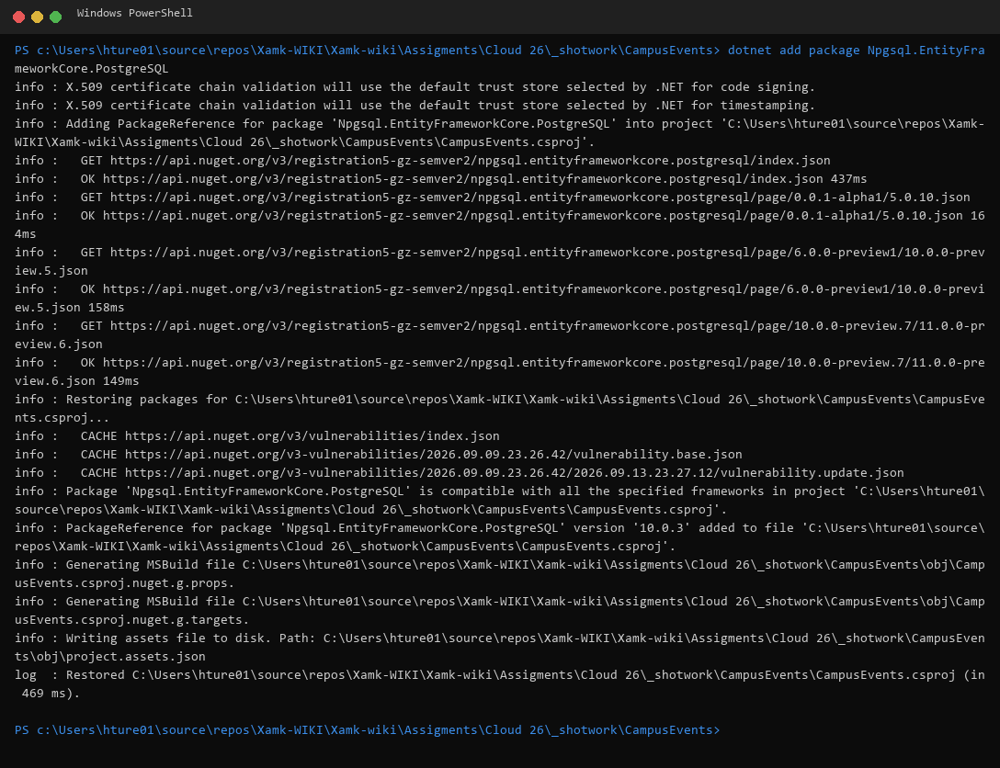

*Your names and IDs will differ. Match the field names, not the pixels.*

**What does the command do?** Adds the Npgsql EF Core provider — EF Core itself comes with it as a dependency. EF Core is .NET's object-relational mapper (ORM): you work with C# objects and LINQ, EF translates to SQL.

### Step 2: Create the DbContext

Create a folder `Data` and in it `Data/AppDbContext.cs`:

```csharp
using CampusEvents.Models;
using Microsoft.EntityFrameworkCore;

namespace CampusEvents.Data;

public class AppDbContext(DbContextOptions<AppDbContext> options) : DbContext(options)
{
    public DbSet<CampusEvent> Events => Set<CampusEvent>();

    protected override void OnModelCreating(ModelBuilder modelBuilder)
    {
        modelBuilder.Entity<CampusEvent>(e =>
        {
            e.HasKey(x => x.Id);
            e.Property(x => x.Title).HasMaxLength(120);
            e.Property(x => x.Location).HasMaxLength(120);

            // One event has many registrations; deleting the event deletes them too.
            e.HasMany(x => x.Registrations)
                .WithOne()
                .OnDelete(DeleteBehavior.Cascade);
        });

        modelBuilder.Entity<Registration>(r =>
        {
            r.HasKey(x => x.Id);
            r.Property(x => x.AttendeeName).HasMaxLength(100);
            r.Property(x => x.AttendeeEmail).HasMaxLength(200);
        });
    }
}
```

**What is a DbContext?** The session between your code and the database: it tracks objects you load, and `SaveChanges()` turns your changes into SQL. `OnModelCreating` maps classes to tables — keys, lengths, and the one-to-many relation.

> Note that `SeatsTaken`, `SeatsLeft` and `IsFull` need no configuration: they are computed get-only properties, so EF Core ignores them automatically. They are calculated from `Registrations` in memory after loading — which is why the queries below always `Include` the registrations.

### Step 3: Move the seed data

The seed data moves out of the in-memory store into a small seeder that runs only when the database is empty. Create `Data/DbSeeder.cs`:

```csharp
using CampusEvents.Models;

namespace CampusEvents.Data;

public static class DbSeeder
{
    public static void SeedIfEmpty(AppDbContext db)
    {
        if (db.Events.Any())
        {
            return; // already seeded — never duplicate
        }

        DateTime now = DateTime.UtcNow;

        db.Events.AddRange(
        [
            new CampusEvent
            {
                Id = Guid.Parse("11111111-1111-1111-1111-111111111111"),
                Title = "Intro to Azure for Students",
                Description = "Hands-on workshop: Azure Portal, CLI, and your first App Service deploy.",
                Location = "Campus Lab A201",
                StartsAtUtc = now.AddDays(7).Date.AddHours(14),
                Capacity = 30,
                CreatedAtUtc = now.AddDays(-3)
            },
            new CampusEvent
            {
                Id = Guid.Parse("22222222-2222-2222-2222-222222222222"),
                Title = "DevOps Coffee Hour",
                Description = "Informal meetup about CI/CD pipelines, GitHub Actions, and release habits.",
                Location = "Student Lounge",
                StartsAtUtc = now.AddDays(14).Date.AddHours(16),
                Capacity = 20,
                CreatedAtUtc = now.AddDays(-2),
                Registrations =
                [
                    new Registration
                    {
                        Id = Guid.NewGuid(),
                        AttendeeName = "Alex Example",
                        AttendeeEmail = "alex@example.com",
                        RegisteredAtUtc = now.AddDays(-1)
                    }
                ]
            },
            new CampusEvent
            {
                Id = Guid.Parse("33333333-3333-3333-3333-333333333333"),
                Title = "Cloud Cost Clinic",
                Description = "Learn budgets, tags, and how to avoid surprise Azure bills.",
                Location = "Online / Teams",
                StartsAtUtc = now.AddDays(21).Date.AddHours(12),
                Capacity = 50,
                CreatedAtUtc = now.AddDays(-1)
            }
        ]);

        db.SaveChanges();
    }
}
```

**Why "if empty"?** In Assignment 1 the seed ran on every start, because every restart wiped the memory. A database *persists* — seeding on every start would duplicate the data. Idempotency again, this time in code.

### Step 4: Write the PostgreSQL-backed store

Create `Services/PostgresEventStore.cs`. It implements the **same `IEventStore` interface** — compare it method by method with `InMemoryEventStore` as you type:

```csharp
using CampusEvents.Data;
using CampusEvents.Models;
using Microsoft.EntityFrameworkCore;

namespace CampusEvents.Services;

/// <summary>
/// EF Core + PostgreSQL implementation of IEventStore.
/// State lives in the database — the app itself is now stateless.
/// </summary>
public class PostgresEventStore(AppDbContext db) : IEventStore
{
    public IReadOnlyList<CampusEvent> GetAll() =>
        db.Events
            .AsNoTracking()
            .Include(e => e.Registrations)
            .OrderBy(e => e.StartsAtUtc)
            .ToList();

    public CampusEvent? GetById(Guid id) =>
        db.Events
            .AsNoTracking()
            .Include(e => e.Registrations)
            .FirstOrDefault(e => e.Id == id);

    public CampusEvent Create(CreateEventRequest request)
    {
        CampusEvent campusEvent = new()
        {
            Id = Guid.NewGuid(),
            Title = request.Title.Trim(),
            Description = request.Description.Trim(),
            Location = request.Location.Trim(),
            StartsAtUtc = DateTime.SpecifyKind(request.StartsAtUtc, DateTimeKind.Utc),
            Capacity = request.Capacity,
            CreatedAtUtc = DateTime.UtcNow
        };

        db.Events.Add(campusEvent);
        db.SaveChanges();
        return campusEvent;
    }

    public CampusEvent? Update(Guid id, UpdateEventRequest request)
    {
        CampusEvent? existing = db.Events
            .Include(e => e.Registrations)
            .FirstOrDefault(e => e.Id == id);

        if (existing is null)
        {
            return null;
        }

        if (request.Capacity < existing.SeatsTaken)
        {
            throw new InvalidOperationException(
                $"Capacity cannot be less than current registrations ({existing.SeatsTaken}).");
        }

        existing.Title = request.Title.Trim();
        existing.Description = request.Description.Trim();
        existing.Location = request.Location.Trim();
        existing.StartsAtUtc = DateTime.SpecifyKind(request.StartsAtUtc, DateTimeKind.Utc);
        existing.Capacity = request.Capacity;

        db.SaveChanges();
        return existing;
    }

    public bool Delete(Guid id)
    {
        CampusEvent? existing = db.Events.FirstOrDefault(e => e.Id == id);
        if (existing is null)
        {
            return false;
        }

        db.Events.Remove(existing);
        db.SaveChanges();
        return true;
    }

    public (RegistrationResponse? Registration, string? Error) Register(Guid eventId, RegisterRequest request)
    {
        CampusEvent? campusEvent = db.Events
            .Include(e => e.Registrations)
            .FirstOrDefault(e => e.Id == eventId);

        if (campusEvent is null)
        {
            return (null, "Event not found.");
        }

        if (campusEvent.IsFull)
        {
            return (null, "Event is full.");
        }

        string email = request.AttendeeEmail.Trim().ToLowerInvariant();
        if (campusEvent.Registrations.Any(r => r.AttendeeEmail.Equals(email, StringComparison.OrdinalIgnoreCase)))
        {
            return (null, "This email is already registered for the event.");
        }

        Registration registration = new()
        {
            Id = Guid.NewGuid(),
            AttendeeName = request.AttendeeName.Trim(),
            AttendeeEmail = email,
            RegisteredAtUtc = DateTime.UtcNow
        };

        campusEvent.Registrations.Add(registration);
        db.Add(registration); // mark explicitly as new — the preset Guid id would otherwise confuse EF's state detection
        db.SaveChanges();

        RegistrationResponse response = new(
            registration.Id,
            campusEvent.Id,
            registration.AttendeeName,
            registration.AttendeeEmail,
            registration.RegisteredAtUtc);

        return (response, null);
    }
}
```

**Things worth noticing while typing:**

| Detail | Why it is there |
|--------|-----------------|
| `AsNoTracking()` on reads | Read-only queries skip EF's change tracking — faster, less memory |
| `Include(e => e.Registrations)` | EF loads only what you ask; without this, `Registrations` is empty and `SeatsTaken` lies |
| No `lock` anywhere | The database handles concurrent access now — the `lock` in `InMemoryEventStore` was compensating for shared in-process state |
| `DateTime.SpecifyKind(..., Utc)` | PostgreSQL `timestamptz` requires UTC timestamps; JSON dates without `Z` arrive with `Kind=Unspecified` |
| `db.Add(registration)` | The new registration's `Id` is already set, so EF's change detection could assume it *exists* and try an UPDATE — the explicit `Add` says "this is new, INSERT it" |
| The business rules are identical | Full event, duplicate email, capacity check — the *rules* did not move, only the *storage* did |

> **Reminder — sync vs. async:** this implementation uses synchronous EF calls to keep the change surface minimal. Production database code is `async` (`ToListAsync`, `SaveChangesAsync`) so threads are not blocked while waiting for the network.

### Step 5: Wire it up in Program.cs

In `Program.cs`, replace the single DI line:

```csharp
builder.Services.AddSingleton<IEventStore, InMemoryEventStore>();
```

with:

```csharp
builder.Services.AddDbContext<AppDbContext>(options =>
    options.UseNpgsql(builder.Configuration.GetConnectionString("DefaultConnection")));

builder.Services.AddScoped<IEventStore, PostgresEventStore>();
```

and add the two usings at the top:

```csharp
using CampusEvents.Data;
using Microsoft.EntityFrameworkCore;
```

**Why `AddScoped` instead of `AddSingleton`?** A `DbContext` is short-lived by design: one per HTTP request. `AddDbContext` registers it as *scoped*, so everything that depends on it must be scoped too. The in-memory store *had* to be a singleton (the data lived in the instance); the Postgres store must *not* be (the data lives in the database). Service lifetime follows where the state lives.

Then, right after `var app = builder.Build();`, create the schema and seed:

```csharp
using (var scope = app.Services.CreateScope())
{
    var db = scope.ServiceProvider.GetRequiredService<AppDbContext>();
    db.Database.EnsureCreated();
    DbSeeder.SeedIfEmpty(db);
}
```

**What does `EnsureCreated()` do?** Creates the database schema directly from the model if it does not exist yet — perfect for this course. Real projects use **EF Core migrations** instead, which can *evolve* an existing schema version by version. (Question 5 in the theory questions asks you to compare them.)

### Step 6: Upgrade /health to check the database

In Assignment 1 you learned why `/health` matters in the cloud. Now it can earn its keep: an app that cannot reach its database is *not* healthy. Replace the `/health` endpoint:

```csharp
app.MapGet("/health", async (AppDbContext db) =>
{
    bool dbReachable = await db.Database.CanConnectAsync();

    return dbReachable
        ? Results.Ok(new { status = "Healthy", database = "reachable", utc = DateTime.UtcNow })
        : Results.Json(
            new { status = "Unhealthy", database = "unreachable", utc = DateTime.UtcNow },
            statusCode: StatusCodes.Status503ServiceUnavailable);
});
```

> **Reminder — health checks have depth:** a *liveness* check ("process is up") should stay cheap and dependency-free, while a *readiness* check ("can actually serve requests") verifies dependencies like the database. We are folding both into one endpoint for simplicity; larger apps expose `/health/live` and `/health/ready` separately, and orchestrators treat them differently.

### Step 7: Delete the in-memory store

Delete `Services/InMemoryEventStore.cs`. It did its job: it got Assignment 1 running without database complexity, and it gave Assignment 2 something to break. Git history remembers it. Build to confirm nothing references it:

```powershell
dotnet build
```

Expected: `Build succeeded`.

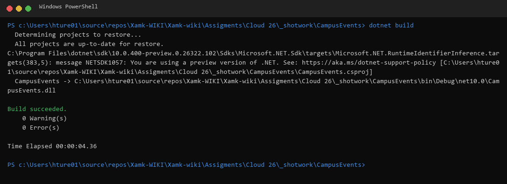

*Your names and IDs will differ. Match the field names, not the pixels.*

---

## Guided section C — Run it locally against PostgreSQL

### Why this step?

Never ship a database change you have not run locally. We start a local PostgreSQL in Docker, point the app at it with a **Development** connection string, and test.

### Step 8: Local PostgreSQL with Docker

Create `docker-compose.yml` next to the `.csproj`:

```yaml
services:
  postgres:
    image: postgres:16-alpine
    container_name: campusevents-db
    environment:
      POSTGRES_USER: campus
      POSTGRES_PASSWORD: localdev   # local only — never a real secret
      POSTGRES_DB: campusevents
    ports:
      - "5432:5432"
    volumes:
      - campusevents-pgdata:/var/lib/postgresql/data

volumes:
  campusevents-pgdata:
```

Start it:

```powershell
docker compose up -d
```

**What does this do?** Pulls the official PostgreSQL 16 image and runs it with a user, password and database ready. The named volume keeps the data across container restarts — your first taste of "state outside the process" applies to containers too.

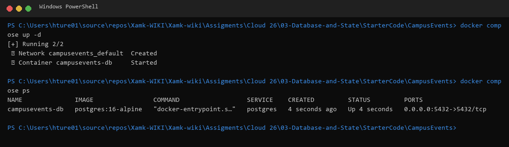

*The lab YAML maps `5432:5432`. If your host port 5432 is already in use, see troubleshooting (map `5433:5432` and change the Development connection string). Do not copy a `5434` mapping from an old screenshot.*

> **No Docker?** Alternative: skip this step, create the Azure database first (section D), and add a firewall rule for your own IP (`--public-access` does it during creation). Then use the Azure connection string locally via **user secrets**: `dotnet user-secrets set "ConnectionStrings:DefaultConnection" "<azure-connection-string>"`. Slower feedback loop, but works.

### Step 9: Development connection string

Open `appsettings.Development.json` and add the connection string section:

```json
{
  "ConnectionStrings": {
    "DefaultConnection": "Host=localhost;Database=campusevents;Username=campus;Password=localdev"
  },
  "Logging": {
    "LogLevel": {
      "Default": "Information",
      "Microsoft.AspNetCore": "Warning"
    }
  }
}
```

**Why the Development file and not `appsettings.json`?** `appsettings.Development.json` is loaded only when `ASPNETCORE_ENVIRONMENT=Development` — i.e. on your machine. The base `appsettings.json` (which is what production falls back to) gets **no connection string at all**: in Azure it arrives as an Application Setting. A missing connection string in production should *fail loudly*, not silently use a leftover dev value.

> **Reminder — what counts as a secret:** `localdev` against a database that only exists on your laptop is not a real secret, so committing it is acceptable. The **Azure** connection string with a real password is a secret and must never appear in any file in the repo. If you are unsure which side of the line something is on, treat it as a secret.

### Step 10: Run and verify locally

```powershell
dotnet run
```

Test in another terminal (adjust the port to what `dotnet run` printed):

```powershell
curl http://localhost:5xxx/health
curl http://localhost:5xxx/api/events
```

Expected: `/health` says `Healthy` + `database: reachable`, and `/api/events` returns the three seeded events.

**Now the moment that separates this from Assignment 1** — restart the app (`Ctrl+C`, `dotnet run` again), register an attendee, restart *again*, and check the registrations:

```powershell
$body = @{ attendeeName = "Persist Test"; attendeeEmail = "persist.test@example.com" } | ConvertTo-Json
Invoke-RestMethod -Method Post `
  -Uri "http://localhost:5xxx/api/events/22222222-2222-2222-2222-222222222222/registrations" `
  -ContentType "application/json" `
  -Body $body

# restart the app, then:
curl http://localhost:5080/api/events/22222222-2222-2222-2222-222222222222
```

Expected: `seatsTaken` is still `2` after the restart. In Assignment 1 a restart reset everything. **State now survives the process.**

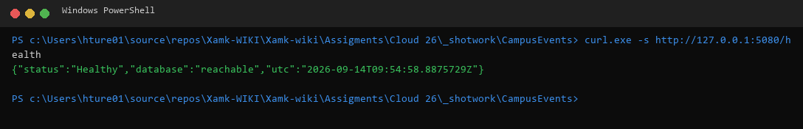

*Your names and IDs will differ. Match the field names, not the pixels.*

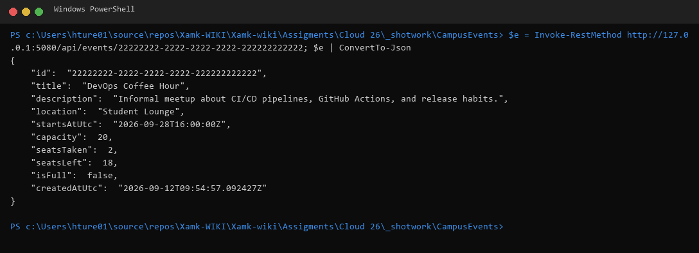

*Your names and IDs will differ. Match the field names, not the pixels.*

---

## Guided section D — Provision the database in Azure

### Why this step?

Local works; now the real thing. You create a Flexible Server with the CLI, open the firewall for Azure services and your own machine, and — as always — know the price before pressing enter (you did the calculator check in section A).

### Step 11: Variables and a password

```powershell
$YourName      = "aapo"                       # same as Assignment 1
$YourEmail     = "kontiainenape@gmail.com"                      # school email, for tags
$ResourceGroup = "rg-cloud26-aapo-dev"
$PgServer      = "pg-cloud26-aapo-ne"          # must be globally unique
$PgAdmin       = "campusadmin"
$PgPassword    = Read-Host "Choose a strong DB password"
```

**Why `Read-Host`?** The password never gets written into a script, a file, or your shell history that way. It exists in the variable for this session only.

### Step 12: Create the Flexible Server

```powershell
az postgres flexible-server create `
  --resource-group $ResourceGroup `
  --name $PgServer `
  --location northeurope `
  --tier Burstable `
  --sku-name Standard_B1ms `
  --storage-size 32 `
  --version 16 `
  --admin-user $PgAdmin `
  --admin-password $PgPassword `
  --public-access 0.0.0.0 `
  --tags Environment=dev Course=cloud26 Owner=$YourName

az postgres flexible-server db create `
  --resource-group $ResourceGroup `
  --server-name $PgServer `
  --name campusevents
```

**What do the commands do?** The first creates the cheapest reasonable managed PostgreSQL (Burstable B1ms, 32 GB, PostgreSQL 16) and tags it like every other resource you own. `--public-access 0.0.0.0` adds the special firewall rule that allows **Azure services** (your App Service) to connect — it does *not* mean "the whole internet" (see the wiki page if that sounds wrong). The second creates the `campusevents` database inside the server. Current Azure CLI only accepts `--database-name` on `flexible-server create` for *elastic clusters*, so the database is a separate `db create` (the flag there is `--name`, not `--database-name`).

> **Do not screenshot the raw create JSON.** `az postgres flexible-server create` prints the admin password and a connection string. Redact `--admin-password` in your command shot, and use the Step 14 table for the "server is Ready" proof.

This takes **5–10 minutes**. While it runs, read the [firewall section of the wiki page](https://github.com/xamk-mire/Xamk-wiki/blob/main/Cloud%20technologies/Azure/Azure-Database-PostgreSQL.md#verkko-ja-palomuuri). The wiki page is in Finnish — the section heading is **Verkko ja palomuuri**.

> **Reminder — the meter note, again:** from this moment the server bills compute per hour and storage per month. Section H stops it. If you must abandon the assignment mid-way, run the section H stop command first.

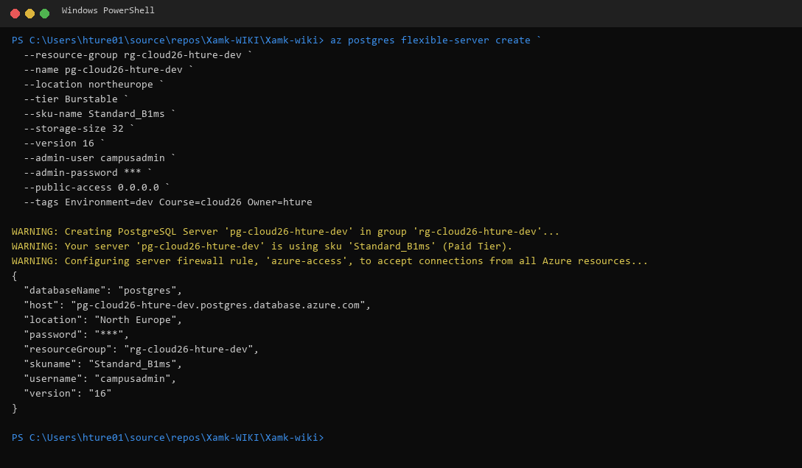

*`databaseName` in this JSON is often `postgres` (the server default). The `campusevents` database is the next command (`db create`). Never screenshot a real password — this example has `***`.*

### Step 13: Allow your own machine (for inspection)

```powershell
$MyIp = (Invoke-RestMethod "https://api.ipify.org")

az postgres flexible-server firewall-rule create `
  --resource-group $ResourceGroup `
  --server-name $PgServer `
  --name MyDevMachine `
  --start-ip-address $MyIp `
  --end-ip-address $MyIp
```

**Why?** The Azure-services rule covers your App Service but not your laptop. This rule lets you connect with `psql`/pgAdmin or run the app locally against the Azure database if you ever need to. Least privilege: exactly one IP.

Current Azure CLI names the **server** `--server-name` and the **rule** `--name`. Older samples used `--name` for the server and `--rule-name` for the rule — those flags now fail.

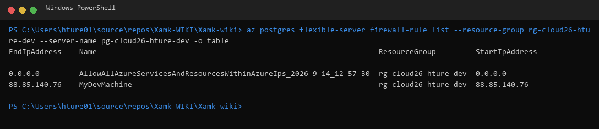

*This is `firewall-rule list`, not the create command. You should see `MyDevMachine` with your public IP, plus the Azure-services rule (`0.0.0.0`).*

### Step 14: Verify the server

```powershell
az postgres flexible-server show `
  --resource-group $ResourceGroup `
  --name $PgServer `
  --query "{name:name, state:state, sku:sku.name, storageGb:storage.storageSizeGb, version:version}" `
  --output table
```

Expected: `state: Ready`, `sku: Standard_B1ms`, `storageGb: 32`, `version: 16`.

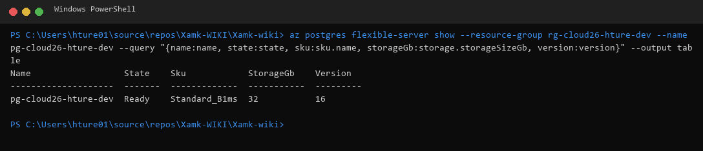

*Your names and IDs will differ. Match the field names, not the pixels.*

---

## Guided section E — Connect the app: configuration, not code

### Why this step?

This is the 12-factor **config** principle made concrete: the same build artifact runs locally against Docker and in Azure against Flexible Server — the *only* difference is one environment variable.

### Step 15: Set the connection string as an Application Setting

```powershell
$AppName  = "app-cloud26-aapo-dev"
$PlanName = "plan-cloud26-aapo-dev"
$BaseUrl  = "https://app-cloud26-aapo-dev.azurewebsites.net/"

$ConnString = "Host=$PgServer.postgres.database.azure.com;Database=campusevents;Username=$PgAdmin;Password=$PgPassword;Ssl Mode=Require"

az webapp config appsettings set `
  --resource-group $ResourceGroup `
  --name $AppName `
  --settings ConnectionStrings__DefaultConnection=$ConnString
```

**What does the command do?** App Service injects Application Settings as environment variables. ASP.NET Core's configuration system maps `ConnectionStrings__DefaultConnection` (two underscores = JSON nesting) onto `ConnectionStrings:DefaultConnection` — exactly what `GetConnectionString("DefaultConnection")` reads. It overrides anything in `appsettings.json`. The app restarts automatically when settings change.

Note `Ssl Mode=Require`: Azure refuses unencrypted database connections. Your local Docker connection string does not have it; the Azure one must.

> **Reminder — where secrets live, the course ladder:** Assignment 1: no secrets at all. **This assignment: secrets in Application Settings** — out of code, but still visible to anyone with portal access. Later in the course: Key Vault + Managed Identity — no password exists in *any* configuration. Each rung is better than the last; know which rung you are standing on.

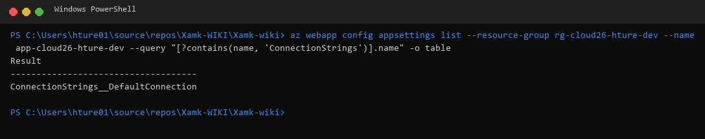

*After Step 15 you should see `DefaultConnection` only. `ConnectionStrings__Storage` appears later, in section G. Listing names (not values) keeps the password out of the screenshot.*

### Step 16: Deploy the new code

From the project folder (same command as Assignment 1 — or run your `provision.ps1` if you extended it):

```powershell
az webapp up `
  --name $AppName `
  --resource-group $ResourceGroup `
  --plan $PlanName `
  --os-type Linux `
  --runtime "DOTNETCORE:10.0"
```

`--os-type Linux` is required. Current Azure CLI defaults .NET apps to Windows, and `DOTNETCORE:10.0` is not a Windows runtime — you get `Windows runtime 'DOTNETCORE|10.0' is not supported` if you omit the flag.

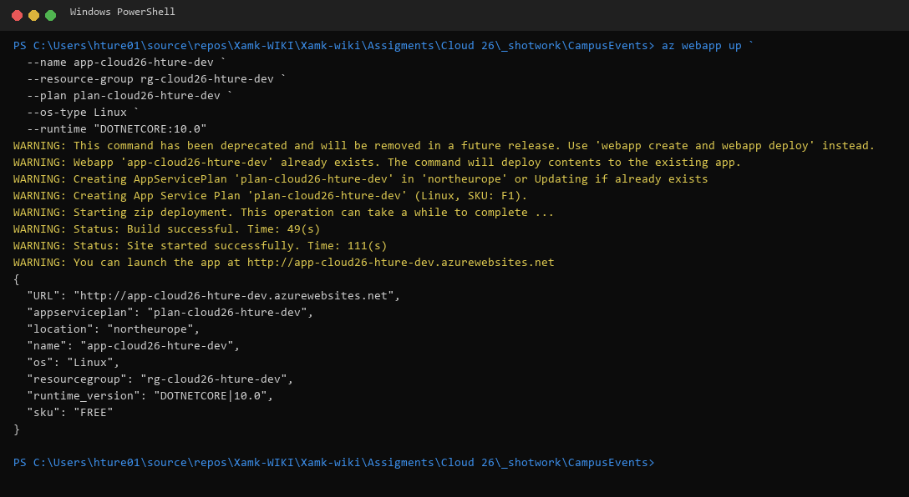

*`Webapp … already exists. The command will deploy contents to the existing app` is expected here — you created the app in Assignment 1. That WARNING is not a failure. Success is `Build successful` and the launch URL.*

### Step 17: Verify in Azure

```powershell
curl.exe -s "https://app-cloud26-aapo-dev.azurewebsites.net"
curl.exe -s "https://app-cloud26-aapo-dev.azurewebsites.net/api/events"
```

Expected: `Healthy` + `database: reachable`, and the three seeded events (freshly seeded — this is a brand new, empty database that `EnsureCreated` + the seeder just populated on first start).

If `/health` returns 503 or the app errors, go to **Support and troubleshooting** at the end — the three most common causes are listed there, and this is your first realistic "app cannot reach its database" debugging session. That is a feature of this assignment, not a bug.

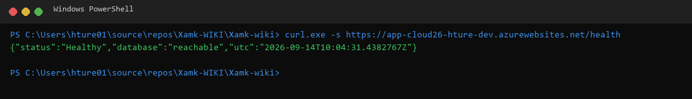

*Your names and IDs will differ. Match the field names, not the pixels.*

### Step 18: The restart test, in Azure

Repeat the persistence proof against the real environment:

```powershell
$body = @{ attendeeName = "Azure Persist"; attendeeEmail = "azure.persist@example.com" } | ConvertTo-Json
Invoke-RestMethod -Method Post `
  -Uri "https://app-cloud26-aapo-dev.azurewebsites.net/api/events/22222222-2222-2222-2222-222222222222/registrations" `
  -ContentType "application/json" `
  -Body $body

az webapp restart --name $AppName --resource-group $ResourceGroup

# wait ~30 seconds, then:
curl.exe -s "https://app-cloud26-aapo-dev.azurewebsites.net/api/events/22222222-2222-2222-2222-222222222222"
```

Expected: `seatsTaken: 2` survives the restart. Take a screenshot — it goes in your submission.

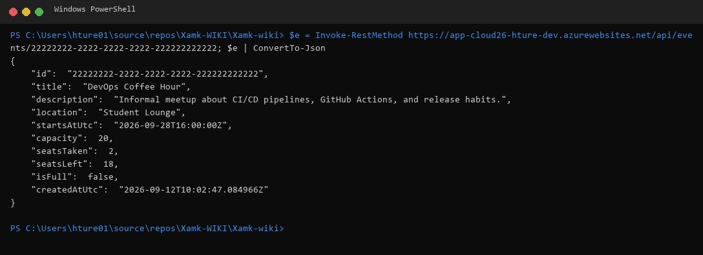

*Your names and IDs will differ. Match the field names, not the pixels.*

---

## Guided section F — The payoff: re-run the Assignment 2 experiment

### Why this step?

In Assignment 2, two instances gave flip-flopping answers. Same experiment, stateless app: it must now give **one consistent answer**. Never claim an architecture fix works — demonstrate it.

### Step 19: Scale up and out (Assignment 2 moves)

```powershell
az appservice plan update `
  --name $PlanName `
  --resource-group $ResourceGroup `
  --sku B1

az webapp update `
  --name $AppName `
  --resource-group $ResourceGroup `
  --client-affinity-enabled false

az appservice plan update `
  --name $PlanName `
  --resource-group $ResourceGroup `
  --number-of-workers 2
```

The second instance often takes **3–5 minutes**. Confirm Azure listed two instances before you loop `/info` (same wait as Assignment 2 Step 7):

```powershell
az webapp list-instances `
  --name $AppName `
  --resource-group $ResourceGroup `
  --output table
```

Then call `/info` without cookies:

```powershell
1..8 | ForEach-Object {
    curl.exe -s "$BaseUrl/info"
    Write-Host ""
}
```

Expected when two rows appear: **two different machine names** — the load balancer is spreading you across instances, ARR affinity is off. If `list-instances` stays at one row after five minutes, screenshot that table plus the consistent `seatsTaken` loop in Step 20 — the database proof is the same number on every request, not a second hostname.

### Step 20: The moment of truth

Register an attendee and read the event repeatedly:

```powershell
$body = @{ attendeeName = "Consistent Now"; attendeeEmail = "consistent.now@example.com" } | ConvertTo-Json
Invoke-RestMethod -Method Post `
  -Uri "$BaseUrl/api/events/22222222-2222-2222-2222-222222222222/registrations" `
  -ContentType "application/json" `
  -Body $body

1..8 | ForEach-Object {
    $e = Invoke-RestMethod "$BaseUrl/api/events/22222222-2222-2222-2222-222222222222"
    "$($e.seatsTaken) seats taken"
}
```

**Expected result: the same number, every time** — no flip-flop. One database, one truth. If Azure started two instances, that is the full contrast with Assignment 2. If it started only one, the consistent loop plus the Step 18 restart test still prove the store is no longer process-local.

Take a screenshot of the consistent output. If you have Assignment 2 flip-flop evidence, put the two images side by side. If Assignment 2 stayed on one instance, say so — do not invent a flip-flop.

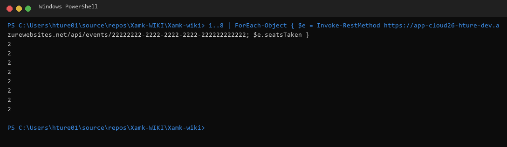

*Your names and IDs will differ. Match the field names, not the pixels.*

### Step 21: Scale back (Assignment 2 discipline)

```powershell
az appservice plan update `
  --name $PlanName `
  --resource-group $ResourceGroup `
  --number-of-workers 1

az webapp update `
  --name $AppName `
  --resource-group $ResourceGroup `
  --client-affinity-enabled true

az appservice plan update `
  --name $PlanName `
  --resource-group $ResourceGroup `
  --sku F1
```

Verify: `sku: F1`, `workers: 1`, `/health` still `Healthy` (F1 can reach the database just fine — the firewall rule is about *where* traffic comes from, not the SKU).

---

## Guided section G — Files are state too: Blob Storage

### Why this step?

Everything this assignment said about rows applies to **files**. An event needs a poster image; where does the uploaded file go? The tempting answer — save it to the web server's disk — is the same trap as the in-memory store: process-local state. On most cloud platforms (containers, Functions, scaled-out anything) local disk is per-instance and disappears on restart — the flip-flop, with JPEGs. App Service happens to have a shared `/home` folder as a special quirk, but it dies with the plan, does not survive deleting and recreating the app — something you will do later on this course — and a web server's disk is not a *file service*: no independent scaling, no lifecycle management, no way to hand out links without going through your app.

The cloud-native home for files is **object storage** — in Azure, **Blob Storage**:

```
Storage account  (stcloud26mattidev)      ← globally unique name, NO HYPHENS
  └── Container  (posters)                ← like a folder, with an access policy
        └── Blob (7b0efc71-...)           ← the file itself + content type
```

Rows → PostgreSQL. Files → Blob Storage. Same principle, second backing service: the app stays stateless, the state lives in services built for it.

**What it costs:** effectively nothing at course scale — Standard LRS (locally redundant) storage is ~€0.02 per GB/month plus fractions of a cent per 10 000 operations. A thousand posters ≈ half a euro a month. Unlike the database there is no per-hour compute meter; you pay only for bytes stored and requests made.

### Step 22: Create the storage account

```powershell
$StorageName = "stcloud26$($YourName -replace '[^a-z0-9]','')dev"   # letters + digits only, 3-24 chars, globally unique

az storage account create `
  --name $StorageName `
  --resource-group $ResourceGroup `
  --location northeurope `
  --sku Standard_LRS `
  --kind StorageV2 `
  --allow-blob-public-access false `
  --min-tls-version TLS1_2 `
  --tags Environment=dev Course=cloud26 Owner=$YourEmail
```

**Reading the flags:**

| Flag | Why |
|------|-----|
| `--sku Standard_LRS` | Locally redundant: 3 copies in one datacenter — cheapest, right for a course. (Production choices: ZRS/GRS for zone/region redundancy) |
| `--allow-blob-public-access false` | Nothing in this account can be made anonymously public, even by accident. The app will *serve* the posters itself |
| The name | Storage account names break the course naming convention — **no hyphens allowed**. Every rule has an exception; this is Azure's most famous one |

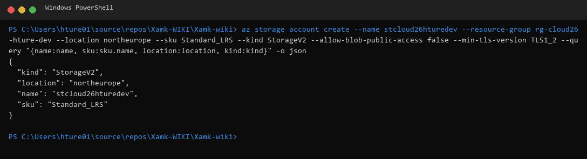

*Your account name will differ (no hyphens). Match `sku` and `kind`, not the exact name.*

### Step 23: Container and connection string

Create the container the posters will live in:

```powershell
az storage container create `
  --name posters `
  --account-name $StorageName `
  --auth-mode key
```

(`--auth-mode key` uses the account key your Owner role can read. The alternative, `--auth-mode login`, needs a *data-plane* RBAC role your Owner role does not automatically include — a distinction you will return to later on this course.)

Then give the app access — connection string as an Application Setting, exactly like the database in section E:

```powershell
$StorageConn = az storage account show-connection-string `
  --name $StorageName `
  --resource-group $ResourceGroup `
  --query connectionString --output tsv

az webapp config appsettings set `
  --resource-group $ResourceGroup `
  --name $AppName `
  --settings "ConnectionStrings__Storage=$StorageConn"
```

> **Reminder — secrets ladder, same rung:** that connection string contains the **account key** — a full-power, long-lived secret, morally identical to the database password sitting one setting above it. Same rung of the ladder, same eventual fix: later on this course both are replaced with identity-based access.

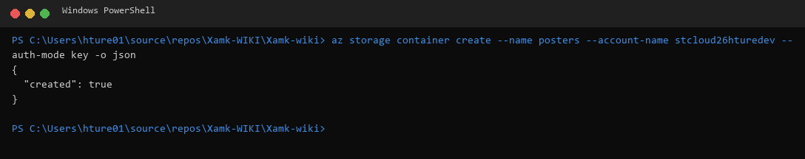

*`created: true` is the first run. If you run the command again, Azure returns `created: false` — the container already exists. That is success, not a failure.*

### Step 24: The upload and serve endpoints

Add the SDK:

```powershell
dotnet add CampusEvents package Azure.Storage.Blobs
```

In `Program.cs`, register the container client when storage is configured (near the DbContext registration):

```csharp
var storageConnectionString = builder.Configuration.GetConnectionString("Storage");

if (storageConnectionString is not null)
{
    // One client for the 'posters' container, shared by all requests (thread-safe).
    builder.Services.AddSingleton(new BlobContainerClient(storageConnectionString, "posters"));
}
```

And two endpoints, mapped only when storage exists (after the other event endpoints):

```csharp
if (storageConnectionString is not null)
{
    app.MapPost("/api/events/{id:guid}/poster",
        async (Guid id, IFormFile file, BlobContainerClient posters, IEventStore store) =>
    {
        if (store.GetById(id) is null)
        {
            return Results.NotFound();
        }

        if (file.Length is 0 or > (2 * 1024 * 1024))
        {
            return Results.BadRequest(new { error = "Poster must be between 1 byte and 2 MB." });
        }

        if (file.ContentType is not ("image/jpeg" or "image/png"))
        {
            return Results.BadRequest(new { error = "Only JPEG and PNG posters are accepted." });
        }

        var blob = posters.GetBlobClient(id.ToString());
        await using var stream = file.OpenReadStream();
        await blob.UploadAsync(stream, new BlobUploadOptions
        {
            HttpHeaders = new BlobHttpHeaders { ContentType = file.ContentType }
        });

        return Results.NoContent();
    }).DisableAntiforgery();

    app.MapGet("/api/events/{id:guid}/poster", async (Guid id, BlobContainerClient posters) =>
    {
        var blob = posters.GetBlobClient(id.ToString());

        if (!await blob.ExistsAsync())
        {
            return Results.NotFound();
        }

        var download = await blob.DownloadStreamingAsync();
        return Results.Stream(download.Value.Content, download.Value.Details.ContentType);
    });
}
```

New usings:

```csharp
using Azure.Storage.Blobs;
using Azure.Storage.Blobs.Models;
```

**Things worth noticing:**

| Detail | Why it matters |
|--------|-----------------|
| Blob named by the event id | One poster per event, re-upload overwrites — no filename bookkeeping, no path traversal risk from user-supplied names |
| Size and content-type checks | User uploads are a **system boundary** — the first input in this app you genuinely cannot trust. Validate before storing |
| `.DisableAntiforgery()` | ASP.NET Core (8+) demands an antiforgery token on form uploads by default — correct for cookie-based browser apps, wrong for a token-less API. Disabling it *knowingly* is the point; know what you switched off |
| The app streams the poster through `GET` | The container stays private; the app decides who reads. (The alternative — handing out time-limited **SAS links** directly to blob storage — is the higher-scale pattern; see the theory questions) |
| Everything mapped inside `if (storageConnectionString is not null)` | No storage configured (your integration tests later, a classmate's clone) → the endpoints simply do not exist. The app degrades honestly instead of failing at startup |

### Step 25: Deploy and upload

Deploy the updated code (same publish + zip deploy as Step 16). Then upload a poster — any small JPEG on your machine — to one of the seeded events:

```powershell
# take an event id from /api/events first ($BaseUrl from Step 15)
curl.exe -s -X POST "$BaseUrl/api/events/<event-id>/poster" -F "file=@poster.jpg;type=image/jpeg"

# then open in a browser:
# $BaseUrl/api/events/<event-id>/poster
```

> Use `curl.exe`, not plain `curl` — in Windows PowerShell `curl` is an alias for `Invoke-WebRequest`, which does not understand `-s`, `-X`, or `-F`.

The image renders in the browser — served by your app, stored in blob storage. Confirm where it actually lives:

```powershell
az storage blob list --container-name posters --account-name $StorageName --auth-mode key --output table
```

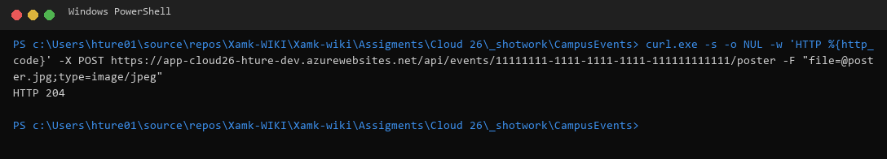

*Your names and IDs will differ. Match the field names, not the pixels.*


*Your names and IDs will differ. Match the field names, not the pixels.*

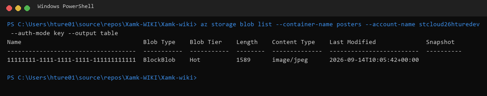

*Your names and IDs will differ. Match the field names, not the pixels.*

### Step 26: The persistence proof, file edition

Same drill as Step 18, now for files:

```powershell
az webapp restart --resource-group $ResourceGroup --name $AppName
# wait ~30 seconds, then reload the poster URL in the browser
```

The poster survives — it was never in the process. Note what you now have: an app whose **every** kind of state (rows *and* files) lives in backing services. Delete the web app entirely and recreate it, and nothing of value is lost. That property is exactly what you will exploit later on this course.

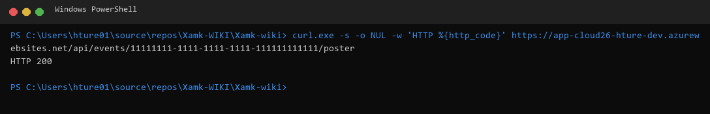

*Your names and IDs will differ. Match the field names, not the pixels.*

---

## Guided section H — Stop the database meter

### Why this step?

The web app on F1 is free. The database is not: B1ms compute bills every hour it runs, storage every month it exists. This is the first assignment after which you own a resource that costs money **while you sleep** — so managing its lifecycle is part of the assignment, not an afterthought.

### Step 27: Choose based on when you continue

| Situation | Action | Billing effect |
|-----------|--------|----------------|
| Continuing within a few days | **Stop** the server | Compute stops, storage (~€4/mo) continues |
| Break longer than a week | **Delete** the server | All billing stops; recreate with your script (Exercise 1) |

**Stop:**

```powershell
az postgres flexible-server stop `
  --resource-group $ResourceGroup `
  --name $PgServer
```

> **Reminder — stopped is a pause, not off:** Azure **automatically restarts** a stopped Flexible Server after **7 days**. If you stop it and disappear for a month, it runs (and bills) for three of those four weeks. For longer breaks: delete, and let your provisioning script bring it back — infrastructure you can recreate on demand is the whole point of the scripting habit (and of the Infrastructure as Code work coming later on this course).

**Start again when you return:**

```powershell
az postgres flexible-server start `
  --resource-group $ResourceGroup `
  --name $PgServer
```

(While the DB is stopped, `/health` returns 503 — your health endpoint is telling the truth. Worth seeing once on purpose.)

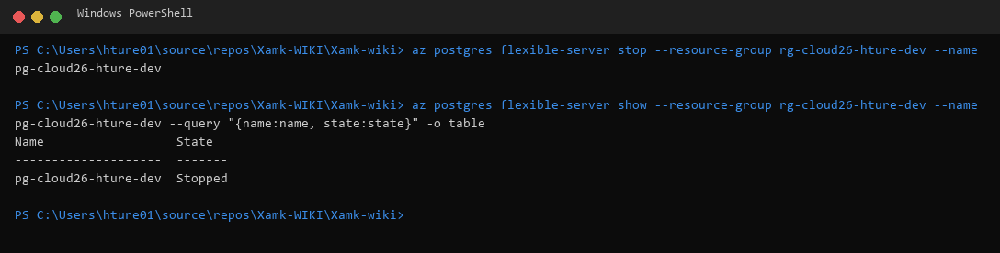

*Your names and IDs will differ. Match the field names, not the pixels.*

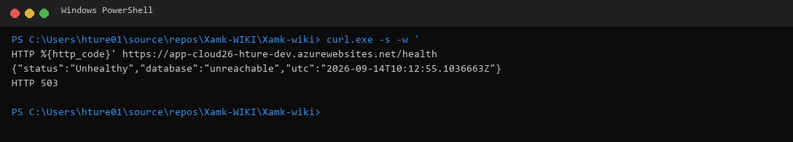

*Your names and IDs will differ. Match the field names, not the pixels.*

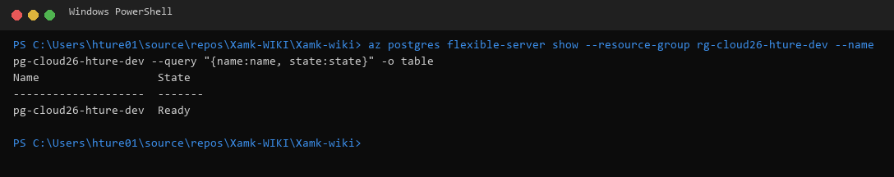

*Your names and IDs will differ. Match the field names, not the pixels.*

> **What about the storage account?** It has no compute meter — it keeps billing its pennies-per-month for the stored bytes whether the database runs or not. Nothing to stop; delete only if you want the posters gone.

### Step 28: Check Cost analysis tomorrow

Portal → resource group → **Cost Management** → **Cost analysis**. By tomorrow you should see the PostgreSQL line item (the storage account will appear too, at a few cents). Compare it against the calculator estimate from section A — screenshot for the submission.

---

## Guided section I — AI in this assignment

### Why this step?

Two realistic AI uses this time: debugging a connection failure, and reviewing your secrets hygiene.

### Step 29: AI as a connection-failure debugger

If (when) something failed between steps 15–17, you already did this organically. If everything worked first try, simulate it: temporarily set a **wrong password** in the Application Setting, watch `/health` go 503, and fetch the real error from the logs:

```powershell
az webapp log tail --name $AppName --resource-group $ResourceGroup
```

Paste the actual exception (e.g. `28P01: password authentication failed` or a timeout) to your AI tool. **Example prompt:**

```
This ASP.NET Core app on Azure App Service cannot reach its Azure Database
for PostgreSQL Flexible Server. Here is the exception from the logs: <paste>.
List the most likely causes in order of probability, and one CLI command
to verify each.
```

Judge the answer: does it distinguish *authentication* failures (wrong password → fix the app setting) from *network* failures (timeout → firewall rule)? That distinction is the first fork in every real database incident. Fix the password back and confirm `/health` recovers.

### Step 30: AI as a secrets-hygiene reviewer

Ask AI to audit what you just built. **Example prompt:**

```
Review this setup for secrets hygiene. The app is ASP.NET Core on Azure
App Service, database is PostgreSQL Flexible Server.
- appsettings.json: no connection string
- appsettings.Development.json: localhost connection string, password "localdev", committed to git
- Azure: connection string with real password in App Service Application Settings
- The password was typed via Read-Host, never written to a file
List remaining risks and the next improvement step, assuming Azure Key Vault
and Managed Identity are available later in the course.
```

Expected themes in a good answer: Application Settings are readable by anyone with sufficient portal RBAC; the password exists in the app setting as plain text; Managed Identity would remove the password entirely. If AI claims your committed `localdev` password is a critical vulnerability, push back and make it justify — calibrating severity is *your* job, and over-flagging is as much an AI failure mode as missing things.

### Step 31: Generate the database provisioning script with AI

Exercise 1 asks you to extend `provision.ps1` (or write `provision-db.ps1`). Example prompt (replace `<your-name>`):

```
Write a PowerShell script named provision-db.ps1 for a student Azure lab.
It must be idempotent (safe to run twice) and must never print or hard-code the admin password.

Variables at the top:
- $YourName, $YourEmail
- $ResourceGroup = "rg-cloud26-<your-name>-dev"
- $AppName = "app-cloud26-<your-name>-dev"
- $PgServer = "pg-cloud26-<your-name>-dev"
- $StorageAccount = "stcloud26<yourname>dev"   # no hyphens, 3–24 chars
- $Location = "northeurope"

Behaviour:
1. az account show — fail clearly if not logged in.
2. Prompt for the PostgreSQL admin password with Read-Host -AsSecureString (or -MaskInput). Do not write it to a file.
3. If the Flexible Server already exists, print "already exists" and skip create.
   If not, run az postgres flexible-server create:
   --name $PgServer --resource-group $ResourceGroup --location $Location
   --tier Burstable --sku-name Standard_B1ms --storage-size 32 --version 16
   --admin-user pgadmin --admin-password <from prompt>
   --public-access 0.0.0.0
   --tags Application=cloud26 Environment=dev Owner=$YourEmail Course=Cloud26
   Current Azure CLI: do NOT pass --database-name on flexible-server create
   (that flag is only for elastic clusters). After the server exists, run:
   az postgres flexible-server db create --resource-group $ResourceGroup
   --server-name $PgServer --name campusevents
4. Firewall for my machine:
   az postgres flexible-server firewall-rule create
   --resource-group $ResourceGroup --server-name $PgServer
   --name MyDevMachine --start-ip-address <my public IP> --end-ip-address <same>
   (server is --server-name, rule is --name — old --rule-name fails).
5. Set App Service setting ConnectionStrings__DefaultConnection to the Npgsql
   connection string (Host=$PgServer.postgres.database.azure.com; Database=campusevents; …).
6. Ensure a Standard_LRS storage account and a blob container named posters.
   Set ConnectionStrings__Storage on the web app (redact keys in any Write-Host).
7. Print next steps: az webapp up --os-type Linux, then stop the Flexible Server when done.

Comment each block in English. I will review every create/update before running.
```

**Before you run it:** confirm there is no `--database-name` on `flexible-server create`, the firewall uses `--server-name` / `--name`, and the password never appears in `Write-Host` or a transcript file.

---

# Independent exercises

## Exercise 1: Extend your provisioning script

Extend your Assignment 1 `provision.ps1` (or write `provision-db.ps1`) so it idempotently ensures the database exists:

1. If the Flexible Server already exists → print "already exists", skip creation
2. If not → create it (prompt for the password with `Read-Host`, never hard-code it)
3. Ensure the firewall rules and the App Service connection string setting
4. Also ensure the **storage account and `posters` container** (section G) exist — same idempotent pattern
5. Safe to run twice in a row — the second run changes nothing and fails nothing

You may start from the **Step 31** prompt. A model solution is in [Solution/provision-db.ps1](Solution/provision-db.ps1) — write yours first, then compare.

## Exercise 2: Cost lifecycle table

Using the Pricing Calculator and your own Cost analysis data, fill in a table for **one month** of the Campus Events environment in three scenarios: database running 24/7, database stopped (remember the 7-day auto-restart!), database deleted. Columns: App Service cost, DB compute cost, DB storage cost, total. Add 2–3 sentences: which scenario fits a student project between course modules, and why?

## Exercise 3: Theory questions

Read the questions in [questions.md](questions.md) and answer them **in your own words first**. **Do not submit the answers** — they are not part of the Learn return. They are training for the exam, and they are useful knowledge in the software industry. Similar questions will appear in the exam. You will be asked to explain why the flip-flop disappeared. When you have tried, compare with [example-answers.md](example-answers.md). The lab text and the Additional material links are enough to answer every question.

---

# Summary — what did we learn?

| Concept | What we learned |
|--------|--------------|
| **Managed database (PaaS)** | Azure runs PostgreSQL (patches, backups, HA); you own schema, queries, connections, cost |
| **Stateless compute, completed** | State moved to PostgreSQL → the Assignment 2 experiment now passes: consistent answers (two instances if Azure started them) |
| **Persistence** | Data survives restarts — locally (Docker volume) and in Azure (managed storage) |
| **Backing services & config** | Same code, different connection string per environment; `ConnectionStrings__DefaultConnection` as an Application Setting |
| **Secrets ladder** | Code → config file → Application Settings → (later) Key Vault + Managed Identity |
| **EF Core basics** | DbContext, `Include`, `AsNoTracking`, `SaveChanges`, `EnsureCreated` vs. migrations |
| **DI lifetimes follow state** | In-memory store = singleton; DbContext-backed store = scoped |
| **Health with depth** | `/health` now verifies the database — liveness vs. readiness |
| **Files are state too** | Uploaded files go to Blob Storage (account → container → blob), not the web server's disk; uploads are a system boundary that gets validated |
| **DB cost lifecycle** | B1ms bills hourly, storage monthly; stop pauses (7-day auto-restart!), delete ends it. Blob storage has no compute meter — pennies per GB-month |
| **AI in operations** | Log-driven debugging and secrets review — with you calibrating the severity |

---

## Submission

**All returns go to the Learn platform.** Submit only the items below — relevant screenshots, your answers, and links to your working Azure app. Do not upload code or script files; screenshots of code and terminal output are enough.

The screenshot and link list is also in [questions.md](questions.md) under **What to return**. Theory questions in that file are **not submitted** — exam training and industry knowledge (try first, then [example-answers.md](example-answers.md)).

- [ ] Screenshot: local restart test (Step 10) — `seatsTaken` survives an app restart
- [ ] Screenshot: `az postgres flexible-server show` output (Step 14)
- [ ] Screenshot: Azure restart test (Step 18)
- [ ] Screenshot: Step 20 — **consistent** `seatsTaken` on every request (two instances if Azure started them). Side by side with your Assignment 2 flip-flop **if you have it**; otherwise the consistent loop plus Step 18 is enough
- [ ] Screenshot: the poster upload (Step 25) — the `curl -F` command and the image rendering in the browser
- [ ] Screenshot: `az storage blob list` output showing the poster blob (Step 25)
- [ ] Screenshot: Cost analysis showing the PostgreSQL charge (Step 28, can be a day late)
- [ ] **Link:** your app's `/api/events` URL on `azurewebsites.net`, now backed by PostgreSQL
- [ ] **Link:** one event's poster URL (`/api/events/<id>/poster`) — served from Blob Storage
- [ ] Screenshot: exercise 1 — your idempotent provisioning script run **twice** (both outputs)
- [ ] In your answers document: exercise 2 — cost lifecycle table + reasoning

**Checklist before submitting:**

- [ ] Plan is `F1`, workers `1`, ARR affinity enabled (Assignment 2 discipline)
- [ ] Database is **stopped or deleted** — and you know which, and why
- [ ] No connection string with a real password anywhere in your repo (`git grep -i "postgres.database.azure.com"` finds nothing)
- [ ] You can explain in your own words why the flip-flop disappeared — you will be asked

---

## Support and troubleshooting

If you need help:
1. Read the error message first; `az webapp log tail` shows the real exception behind a generic 500
2. Separate *auth* problems (wrong password/username) from *network* problems (firewall, timeouts) — they have different fixes
3. Ask classmates or the teacher

**Common problems:**

| Problem | Solution |
|---------|----------|
| `/health` 503 in Azure, works locally | 1) Wrong/missing `ConnectionStrings__DefaultConnection` app setting, 2) missing `AllowAzureServices` firewall rule (`--public-access 0.0.0.0` at creation, or add rule `0.0.0.0–0.0.0.0`), 3) database still starting or stopped |
| `28P01: password authentication failed` | Password in the app setting doesn't match the server's — reset with `az postgres flexible-server update --admin-password` and update the app setting |
| Connection timeout locally against Azure DB | Your IP is not in the firewall — re-run Step 13 (home/campus IPs change) |
| `Cannot write DateTime with Kind=Unspecified` | A `DateTime` reached Npgsql without UTC kind — check every write path uses `DateTime.SpecifyKind(..., Utc)` (Step 4 code does) |
| `docker compose up` fails on port 5432 | Another PostgreSQL is already running locally — stop it, or map `"5433:5432"` and change the Development connection string port |
| Seed data duplicated | Something seeds unconditionally — the seeder must check `db.Events.Any()` first (Step 3) |
| Server name already taken | `pg-cloud26-<name>-dev` must be globally unique — add a number or initials |
| `/health` 503 after coming back to the assignment | The 7-day auto-restart didn't happen yet — the server is stopped; `az postgres flexible-server start` |
| `az webapp up` fails with "site failed to start" after you stopped the database | `EnsureCreated()` runs at process start and blocks until PostgreSQL answers. Start the Flexible Server first, then deploy. Stopping the DB is for when you are **done** deploying, not in the middle. |
| Storage account name rejected | No hyphens, lowercase letters and digits only, 3–24 chars, globally unique — `stcloud26<yourname>dev` |
| Poster upload returns 400 `AntiforgeryValidationException` in logs | The `.DisableAntiforgery()` call is missing from the POST endpoint (Step 24) |
| Poster endpoints return 404 for everything | `ConnectionStrings__Storage` app setting missing → the endpoints were never mapped — re-run the Step 23 `appsettings set` |
| `curl -F` says "file" is required | The form field name must match the parameter name: `-F "file=@poster.jpg;type=image/jpeg"` |
| POST registration 400 / invalid JSON in PowerShell | Do not paste bash `curl -d "{ \"…\" }"` into PowerShell — it strips the quotes. Use the `Invoke-RestMethod` + `ConvertTo-Json` snippet in the step, or write the JSON to a file and `curl.exe --data-binary "@register.json"`. |
| Only one machine name in Step 19 | Same as Assignment 2: wait on `list-instances`. One row after five minutes is fine — Step 20 is the database proof. |
| `Windows runtime 'DOTNETCORE\|10.0' is not supported` | `--os-type Linux` is missing from `az webapp up`. Current CLI defaults .NET to Windows. |

**Wiki materials:**
- [Azure Database for PostgreSQL](https://github.com/xamk-mire/Xamk-wiki/blob/main/Cloud%20technologies/Azure/Azure-Database-PostgreSQL.md)
- [Azure Blob Storage](https://github.com/xamk-mire/Xamk-wiki/blob/main/Cloud%20technologies/Azure/Blob-Storage.md)
- [Azure App Service](https://github.com/xamk-mire/Xamk-wiki/blob/main/Cloud%20technologies/Azure/App-Service.md)
- [Cloud Concepts](https://github.com/xamk-mire/Xamk-wiki/blob/main/Cloud%20technologies/Cloud-Concepts.md)

**External links:**
- [Flexible Server documentation](https://learn.microsoft.com/en-us/azure/postgresql/flexible-server/)
- [EF Core documentation](https://learn.microsoft.com/en-us/ef/core/)
- [Npgsql EF Core provider](https://www.npgsql.org/efcore/)
- [12-factor: Backing services](https://12factor.net/backing-services) and [Config](https://12factor.net/config)
