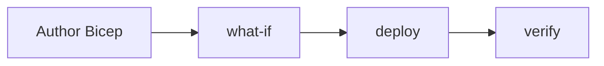
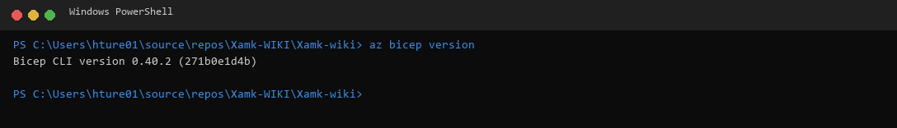
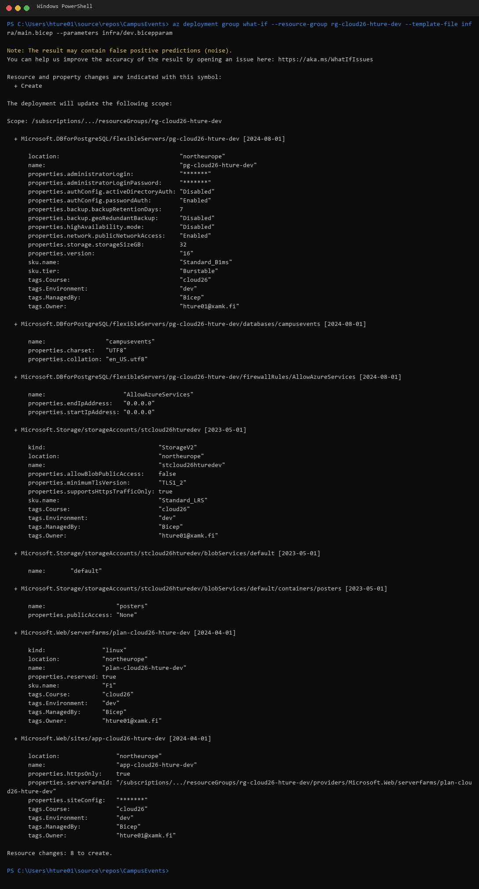
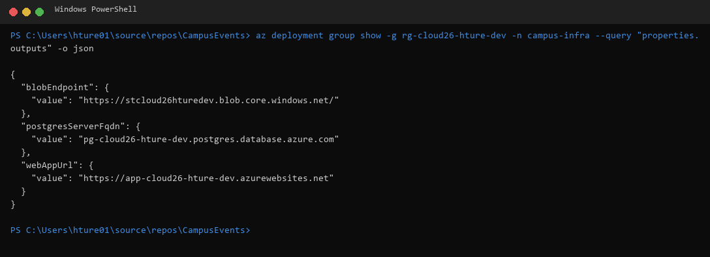
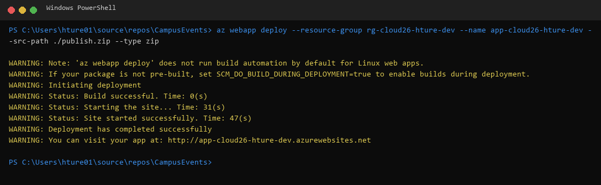
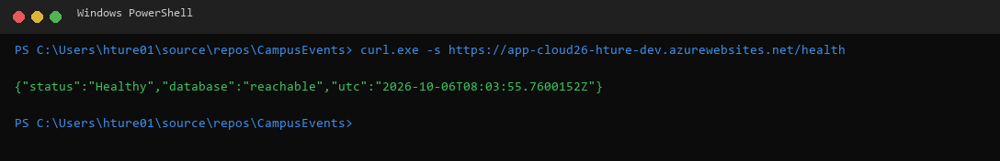
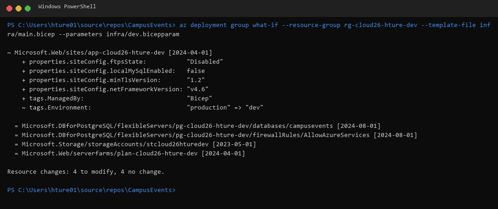
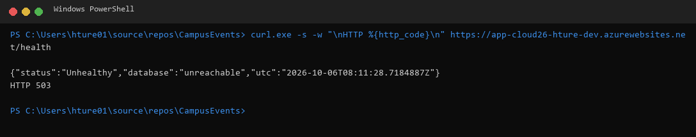
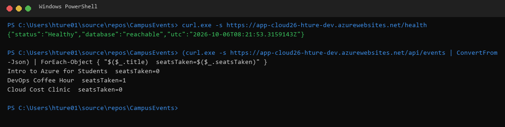
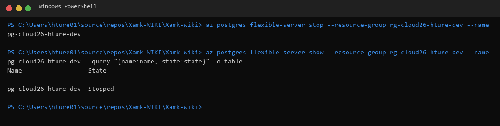

# Assignment 4: Infrastructure as Code — the environment rises from a file

Welcome to the fourth assignment! So far you have built your Azure environment **imperatively**: CLI commands in order, with hand-written `if exists` checks to make scripts rerunnable. In this assignment you switch to **declarative Infrastructure as Code**: you describe the *desired end state* in **Bicep**, and Azure Resource Manager figures out what to create, change, or leave alone. At the end you will prove it works the hard way — by **deleting your database and resurrecting the whole environment with one command**.

The exercise proceeds **step by step**: theory, tooling, then building `main.bicep` piece by piece, and finally the drift and resurrection experiments. Type the code **yourself** — every block is explained: what it does and why.

> **Note:** This assignment builds on [Assignment 3](../03-Database-and-State/README.md): the same resource group, App Service and PostgreSQL — but from now on they are *described in code*, not created by commands. If you deleted your database at the end of Assignment 3: perfect, this assignment recreates it.

> **Cost note:** Bicep deployments themselves are free — you pay only for the resources they create, and this template creates exactly what you already had: F1 plan (free) + B1ms PostgreSQL (≈ €0.02/h + ≈ €4/mo storage) + the poster storage account (pennies). The database lifecycle rules from Assignment 3 still apply: stop or delete when not working. After this assignment, "delete" finally becomes the easy choice — recreation is one command.

Each section below starts collapsed. Open the one you are working on.

<details>
<summary>Additional material</summary>

**Theory materials:**
- [Infrastructure as Code](https://github.com/xamk-mire/Xamk-wiki/blob/main/Cloud%20technologies/Azure/Infrastructure-as-Code.md) - IaC concepts, Bicep examples (incl. App Service and PostgreSQL), what-if — **read this first**
- [Bicep - Azure's IaC language](https://github.com/xamk-mire/Xamk-wiki/blob/main/Cloud%20technologies/Azure/Bicep.md) - Syntax reference: parameters, variables, modules, decorators
- [Azure Database for PostgreSQL](https://github.com/xamk-mire/Xamk-wiki/blob/main/Cloud%20technologies/Azure/Azure-Database-PostgreSQL.md) - The service you are now describing in code
- [Azure Blob Storage](https://github.com/xamk-mire/Xamk-wiki/blob/main/Cloud%20technologies/Azure/Blob-Storage.md) - Posters survive the resurrection test because they live in a separate backing service

**External links:**
- [Bicep documentation](https://learn.microsoft.com/en-us/azure/azure-resource-manager/bicep/)
- [ARM template reference (all resource types)](https://learn.microsoft.com/en-us/azure/templates/)
- [What-if deployment](https://learn.microsoft.com/en-us/azure/azure-resource-manager/bicep/deploy-what-if)
- [Bicep VS Code extension](https://marketplace.visualstudio.com/items?itemName=ms-azuretools.vscode-bicep)
</details>

<details>
<summary>What do you need?</summary>

- The **Assignment 1–3 environment**: resource group with budget alert; App Service and PostgreSQL may exist or be deleted — both are fine
- **Azure CLI**, signed in (`az account show`)
- **VS Code** with the **Bicep extension** (installed in section B)
- Your Campus Events code from Assignment 3 (the PostgreSQL version)

Example pictures in this lab are real CLI output where they exist. Portal steps (deployments, drift tags, Cost analysis) have no example image — screenshot **your** blade for the return.
</details>

<details>
<summary>What are we building?</summary>

```
Before (Assignments 1–3):                  After (this assignment):

  provision.ps1        provision-db.ps1      infra/
  "run these commands   "check if exists,      ├── main.bicep          ← the desired state
   in this order"        then create"          ├── dev.bicepparam      ← environment values
        │                    │                 └── modules/
        ▼                    ▼                     └── postgres.bicep
  ┌─────────────────────────────┐                       │
  │ Azure (state = whatever      │                      ▼  az deployment group create
  │ the scripts happened to do)  │           ┌─────────────────────────────┐
  └─────────────────────────────┘            │ Azure (state = the file,    │
                                             │ verified with what-if)      │
                                             └─────────────────────────────┘
```

> **If a diagram shows as code** (`flowchart …` instead of boxes): the VS Code / Cursor Markdown preview does not draw Mermaid. Open the file on GitHub, or install the **Markdown Preview Mermaid Support** extension and reopen the preview.



**Target state at the end of the assignment:**

1. `infra/main.bicep` describes the whole environment: plan, web app (with connection strings), PostgreSQL server + database + firewall, storage account + posters container
2. You previewed every deployment with **what-if** before running it
3. You caused **configuration drift** by hand and watched Bicep detect and repair it
4. You **deleted the database server and brought it back with one command** — and can explain what came back and what did not
5. The infra code lives in the same git repository as the app — ready for a pipeline later on this course
</details>

<details>
<summary>Guided sections A–G — do these in order (Steps 1–21)</summary>

<details>
<summary>Guided section A — The provisioning ladder</summary>

<details>
<summary>Why this step?</summary>

You have already climbed two rungs of a ladder without naming it. Name it now, because the third rung only makes sense in contrast to the first two.

| Rung | How | Idempotent? | Where you did it |
|------|-----|-------------|------------------|
| 1. **Portal clicking** | Click through wizards | No — nobody remembers the clicks | Assignment 1, first contact |
| 2. **Imperative script** | CLI commands + hand-written `if exists` checks | Only if *you* write the checks — you did, and it was work | `provision.ps1`, `provision-db.ps1` |
| 3. **Declarative IaC** | Describe the end state; the platform computes the diff | **Built in** — this is the whole point | This assignment |

Look at your `provision-db.ps1` from Assignment 3: roughly half of it is *checking whether things already exist*. That is you manually implementing what a declarative tool gives you for free. Bicep does not say "create a server" — it says "**a server like this exists**", and Azure Resource Manager (ARM) compares that claim to reality:

```
main.bicep ──(compile)──► ARM JSON ──► Azure Resource Manager
                                            │
                                            ├── resource missing?      → create it
                                            ├── resource differs?      → change it
                                            └── resource matches?      → do nothing
```

Run it once, run it ten times — same end state. And because the desired state is a *file*, it is versioned in git, reviewed in pull requests, and deployed by pipelines. You will put that last part into practice later on this course.

> **Reminder — imperative scripts are not "wrong":** the CLI is still right for one-off operations (stopping a database, tailing logs, querying state). IaC owns the *shape* of the environment; the CLI operates *within* it. You will keep using both.
</details>
</details>

<details>
<summary>Guided section B — Tooling</summary>

<details>
<summary>Why this step?</summary>

Bicep needs two things: the compiler (ships inside Azure CLI) and editor support (which makes learning it dramatically easier).
</details>

<details>
<summary>Step 1: Bicep CLI</summary>

```powershell
az bicep install
az bicep version
```

If it was already installed, `az bicep upgrade` gets the latest. The version does not matter much — anything recent is fine.

PowerShell often prints `WARNING: A new Bicep release is available` in red, wrapped in `NativeCommandError`. That is PowerShell treating the CLI's stderr as an error. The version line under it is the result. Upgrade if you want the warning gone; the lab works either way.



*Your names and IDs will differ. Match the field names, not the pixels.*
</details>

<details>
<summary>Step 2: VS Code extension</summary>

Install **Bicep** (publisher: Microsoft) from the VS Code extensions panel. You get IntelliSense for every resource type and property, inline validation, and hover documentation. Writing Bicep without this extension is unnecessarily hard — with it, the editor teaches you the resource schemas as you type. Screenshot your Extensions panel if you want a reminder — there is no example picture here.
</details>

<details>
<summary>Step 3: Folder layout</summary>

In your Campus Events repository, create the infra folder next to the app code:

```
<your-repo>/
├── StarterCode/
│   └── CampusEvents/      # the app (from Assignments 1 and 3)
├── provision.ps1          # Assignment 1 exercise 1
└── infra/
    ├── main.bicep         # created in section C
    ├── dev.bicepparam     # created in section C
    └── modules/
        └── postgres.bicep # created in section D
```

Every `az deployment` command in this assignment is written for the **repository root** — that is where `infra/main.bicep` resolves. Only Step 12 (the app zip) runs inside the project folder.

**Why the same repository?** Infra and app change together (a new feature might need a new app setting). One repo means one pull request covers both, and one pipeline can deploy both — something you will do later on this course.
</details>
</details>

<details>
<summary>Guided section C — First template: plan and web app</summary>

<details>
<summary>Why this step?</summary>

We start with the resources you know best and get the full loop working — author, what-if, deploy, verify — before adding the database.
</details>

<details>
<summary>Step 4: main.bicep — parameters and naming</summary>

Create `infra/main.bicep` and start with the inputs and naming:

```bicep
@description('Your name in lowercase, no special characters — used in resource names')
param yourName string

@description('Owner tag value (school email)')
param ownerEmail string

@description('Environment name — part of every resource name')
param environment string = 'dev'

param location string = resourceGroup().location

@allowed(['F1', 'B1'])
@description('App Service Plan SKU. F1 = free, B1 = paid (scale-out capable)')
param appServiceSku string = 'F1'

// --- Naming convention (course standard) and shared tags ---

var planName   = 'plan-cloud26-${yourName}-${environment}'
var appName    = 'app-cloud26-${yourName}-${environment}'

var tags = {
  Environment: environment
  Course: 'cloud26'
  Owner: ownerEmail
  ManagedBy: 'Bicep'
}
```

**What is going on here?**

| Construct | Meaning |
|-----------|---------|
| `param` | An input — differs per environment or per student |
| `@description`, `@allowed` | Decorators: documentation and validation *in* the code |
| `var` | Computed values — the naming convention lives in one place, derived from params |
| `resourceGroup().location` | A sensible default: resources go where the resource group is |
| `ManagedBy: 'Bicep'` tag | Anyone looking at the resource in the Portal knows not to edit it by hand |

Note what is *not* here: no resource group. The template targets an **existing** resource group (`targetScope` defaults to `resourceGroup`) — your RG with its budget alert stays as it is, and this template describes its *contents*.

> **Did Assignment 1 force a number onto your app name** (`app-cloud26-matti-dev-42`, because the plain name was taken)? Then `appName` must produce that exact name, or the template will try to create a *second* app under a name that is already in use. Put the same suffix in the variable: `var appName = 'app-cloud26-${yourName}-${environment}-42'`. The names must match for Bicep to adopt what already exists.
</details>

<details>
<summary>Step 5: The plan and the web app</summary>

Append to `main.bicep`:

```bicep
// --- App Service Plan ---

resource appServicePlan 'Microsoft.Web/serverfarms@2024-04-01' = {
  name: planName
  location: location
  sku: {
    name: appServiceSku
  }
  kind: 'linux'
  properties: {
    reserved: true // required flag for Linux plans
  }
  tags: tags
}

// --- Web App ---

resource webApp 'Microsoft.Web/sites@2024-04-01' = {
  name: appName
  location: location
  tags: tags
  properties: {
    serverFarmId: appServicePlan.id
    httpsOnly: true
    siteConfig: {
      linuxFxVersion: 'DOTNETCORE|10.0'
      alwaysOn: appServiceSku != 'F1' // F1 does not support Always On — deployment fails if set
      minTlsVersion: '1.2'
      ftpsState: 'Disabled'
    }
  }
}

output webAppUrl string = 'https://${webApp.properties.defaultHostName}'
```

**Things worth noticing while typing:**

| Detail | Why it is there |
|--------|-----------------|
| `serverFarmId: appServicePlan.id` | A reference to the other resource's symbolic name — Bicep infers the deployment order from this (plan first, then app) |
| `alwaysOn: appServiceSku != 'F1'` | Conditional expression: the template adapts to the SKU. Hard-coding `true` breaks F1 deployments — remember this in the AI section |
| `linuxFxVersion: 'DOTNETCORE\|10.0'` | The same runtime `az webapp up` set for you in Assignment 1 — now it is explicit and versioned |
| `output` | Deployment prints the URL — scripts and pipelines read outputs instead of re-querying |
</details>

<details>
<summary>Step 6: Parameter file</summary>

Create `infra/dev.bicepparam`:

```bicep
using 'main.bicep'

param yourName = '<your-name>'
param ownerEmail = '<your-email>'
param environment = 'dev'
```

One template, many parameter files — that is how the same `main.bicep` later produces a `test` environment (independent exercise 1) without copying any code. The database password is **not** added here. It shows up in Step 11, as an environment-variable read, after the parameter exists in `main.bicep`.

Set these in the **same PowerShell session** you will use for the rest of the assignment (replace the placeholders once):

```powershell
$YourName      = "<your-name>"                       # same as Assignment 1
$ResourceGroup = "rg-cloud26-$YourName-dev"
$AppName       = "app-cloud26-$YourName-dev"         # include your Assignment 1 suffix if you had one
$PgServer      = "pg-cloud26-$YourName-dev"
$BaseUrl       = "https://app-cloud26-aapo-dev.azurewebsites.net"
```
</details>

<details>
<summary>Step 7: What-if — always look before you leap</summary>

```powershell
az deployment group what-if `
  --resource-group $ResourceGroup `
  --template-file infra/main.bicep `
  --parameters infra/dev.bicepparam
```

**What does the command do?** Compiles the Bicep, sends it to ARM, and asks: *"if I deployed this, what would change?"* — without changing anything. Read the output carefully:

- Lines with `+` would be **created** (if you deleted resources after Assignment 3)
- Lines with `~` would be **modified** — likely here, because your CLI-created web app differs in small ways from the template (e.g. `httpsOnly`, `ftpsState`)
- Lines with `=` are already **as described**

There is no "correct" output at this point — what matters is that **you can explain every line**. If a `~` surprises you, that *is* the lesson: the file and reality disagree, and now you can see exactly where.

> **Reminder — what-if before every deployment, forever:** this is the IaC equivalent of "check the price before creating". Later on this course, what-if can run automatically in a pipeline and a human still reads it before approving production changes.


*Your names differ. This picture is a first deploy of the full template onto an empty group, so every resource is `+`. At Step 7 you only have the plan and the web app, so your list is shorter. `*******` is a secure value, not a missing field.*
</details>

<details>
<summary>Step 8: Deploy</summary>

```powershell
az deployment group create `
  --resource-group $ResourceGroup `
  --template-file infra/main.bicep `
  --parameters infra/dev.bicepparam
```

**What does the command do?** Executes the plan you just previewed. The deployment is **incremental** (the default mode): resources in the template are created/updated, and resources *not* in the template are **left alone** — your budget alert and (if it still exists) your PostgreSQL server are untouched.

Verify: run the what-if from Step 7 again. The plan should be `=` (no change). The web app may still show a `~` for `ftpsState`, `minTlsVersion`, `localMySqlEnabled`, or `netFrameworkVersion` even though the deploy already set them. That is a known what-if false positive on App Service `siteConfig`. Check `az webapp show` (Linux, `httpsOnly`, `ftpsState`, `linuxFxVersion`) instead of editing the template to chase those lines. Screenshot **your** deploy output and the resource group's **Deployments** list — those go in the return.
</details>
</details>

<details>
<summary>Guided section D — The database as a module</summary>

<details>
<summary>Why this step?</summary>

The PostgreSQL definition is a coherent unit (server + database + firewall), so it goes in a **module** — Bicep's mechanism for grouping and reusing resources. This also mirrors how real teams share infra: someone maintains the database module, everyone consumes it.
</details>

<details>
<summary>Step 9: modules/postgres.bicep</summary>

Create `infra/modules/postgres.bicep`:

```bicep
param location string
param serverName string
param databaseName string
param administratorLogin string

@secure()
@description('Admin password — supplied at deploy time, never stored in a file')
param administratorLoginPassword string

param tags object = {}

// --- PostgreSQL Flexible Server (Burstable B1ms — course standard) ---

resource postgresServer 'Microsoft.DBforPostgreSQL/flexibleServers@2024-08-01' = {
  name: serverName
  location: location
  sku: {
    name: 'Standard_B1ms'
    tier: 'Burstable'
  }
  properties: {
    version: '16'
    administratorLogin: administratorLogin
    administratorLoginPassword: administratorLoginPassword
    authConfig: {
      passwordAuth: 'Enabled'
      activeDirectoryAuth: 'Disabled'
    }
    network: {
      publicNetworkAccess: 'Enabled' // App Service is not in a VNet; the firewall rule needs this
    }
    storage: {
      storageSizeGB: 32
    }
    backup: {
      backupRetentionDays: 7
      geoRedundantBackup: 'Disabled'
    }
    highAvailability: {
      mode: 'Disabled' // HA doubles the price — not for course projects
    }
  }
  tags: tags
}

// --- The application database ---

resource database 'Microsoft.DBforPostgreSQL/flexibleServers/databases@2024-08-01' = {
  parent: postgresServer
  name: databaseName
  properties: {
    charset: 'UTF8'
    collation: 'en_US.utf8'
  }
}

// --- Firewall: allow Azure services (the special 0.0.0.0 rule) ---

resource allowAzureServices 'Microsoft.DBforPostgreSQL/flexibleServers/firewallRules@2024-08-01' = {
  parent: postgresServer
  name: 'AllowAzureServices'
  properties: {
    startIpAddress: '0.0.0.0'
    endIpAddress: '0.0.0.0'
  }
}

output serverFqdn string = postgresServer.properties.fullyQualifiedDomainName
```

**Things worth noticing:**

| Detail | Why it is there |
|--------|-----------------|
| `@secure()` on the password | The value is never written to deployment logs or history — and Bicep refuses to put it in an `output` |
| `publicNetworkAccess: 'Enabled'` | Your App Service is not inside a virtual network. The `0.0.0.0` firewall rule does nothing if public access is off. Writing the property down also stops what-if from predicting that the next deploy will delete it |
| `passwordAuth: 'Enabled'` | The connection string is a password. The file should say that, instead of hoping the platform default stays |
| `charset` and `collation` | Azure's own defaults (`UTF8`, `en_US.utf8`). Without them, what-if claims the next deploy will delete the database properties. It will not — but the noise looks like a wiped database |
| `parent: postgresServer` | Child resources (database, firewall rule) belong to the server — same structure as the CLI commands in Assignment 3, but declarative |
| No `MyDevMachine` firewall rule | Your laptop's IP changes; a hard-coded IP in versioned code goes stale and misleads. Keep that one as a CLI operation (`az postgres flexible-server firewall-rule create`) — CLI operates, IaC owns the shape |
| `output serverFqdn` | `main.bicep` needs the hostname to build the connection string |
</details>

<details>
<summary>Step 10: Wire the module into main.bicep</summary>

In `main.bicep`, add the database parameters and names near the top (after the existing `param`/`var` block):

```bicep
@secure()
@description('PostgreSQL admin password — read from POSTGRES_ADMIN_PASSWORD, never stored in a file')
param postgresAdminPassword string

var postgresServerName  = 'pg-cloud26-${yourName}-${environment}'
var databaseName        = 'campusevents'
var postgresAdminLogin  = 'campusadmin'
var storageAccountName  = 'stcloud26${replace(yourName, '-', '')}${environment}' // letters + digits only, no hyphens, 3–24 characters total
```

This is the same formula Assignment 3 used for `$StorageName`, so with the same `yourName` the template **adopts** your existing account — the one with your posters in it. A different name would make what-if plan a second, empty account. The name has to be **3–24 characters**: `stcloud26` is 9 and `test` (exercise 1) is 4, so `yourName` of at most **11 characters** fits both environments. A normal first name does. If yours is longer, trim it in this one variable only — the plan, app, and database can stay readable.

Then add the module call and the connection string. The module goes **before** the web app resource, and the web app gets its `appSettings`:

```bicep
// --- PostgreSQL (module) ---

module postgres 'modules/postgres.bicep' = {
  name: 'postgresDeployment'
  params: {
    location: location
    serverName: postgresServerName
    databaseName: databaseName
    administratorLogin: postgresAdminLogin
    administratorLoginPassword: postgresAdminPassword
    tags: tags
  }
}
```

The environment has a second backing service since Assignment 3 section G: the poster storage account. It goes into the template too — as plain resources this time (it is small enough not to need a module; extracting it into one is independent exercise 2):

```bicep
// --- Storage account + posters container (Assignment 3, section G) ---

resource storageAccount 'Microsoft.Storage/storageAccounts@2023-05-01' = {
  name: storageAccountName
  location: location
  sku: {
    name: 'Standard_LRS'
  }
  kind: 'StorageV2'
  tags: tags
  properties: {
    allowBlobPublicAccess: false
    minimumTlsVersion: 'TLS1_2'
    supportsHttpsTrafficOnly: true
  }
}

resource blobService 'Microsoft.Storage/storageAccounts/blobServices@2023-05-01' = {
  parent: storageAccount
  name: 'default'
}

resource postersContainer 'Microsoft.Storage/storageAccounts/blobServices/containers@2023-05-01' = {
  parent: blobService
  name: 'posters'
  properties: {
    publicAccess: 'None'
  }
}
```

and inside the web app's `siteConfig`, add **both** connection strings:

```bicep
      appSettings: [
        {
          name: 'ConnectionStrings__DefaultConnection'
          value: 'Host=${postgres.outputs.serverFqdn};Database=${databaseName};Username=${postgresAdminLogin};Password=${postgresAdminPassword};Ssl Mode=Require'
        }
        {
          name: 'ConnectionStrings__Storage'
          value: 'DefaultEndpointsProtocol=https;AccountName=${storageAccount.name};AccountKey=${storageAccount.listKeys().keys[0].value};EndpointSuffix=${az.environment().suffixes.storage}'
        }
      ]
```

Finally add outputs at the end:

```bicep
output postgresServerFqdn string = postgres.outputs.serverFqdn
output blobEndpoint string = storageAccount.properties.primaryEndpoints.blob
```

**The important lines are the connection strings.** In Assignment 3 you built them by hand and set them with `az webapp config appsettings set`. Now they are *derived*: the server's real hostname comes from the module output, the storage key from `listKeys()` at deploy time — and if a name ever changes, the connection strings follow automatically. Configuration that cannot drift out of sync, because it is computed from the source.

> **Why *both* strings must be in the template:** the `appSettings` array is deployed as a **complete list** — whatever it contains *replaces* the app's settings. If you listed only the database string, the next deployment would silently wipe `ConnectionStrings__Storage` and the poster endpoints would vanish. Incremental mode ignores resources *outside* the template, but *inside* a resource the template's word is law. This is the number one way people shoot themselves in the foot when adopting IaC over a hand-built environment: the template must describe **everything** you set by hand, or the deployment un-sets it.

> **Reminder — the secrets ladder, revisited:** the password still ends up in an App Service Application Setting, same rung as Assignment 3 — Bicep did not change *where* the secret lives, only *how* it gets there (and `@secure()` keeps it out of logs). The rung above — Key Vault + Managed Identity, where no password exists at all — comes later in the course.
</details>

<details>
<summary>Step 11: What-if, then deploy</summary>

`main.bicep` now has one more parameter than your parameter file, so **first** add this line to `infra/dev.bicepparam` (the parameter, no literal value):

```bicep
param postgresAdminPassword = readEnvironmentVariable('POSTGRES_ADMIN_PASSWORD')
```

Then set the variable and preview:

```powershell
$env:POSTGRES_ADMIN_PASSWORD = Read-Host "PostgreSQL admin password"

az deployment group what-if `
  --resource-group $ResourceGroup `
  --template-file infra/main.bicep `
  --parameters infra/dev.bicepparam
```

Do these two in that order. Current Bicep **does not prompt** for a parameter that is missing from a `.bicepparam` file: it stops with `BCP258` before Azure sees the template. `readEnvironmentVariable` keeps the password out of git. `@secure()` still keeps it out of the deployment history — the history stores the type `SecureString`, not the value. Set the environment variable in the **same** terminal session you deploy from. Use the same password as in Assignment 3 if your server still exists, so the connection string stays valid. A new terminal means you set the variable again; nothing was written to disk.

Read the output. There is no single "correct" diff, but every line should fall into one of these:

- **Real create (`+`)** — the resource is missing. A deleted server, database, and `AllowAzureServices` rule show up here. So does a brand-new storage account.
- **Real modify (`~`)** — tags and settings you actually want changed. Adopting Assignment 3 resources usually adds `ManagedBy: Bicep`. The plan and web app from Assignment 1 were tagged `Course=Cloud26` and `Application=cloud26`. This template's `tags` object **replaces the whole set**, so what-if also shows `Course: Cloud26 => cloud26` and `Application` disappearing. That is expected.
- **Extra firewall rule (`+`)** — Assignment 3's `--public-access 0.0.0.0` created a rule with a timestamp in the name (`AllowAllAzureServicesAndResourcesWithinAzureIps_...`). This template uses the stable name `AllowAzureServices`. You get a second `0.0.0.0` rule. Leave the old one; incremental mode will not delete it, and two Azure-services rules are harmless.
- **Noise (`-` or a `+` on a property you already set)** — what-if's own warning says the result may contain false positives. After a successful deploy, a second what-if still lists deletes of platform defaults you never wrote: `dataEncryption`, `replica`, `storage.iops`, `storage.tier`, `storage.type`, blob `deleteRetentionPolicy`, container `defaultEncryptionScope`, and on the web app `ftpsState` / `minTlsVersion` / `localMySqlEnabled` / `netFrameworkVersion`. A repeat deploy does **not** turn public access off and does **not** drop the database. Do not add those properties just to silence the diff. Confirm with `az postgres flexible-server show` and `az webapp show`.



*Your names differ. `+` means "will be created". Passwords and the whole `siteConfig` show as `*******` because the connection string is a secure parameter. The same picture is introduced at Step 7.*


*A `-` under a resource that already matches the file is a false positive. The server stays public and the database stays put. The lines you act on are tags, SKUs, names, and `appSettings`.*

Then deploy:

```powershell
az deployment group create `
  --resource-group $ResourceGroup `
  --template-file infra/main.bicep `
  --parameters infra/dev.bicepparam
```

If the server is being created, this takes 5–10 minutes — same as the CLI creation in Assignment 3, it is the same operation underneath. The password comes from `$env:POSTGRES_ADMIN_PASSWORD` again; there is no second prompt unless the variable is empty. Screenshot **your** what-if and the Succeeded deploy (outputs visible, no password).



*Match the output names. The host names are yours.*
</details>

<details>
<summary>Step 12: Deploy the app code and verify</summary>

Bicep created the *infrastructure* — the web app is an empty shell until code lands in it. Deploy the Assignment 3 app. These commands run **inside the project folder** (`cd StarterCode/CampusEvents`); return to the repository root afterwards, because the next `az deployment` needs the `infra/` paths again.

**Not `az webapp up` this time.** That command from Assignments 1 and 3 creates or reconfigures the plan and the app as a side effect — it would fight the template you just deployed. From now on, Bicep owns the infrastructure and the app deploy only ships code:

```powershell
dotnet publish -c Release -o ./publish
if (Test-Path ./publish.zip) { Remove-Item ./publish.zip -Force }
tar -a -c -f ./publish.zip -C ./publish .

az webapp deploy `
  --resource-group $ResourceGroup `
  --name $AppName `
  --src-path ./publish.zip `
  --type zip
```

**Do not use `Compress-Archive` for this zip.** It stores paths with backslashes. Linux Kudu then fails the deploy with `rsync ... Invalid argument (22)` on names like `runtimes\win\lib\...`. `tar -a` writes a zip with forward slashes. Windows 10 and 11 include `tar`.

The CLI also prints: *`az webapp deploy` does not run build automation... set `SCM_DO_BUILD_DURING_DEPLOYMENT=true`*. Ignore that hint. You already ran `dotnet publish`. Setting the flag makes Kudu try to compile the published folder, and the deploy fails. PowerShell may paint the warning red (`NativeCommandError`). Success is `Site started successfully` and `Deployment has completed successfully`.



*Look for `Deployment has completed successfully`. The red warning above it is the CLI talking about build automation, which you do not want for a published folder.*

Verify:

```powershell
curl.exe -s "$BaseUrl/health"
curl.exe -s "$BaseUrl/api/events"
```

Expected: `Healthy` + `database: reachable`, three seeded events.



*The body is JSON from your app. `database: reachable` means the connection string, the firewall rule, and a running server all agree.*

> **Reminder — infra deploy vs. app deploy:** these are two different lifecycles. Infrastructure changes rarely (Bicep); code changes constantly (zip deploy today, a pipeline later on this course). Later you can automate both — infra job first, app job after.

Screenshot **your** zip deploy plus `/health` — that is the return for this step.
</details>
</details>

<details>
<summary>Guided section E — Drift: cause it, detect it, repair it</summary>

<details>
<summary>Why this step?</summary>

**Configuration drift** — reality diverging from the code — is the disease IaC exists to cure. The only way to trust the cure is to see it work: you will damage your environment by hand and let the template repair it.
</details>

<details>
<summary>Step 13: Cause drift</summary>

Change something by hand, like a well-meaning colleague at a Portal on a Friday afternoon. In the Portal: your web app → **Tags** → change `Environment` from `dev` to `production` and remove the `ManagedBy` tag. (Or via CLI — either way, the point is the change happens *outside* the code.) Screenshot **your** tag change.
</details>

<details>
<summary>Step 14: Detect it</summary>

```powershell
az deployment group what-if `
  --resource-group $ResourceGroup `
  --template-file infra/main.bicep `
  --parameters infra/dev.bicepparam
```

Expected: a `~` on the web app showing `tags.Environment: "production" => "dev"` and `ManagedBy` being added back. The same noisy `-` lines from Step 11 may still be in the output — skip those and find the tag lines. The file noticed. Nobody had to remember what was changed — the diff *is* the memory. Screenshot this what-if — it is the drift return.



*The `siteConfig` lines above the tags are the false positive from Step 8. The two tag lines are the drift.*
</details>

<details>
<summary>Step 15: Repair it</summary>

Run the deployment (Step 11's `create` command). Check the tags in the Portal: back to the declared state. Drift caused, detected, repaired — in three commands.

> **Reminder — what drift detection does NOT catch:** incremental deployments ignore resources that exist in Azure but are absent from the template (someone's forgotten VM keeps running — and billing). What-if compares only what the template *claims*. Catching truly orphaned resources takes other tools: tag discipline (`ManagedBy`), cost analysis by tag, or deployment stacks. Keep that limitation in mind when someone says "we have IaC, so the environment is under control".
</details>
</details>

<details>
<summary>Guided section F — The resurrection test</summary>

<details>
<summary>Why this step?</summary>

The strongest promise of IaC: *the environment is disposable, because it can be recreated on demand*. Assignment 3 told you "delete the database during long breaks, recreate it from a script". Prove that promise for real — deliberately, when the stakes are zero, rather than hoping it works during a disaster.
</details>

<details>
<summary>Step 16: Delete the database server</summary>

```powershell
az postgres flexible-server delete `
  --resource-group $ResourceGroup `
  --name $PgServer `
  --yes
```

Gone — server, database, registrations, everything. Confirm the app noticed:

```powershell
curl.exe -s "$BaseUrl/health"
```

Expected: **503**, with a JSON body `database: unreachable`. That is your Assignment 3 health endpoint telling the truth, and it usually answers in a few seconds.

You may instead get an HTML "Application Error" page. That means App Service happened to restart the process while the database was gone, and `EnsureCreated()` fails before any endpoint exists. It is the same lesson, just less readable. Screenshot whichever you get and continue to Step 17 — the database comes back there, and `/health` answers again. Do not spend time trying to force the JSON 503.

Screenshot this — it is half of the resurrection return.



*HTTP 503 and `database: unreachable`. This is the app, not the Azure error page.*
</details>

<details>
<summary>Step 17: Resurrect with one command</summary>

```powershell
az deployment group create `
  --resource-group $ResourceGroup `
  --template-file infra/main.bicep `
  --parameters infra/dev.bicepparam
```

`$env:POSTGRES_ADMIN_PASSWORD` must still be set in this terminal (Step 11). A new window does not remember it — `Read-Host` into that variable again. There is no CLI password prompt. Wait 5–10 minutes.

The new server has the **same host name and the same password**, so the connection string does not change. App Service often skips the restart in that case. `EnsureCreated()` runs only when the process starts. Until you restart, `/health` can already say `reachable` (the server answers) while `/api/events` returns **500** (the tables do not exist yet).

```powershell
az webapp restart `
  --resource-group $ResourceGroup `
  --name $AppName
```

Give the free plan half a minute to come back, then:

```powershell
curl.exe -s "$BaseUrl/health"
curl.exe -s "$BaseUrl/api/events"
```

Expected: `Healthy`, and three events — the app's `EnsureCreated` + seeder repopulated the fresh database on first use. Note that you did **not** redeploy the app code: the web app was never deleted, only its dependency was. The environment healed around it. A registration you created by hand before the delete is gone; `seatsTaken` is back to whatever the seeder writes. Screenshot Healthy + events next to the 503.



*This app's seeder leaves one registration on DevOps Coffee Hour (`seatsTaken` 1) and zero on the others. Your seeder may leave all three at 0. The point is the same: rows you inserted yourself do not come back.*
</details>

<details>
<summary>Step 18: Name what came back — and what did not</summary>

| | Came back? | Why |
|---|---|---|
| PostgreSQL server, database, firewall rule | ✅ | Described in Bicep |
| Connection strings in App Service | ✅ | Derived in Bicep from the new server and the storage account |
| Seeded events | ✅ | The *app* seeds an empty database — code, not infra |
| Registrations you created by hand | ❌ **Gone** | **Data is not infrastructure.** IaC recreates the *container*, not the *contents* |
| Poster images in Blob Storage | ✅ Untouched | The storage account was never deleted — state in an independent backing service survives its neighbour's disaster. (Had you deleted it, the blobs would be as gone as the registrations) |

That last row is a critical distinction: **IaC ≠ backup**. Real systems pair IaC (for the infrastructure) with database backups and restore procedures (for the data). Flexible Server's automatic backups would have covered this — but only while the server existed; deleting the server deletes its backups too. Write this distinction down; it is a theory question and a favourite exam topic.
</details>

<details>
<summary>Step 19: Stop the meter</summary>

Same discipline as Assignment 3 — the database now bills. Choose: **stop** (short break, remember the 7-day auto-restart) or **delete** (longer break — and after today, deleting costs you nothing but the 10-minute resurrection):

```powershell
az postgres flexible-server stop `
  --resource-group $ResourceGroup `
  --name $PgServer
```

To delete instead, use the Step 16 command — and note that you now have the receipt that getting it back is one deployment.



*Your names and IDs will differ. Match the field names, not the pixels. Screenshot **your** Cost analysis in the Portal — there is no example picture.*
</details>
</details>

<details>
<summary>Guided section G — AI as a Bicep generator, you as the reviewer</summary>

<details>
<summary>Why this step?</summary>

AI is genuinely good at producing Bicep — the syntax is regular and the training data is plentiful. It is also confidently wrong in specific, predictable ways. Later on this course you may put AI review into a pipeline — learn its failure modes on infrastructure code now.
</details>

<details>
<summary>Step 20: Generate and review</summary>

Ask your AI tool:

```
Write a Bicep template for Azure: a Linux App Service Plan (F1),
a .NET 10 web app, and an Azure Database for PostgreSQL Flexible Server
(Burstable B1ms, PostgreSQL 16, 32 GB) with a database named "campusevents"
and a firewall rule allowing Azure services. The web app needs the
connection string as an app setting. Include tags on every resource.
```

Now review the output against what you *know* from building the same thing yourself. Check specifically:

| Check | Typical AI failure |
|-------|--------------------|
| API versions (`@2024-...`) | Invented or years-old versions — verify against the [template reference](https://learn.microsoft.com/en-us/azure/templates/) or the VS Code extension's warnings |
| `alwaysOn` with F1 | AI loves `alwaysOn: true` — which **fails deployment** on F1 (you know this from Step 5) |
| The password | Hard-coded, or a plain `param` without `@secure()` |
| `reserved: true` on the plan | Forgotten → the plan silently comes up as Windows |
| Postgres SKU format | `tier` and `name` confused, or a SKU that does not exist for Flexible Server |
| Tags | Promised in the prompt, missing on half the resources |

Paste the AI's template into VS Code (Bicep extension on) and run:

```powershell
az bicep build --file <ai-template>.bicep
```

The compiler and linter are your ground truth — every warning it prints about the AI code goes in your submission notes. **Do not deploy the AI template**; the review is the exercise.
</details>

<details>
<summary>Step 21: The verdict habit</summary>

Write 3–5 sentences: what did the AI get right, what did it get wrong, and — most importantly — *which mistakes would what-if or the compiler have caught, and which would have silently deployed*? (A wrong SKU deploys fine and just costs more. That class of error is why humans review infra changes even with all the tooling green.)

Keep your Step 20 notes — theory question 13 in [questions.md](questions.md) asks you to write the prompt you wish you had given.

Exercise 3 asks for `infra/deploy.ps1`. **Example prompt:**

```
Write a PowerShell script named infra/deploy.ps1 for a student Azure lab.

Variables at the top:
- $ResourceGroup = "rg-cloud26-<your-name>-dev"
- $TemplateFile = "infra/main.bicep"
- $ParametersFile = "infra/dev.bicepparam"

The script must:
1. Fail clearly if az account show does not work.
2. Run az deployment group what-if with those files and print the output.
3. Ask Read-Host "Deploy? (y/n)" — exit if the answer is not y.
4. On yes, run az deployment group create with the same files.
5. Print the deployment outputs (web app URL, server FQDN).
6. Never hard-code or Write-Host the PostgreSQL password. If POSTGRES_ADMIN_PASSWORD is empty, ask with Read-Host and store it only in that environment variable. dev.bicepparam already reads it with readEnvironmentVariable. Do not expect the CLI to prompt.

Comment each block in English. I will review every mutating command before I run it.
```
</details>
</details>
</details>

<details>
<summary>Independent exercises 1–4 — after the guided sections</summary>

<details>
<summary>Exercise 1: A second environment from the same template</summary>

The template already takes `environment` as a parameter. Use it:

1. Create `infra/test.bicepparam`. Same `yourName` and `ownerEmail` as dev, `environment = 'test'`, and the same password line (otherwise you get `BCP258`):

```bicep
using 'main.bicep'

param yourName = '<your-name>'
param ownerEmail = '<your-email>'
param environment = 'test'
param postgresAdminPassword = readEnvironmentVariable('POSTGRES_ADMIN_PASSWORD')
```
2. What-if first: confirm it plans to **create** a parallel set (`plan-...-test`, `app-...-test`, `pg-...-test`, `stcloud26...test`) inside the same resource group. The dev resources show up as `*` **Ignore** — incremental mode will not touch them. That ignore list is the proof.
3. Deploy it, verify `/health` on the test app (deploy the app code zip to it too)
4. Write 2–3 sentences: what would this have cost with the Assignment 1 manual approach, in effort and in mistakes?
5. **Delete the test environment resources** when done (the test database bills!) — and note which tool you reached for to delete them
</details>

<details>
<summary>Exercise 2: Author a module from scratch</summary>

In Step 10 the storage account went into `main.bicep` as plain inline resources. Refactor it into a module, the way postgres already is — a pure restructuring that must change **nothing** in Azure:

1. Write `infra/modules/storage.bicep` yourself: move the account, blob service and `posters` container into it; take `location`, `storageAccountName` and `tags` as params; output the account name and the blob endpoint
2. Replace the inline resources in `main.bicep` with a `module storage 'modules/storage.bicep'` call
3. One thing breaks: the connection string used `storageAccount.listKeys()`, and that symbol no longer exists in `main.bicep` — module outputs must not carry secrets. Bridge it with an `existing` reference next to the module:

```bicep
resource storageAccountRef 'Microsoft.Storage/storageAccounts@2023-05-01' existing = {
  name: storageAccountName
}
```

   …use `storageAccountRef.listKeys()` in the connection string, and add `dependsOn: [storage]` to the web app (an `existing` reference creates no automatic ordering, so on a fresh environment the web app must be told to wait for the module — the first time in this course an *explicit* `dependsOn` is justified)
4. Prove it was pure refactoring: `az bicep build` is clean, and what-if does **not** plan a new storage account, a rename, or a tag/SKU change. The noisy `-` lines from Step 11 (storage defaults, blob retention, `siteConfig`) may still be there — they were there before the refactor. A restructure that ARM cannot see is exactly what "the file describes the desired state" means — *how* the file says it is irrelevant.

A model solution is in [Solution/](Solution/) — write yours first, then compare.
</details>

<details>
<summary>Exercise 3: A deploy wrapper with a safety habit</summary>

Write `infra/deploy.ps1` that encodes the discipline you practised manually:

1. Runs what-if and shows the output
2. Asks for confirmation (`Read-Host "Deploy? (y/n)"`)
3. On yes, runs the deployment and prints the outputs (web app URL, server FQDN)
4. Never writes the password into a file or prints it. If `POSTGRES_ADMIN_PASSWORD` is not set, the script asks with `Read-Host` and keeps the value only in that process. `dev.bicepparam` reads it with `readEnvironmentVariable`

A model solution is in [Solution/](Solution/) — write yours first, then compare.
</details>

<details>
<summary>Exercise 4: Theory questions</summary>

Read the questions in [questions.md](questions.md) and answer them **in your own words first**. **Do not submit the answers** — they are not part of the Learn return. They are training for the exam, and they are useful knowledge in the software industry. Similar questions will appear in the exam. You will be asked to explain the resurrection test (what came back and what did not). When you have tried, compare with [example-answers.md](example-answers.md). The lab text and the Additional material links are enough to answer every question.
</details>
</details>

<details>
<summary>Summary — what did we learn?</summary>

| Concept | What we learned |
|--------|--------------|
| **The provisioning ladder** | Portal → imperative script (hand-made idempotence) → declarative IaC (idempotence built in) |
| **Bicep** | Params, vars, resources, modules, outputs, `@secure()` — the environment as a reviewable file |
| **What-if** | Preview every change before it happens. Act on names, SKUs, tags, and `appSettings`. Ignore the known `-` noise from Step 11 |
| **Incremental deployments** | Template resources are enforced; resources outside the template are ignored — both a feature and a blind spot |
| **Drift** | Caused it in the Portal, detected it with what-if, repaired it with a deployment |
| **Resurrection** | Environment recreated with one command — infrastructure is disposable |
| **IaC ≠ backup** | The container comes back, the data does not; backups are a separate discipline |
| **Derived configuration** | Connection strings computed from module outputs and `listKeys()` — cannot drift out of sync |
| **Complete lists** | `appSettings` replaces the whole list on deploy — the template must describe every setting, or the deployment un-sets it |
| **AI on infra code** | Fluent Bicep, predictable failures (API versions, `alwaysOn` on F1, secrets) — compiler, linter and what-if are the ground truth |
</details>

<details>
<summary>Submission</summary>

**All returns go to the Learn platform.** Submit only the items below — relevant screenshots, your answers, and links to your working Azure app. Do not upload code or Bicep files; screenshots of code and terminal output are enough.

The screenshot and link list is also in [questions.md](questions.md) under **What to return**. Theory questions in that file are **not submitted** — exam training and industry knowledge (try first, then [example-answers.md](example-answers.md)).

- [ ] Screenshot: your `main.bicep` open in the editor — parameters and modules visible, **no passwords anywhere**
- [ ] Screenshot: what-if output from Step 7 or 11, with a 1–2 sentence explanation of every `+`/`~` line
- [ ] Screenshot: the drift experiment — what-if detecting your Portal change (Step 14)
- [ ] Screenshot: `/health` returning 503 after deletion, and `Healthy` + events after resurrection (Steps 16–17)
- [ ] **Link:** your resurrected app's URL on `azurewebsites.net`
- [ ] In your answers document: Step 18 — what came back, what did not, why
- [ ] In your answers document: AI review notes from Steps 20–21, including the compiler/linter findings
- [ ] Screenshots + answers: exercise 1 — test environment evidence, reflection, and confirmation of deletion
- [ ] Screenshot + answer: exercise 2 — what-if after the module refactor, showing **no new or renamed resource** (the Step 11 noise lines may still be there), and 1–2 sentences on why the `existing` reference + explicit `dependsOn` were needed
- [ ] Screenshot: exercise 3 — `deploy.ps1` run output (what-if preview + confirmation prompt visible)

**Checklist before submitting:**

- [ ] `git grep -i password infra/` finds no actual password values
- [ ] What-if on your final template shows no unexplained changes (the Step 11 noise lines do not count; a new name, SKU, or tag does)
- [ ] Test environment (Exercise 1) is deleted
- [ ] Database is stopped or deleted — and you know which
- [ ] Plan is F1, workers 1
</details>

<details>
<summary>Support and troubleshooting</summary>

If you need help:
1. The Bicep VS Code extension underlines most mistakes before you deploy — hover for the reason
2. `az bicep build --file infra/main.bicep` compiles and lints without deploying
3. Read what-if output line by line; paste confusing diffs to AI *with* the template
4. Ask classmates or the teacher

**Common problems:**

| Problem | Solution |
|---------|----------|
| `alwaysOn` deployment error on F1 | F1 does not support Always On — use the conditional from Step 5 (`appServiceSku != 'F1'`) |
| Plan deploys as Windows | `reserved: true` missing from the plan's `properties` |
| `LinuxFxVersion has an invalid value` | Exact format is `DOTNETCORE\|10.0` — pipe character, no spaces |
| What-if shows changes you did not make | The Step 11 list (postgres `dataEncryption` / `storage.iops` / `storage.tier`, blob retention, container encryption scope, web app `ftpsState` / `minTlsVersion` / `netFrameworkVersion`) is known noise. A second deploy does not apply those deletes. Investigate anything about SKUs, names, tags, or `appSettings` |
| `BCP258` mentioning `postgresAdminPassword` | Add `param postgresAdminPassword = readEnvironmentVariable('POSTGRES_ADMIN_PASSWORD')` to the `.bicepparam` file and set `$env:POSTGRES_ADMIN_PASSWORD` in the same terminal. Current Bicep will not prompt for a parameter missing from that file |
| PowerShell shows a red `NativeCommandError` around a WARNING | Azure CLI writes warnings to stderr. If the output below still has a version, a what-if table, `Succeeded`, or `Deployment has completed successfully`, the command worked |
| Zip deploy: `rsync` / `Invalid argument (22)` and a path with backslashes | The zip came from `Compress-Archive`. Delete it and recreate with `tar -a` as in Step 12 |
| CLI suggests `SCM_DO_BUILD_DURING_DEPLOYMENT=true` | Do not set it. The folder is already the output of `dotnet publish`. The flag makes Kudu compile that folder and the deploy fails |
| `Operation cannot be completed without additional quota` on the plan | Free tier allows 10 F1 plans per region per subscription, and 10 apps per plan. Normally you are far below that — but a shared course subscription may not be. Check with `az appservice plan list --query "[?sku.name=='F1']" -o table` and delete plans you no longer need |
| `InvalidTemplateDeployment` on the Postgres module | Check the SKU pair: `name: 'Standard_B1ms'` + `tier: 'Burstable'` — both required, exact spelling. Also `publicNetworkAccess: 'Enabled'` from Step 9 |
| App returns 503 after a normal deploy | Same triage as Assignment 3: connection string app setting, firewall rule, server state (stopped?). Right after Step 16, 503 with `database: unreachable` is the expected result |
| `/health` is Healthy but `/api/events` returns 500 after Step 17 | The web app did not restart, so `EnsureCreated()` never created the tables. Run `az webapp restart` and request `/api/events` again |
| Storage account name rejected | No hyphens, lowercase letters and digits only, 3–24 characters, globally unique. The error is `StorageAccountAlreadyTaken` when another subscription already has that name. `stcloud26` + your name + `dev` must fit. Shorten `yourName` if it does not |

**Wiki materials:**
- [Infrastructure as Code](https://github.com/xamk-mire/Xamk-wiki/blob/main/Cloud%20technologies/Azure/Infrastructure-as-Code.md)
- [Bicep - Azure's IaC language](https://github.com/xamk-mire/Xamk-wiki/blob/main/Cloud%20technologies/Azure/Bicep.md)
- [Azure Database for PostgreSQL](https://github.com/xamk-mire/Xamk-wiki/blob/main/Cloud%20technologies/Azure/Azure-Database-PostgreSQL.md)
- [Azure Blob Storage](https://github.com/xamk-mire/Xamk-wiki/blob/main/Cloud%20technologies/Azure/Blob-Storage.md)

**External links:**
- [Bicep documentation](https://learn.microsoft.com/en-us/azure/azure-resource-manager/bicep/)
- [ARM template reference](https://learn.microsoft.com/en-us/azure/templates/)
- [What-if deployment](https://learn.microsoft.com/en-us/azure/azure-resource-manager/bicep/deploy-what-if)
</details>
