# Assignment 5: CI/CD — no human hands on production

Welcome to the fifth assignment! This is where the course promise starts coming true: after this assignment, **nobody deploys by hand anymore**. Every change travels through a pull request, passes **quality gates** (build, tests, lint, AI review), and lands in Azure **automatically** — infrastructure first, then the app, then a smoke test that proves it actually works. If anything fails, **you get an email**.

The exercise proceeds **step by step**: first tests worth gating on, then the CI pipeline, then branch protection and AI review, then OIDC authentication to Azure, and finally the deployment pipeline with a live demonstration of the whole chain — including the failure path. Type everything **yourself** — every file is explained: what it does and why.

> **Note:** This assignment builds directly on [Assignment 4](../04-Infrastructure-as-Code/README.md): your repository must contain the Campus Events app (Assignment 3 version) and the `infra/` folder. You also need a **GitHub account** — and the [GitHub Student Developer Pack](https://education.github.com/pack) is strongly recommended (free GitHub Pro: branch protection on private repos, Copilot for AI review).

> **Cost note:** GitHub Actions is free for our purposes (2 000 min/month on private repos, unlimited on public). Azure costs do not change — but the **database must be running** whenever the pipeline deploys, because the smoke test checks `/health`. Start it before section G and apply the usual stop/delete discipline afterwards.

> **Tip:** every section below is collapsed. Click **Show section** under a heading to open it, and open the next one when you get there.

---

## Additional material

<details>
<summary><strong>Show section</strong></summary>


**Theory materials:**
- [CI/CD — Continuous Integration and Delivery](https://github.com/xamk-mire/Xamk-wiki/blob/main/Development-guidelines/CI-CD.md) - CI/CD concepts, GitHub Actions, OIDC, quality gates — **read this first**
- [Infrastructure as Code](https://github.com/xamk-mire/Xamk-wiki/blob/main/Cloud%20technologies/Azure/Infrastructure-as-Code.md) - The Bicep you are about to automate
- [Unit Testing](https://github.com/xamk-mire/Xamk-wiki/blob/main/C%23/eng/04-Advanced/UnitTesting/Unit-Testing.md) - xUnit basics if integration tests are new to you

**External links:**
- [GitHub Actions documentation](https://docs.github.com/en/actions)
- [Azure login with OIDC](https://learn.microsoft.com/en-us/azure/developer/github/connect-from-azure-openid-connect)
- [Integration tests in ASP.NET Core](https://learn.microsoft.com/en-us/aspnet/core/test/integration-tests)
- [GitHub Copilot code review](https://docs.github.com/en/copilot/using-github-copilot/code-review)
- [About protected branches](https://docs.github.com/en/repositories/configuring-branches-and-merges-in-your-repository/managing-protected-branches/about-protected-branches)

</details>

---

## What do you need?

<details>
<summary><strong>Show section</strong></summary>


- The **Assignment 3–4 result**: Campus Events (PostgreSQL version) + `infra/` folder
- A **GitHub account**, preferably with the Student Developer Pack activated
- **Git** installed and configured
- **GitHub CLI** (`winget install GitHub.cli`, then `gh auth login`) — section F needs it once, and it is handy for the rest of the course
- **Azure CLI**, signed in — with the **Owner** role on your subscription (Azure for Students gives you this), because section F assigns a role
- The Azure environment from Assignment 4 (database can be stopped for now)

The pictures in this lab are examples (your names and values differ). For the return, screenshot **your own** GitHub Checks, Actions runs, and emails.

</details>

---

## What are we building?

<details>
<summary><strong>Show section</strong></summary>


```
 You            GitHub                                          Azure
──────  ───────────────────────────────────────────────  ─────────────────

 code ──► feature branch ──► Pull Request
                                 │
                    ┌────────────┴────────────┐
                    │ QUALITY GATES            │
                    │  ✅ dotnet format        │
                    │  ✅ dotnet build         │
                    │  ✅ dotnet test          │
                    │  ✅ AI code review       │
                    └────────────┬────────────┘
                     all green → merge to main
                                 │
                    ┌────────────┴────────────┐
                    │ DEPLOY PIPELINE          │         ┌──────────────┐
                    │  1. az login (OIDC)     │────────► │ Bicep what-if │
                    │  2. deploy infra        │────────► │ + deploy      │
                    │  3. publish + deploy app│────────► │ App Service   │
                    │  4. smoke test /health  │◄──────── │ (live check)  │
                    └────────────┬────────────┘         └──────────────┘
                                 │
                        ❌ any failure → EMAIL TO YOU
```

> **If a diagram shows as code** (`flowchart …` instead of boxes): the VS Code / Cursor Markdown preview does not draw Mermaid. Open the file on GitHub, or install the **Markdown Preview Mermaid Support** extension and reopen the preview.

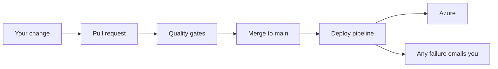

**Target state at the end of the assignment:**

1. The repository has a **CI workflow**: format check, build, and integration tests on every PR
2. **Branch protection**: `main` accepts only PRs with green checks — no exceptions, not even you
3. **AI code review** comments every PR; you fix or justify every comment
4. A **deploy workflow** runs on merge to main: Bicep what-if + deploy, app publish + deploy, smoke test
5. The pipeline authenticates to Azure with **OIDC** — zero long-lived secrets in GitHub
6. A failed run (including a failed smoke test) **emails you** — you have seen it happen

</details>

---

## What do you return?

<details>
<summary><strong>Show section</strong></summary>

**All returns go to the Learn platform.** Submit only screenshots plus one short answers document — no workflow or code files. Every guided section and exercise below ends with a **📤 Return from this section** box, so you can collect the items as you go. The same list is repeated under *Submission* at the end.

**Gates (sections C–E)**

- [ ] Screenshot: the rejected direct push to `main` (Step 10)
- [ ] Screenshot: a PR with the `build-and-test` check green and the AI review comments visible (Steps 11–12) — plus, in your answers document, your reaction to every AI comment (fix or justify)

**Pipeline (sections F–H)**

- [ ] Screenshot: the repository **Secrets** page (Step 16) — four names, `PG_PASSWORD` the only real secret
- [ ] Screenshot: a green Deploy run (Step 18) — `infra` and `app` jobs green, and the smoke test log showing `200`
- [ ] Screenshot: `/info` answering `"version": "1.1.0"` after the automated deploy (Step 19); put the URL in your answers document
- [ ] Screenshot: the failed run with the red smoke test **and** the GitHub failure e-mail (Step 21)

**Exercises**

- [ ] Exercise 1: screenshot of a PR with the what-if check green and its log showing your tag change
- [ ] Exercise 2: screenshot of a run paused at *production waiting for review*, plus the 3–5 sentence Delivery vs. Deployment write-up in your answers document
- [ ] Exercise 3: before/after durations and your one-sentence answer in your answers document

Theory questions in [questions.md](questions.md) are **not** submitted — they are exam training (try first, then [example-answers.md](example-answers.md)).

</details>

---

# Guided section

## Guided section A — Why gates before automation?

<details>
<summary><strong>Show section</strong></summary>


### Why this step?

Automation without gates is just a faster way to break production. The order matters: first make "is this change OK?" answerable *automatically* (tests, lint, review), then — and only then — let a machine deploy every change that passes.

Recall the ladder you already know from cost and infra, applied to releases:

| Rung | Release process | Failure mode |
|------|-----------------|--------------|
| 1 | `az webapp deploy` by hand, when you remember | "Works on my machine"; nobody knows what is deployed |
| 2 | Script that builds, tests, deploys | Better — but humans skip steps under deadline pressure |
| 3 | **Pipeline: gates enforce, merge deploys** | Failures are loud, skipping is impossible, history is in git |

Two terms you will use precisely from now on (details in the [wiki](https://github.com/xamk-mire/Xamk-wiki/blob/main/Development-guidelines/CI-CD.md)):

- **Continuous Delivery**: every change is *deployable*; a human presses the final button
- **Continuous Deployment**: no button — green gates *are* the decision

This assignment builds Continuous **Deployment**, because the course outcome demands it. Independent exercise 2 adds the human button back so you can feel the difference.

> **📤 Return from this section:** Nothing to return from this section.

</details>

---

## Guided section B — Repository setup

<details>
<summary><strong>Show section</strong></summary>


### Why this step?

The pipeline can only enforce what is in version control. Everything — app, tests, infra, and the pipeline definition itself — goes into one repository.

### Step 1: Solution and layout

Arrange your work from Assignments 3–4 like this (commands from the repo root):

```powershell
dotnet new gitignore
dotnet new sln --name CampusEvents
dotnet sln add CampusEvents/CampusEvents.csproj
```

Target layout:

```
<repo-root>/
├── .gitignore
├── CampusEvents.slnx          # .NET 10 creates .slnx (older SDKs: .sln)
├── CampusEvents/              # the app (Assignment 3)
├── CampusEvents.Tests/        # created in section C
├── infra/                     # Bicep (Assignment 4)
└── .github/
    └── workflows/             # created in sections D and G
```

**Why a solution file?** The pipeline (and `dotnet format`) needs one entry point that covers both the app and the tests. `dotnet build` / `test` / `format` at the root now do the right thing.

### Step 2: The secrets check — before the first push

You are about to publish this repository. Stage everything, then prove there is nothing secret in what you staged (`git grep` searches only files Git knows about — that is why `git add` comes first):

```powershell
git init          # skip if the folder is already a Git repository
git add .
git grep -i "postgres.database.azure.com"
git grep -iE "password\s*=" -- "*.json" "*.bicep" "*.bicepparam" "*.ps1"
```

Expected: the first command prints nothing; the second prints only the `localdev` password in `appsettings.Development.json` (fine — Assignment 3 explained where that line is drawn) and lines that *refer* to a password (`readEnvironmentVariable(...)`, `Password=${postgresAdminPassword}`), never an actual value. If a real password or connection string shows up, remove it and `git add .` again before continuing.

### Step 3: Push to GitHub

Create a repository on GitHub (private is fine with the Student Pack), then:

```powershell
git commit -m "Campus Events: app and infra"
git branch -M main
git remote add origin https://github.com/AapoKontiainen/CloudEnvironment2026.git
git push -u origin main
```

> **Reminder — this push is the last direct push to main you will ever do in this course.** From section E onwards, branch protection makes `main` PR-only. Enjoy the moment.

> **📤 Return from this section:** Nothing to return from this section. Keep the repository intact — the final demo runs from it.

</details>

---

## Guided section C — Tests worth gating on

<details>
<summary><strong>Show section</strong></summary>


### Why this step?

A gate that checks nothing is theatre. Right now `dotnet test` would pass trivially — there are no tests. We add **integration tests** that boot the real app in memory and call its real endpoints. Remember the mysterious `public partial class Program;` line from Assignment 1? It was planted for exactly this moment.

### Step 4: Create the test project

From the repo root:

```powershell
dotnet new xunit -o CampusEvents.Tests
dotnet sln add CampusEvents.Tests/CampusEvents.Tests.csproj
dotnet add CampusEvents.Tests reference CampusEvents/CampusEvents.csproj
dotnet add CampusEvents.Tests package Microsoft.AspNetCore.Mvc.Testing
dotnet add CampusEvents.Tests package Microsoft.EntityFrameworkCore.InMemory
```

| Package | Role |
|---------|------|
| `Microsoft.AspNetCore.Mvc.Testing` | `WebApplicationFactory` — boots your actual `Program.cs` inside the test process, no real HTTP port |
| `Microsoft.EntityFrameworkCore.InMemory` | A fake EF Core database provider — the tests must not need PostgreSQL (CI runners have none) |

Delete the generated `UnitTest1.cs`.

### Step 5: The test factory — swap the database, keep everything else

Create `CampusEvents.Tests/TestAppFactory.cs`:

```csharp
using CampusEvents.Data;
using Microsoft.AspNetCore.Hosting;
using Microsoft.AspNetCore.Mvc.Testing;
using Microsoft.EntityFrameworkCore;
using Microsoft.EntityFrameworkCore.Infrastructure;
using Microsoft.Extensions.DependencyInjection;
using Microsoft.Extensions.DependencyInjection.Extensions;

namespace CampusEvents.Tests;

/// <summary>
/// Boots the real app (Program.cs) but replaces PostgreSQL with an
/// in-memory EF Core provider, so tests run anywhere — including CI.
/// </summary>
public class TestAppFactory : WebApplicationFactory<Program>
{
    // Unique name per factory instance → test classes do not share state.
    // (Tests inside ONE class share the factory via IClassFixture, so they share this database.)
    private readonly string _databaseName = $"CampusEventsTests-{Guid.NewGuid()}";

    protected override void ConfigureWebHost(IWebHostBuilder builder)
    {
        builder.ConfigureServices(services =>
        {
            // Remove the real PostgreSQL registration from Program.cs...
            services.RemoveAll<DbContextOptions<AppDbContext>>();
            services.RemoveAll<IDbContextOptionsConfiguration<AppDbContext>>();

            // ...and register the in-memory provider instead.
            services.AddDbContext<AppDbContext>(options =>
                options.UseInMemoryDatabase(_databaseName));
        });
    }
}
```

**How does this work?** `WebApplicationFactory<Program>` runs your real `Program.cs` — DI, endpoints, seeding, everything. `ConfigureWebHost` runs *after* the app's own service registrations, so it can surgically replace the database provider. The `EnsureCreated` + seeder block in `Program.cs` then runs against the in-memory database: every test starts with the three seeded events. The rest of the app has no idea it is being tested — which is the point.

> **Reminder — why not a real PostgreSQL in tests?** You could (the real-world tool is [Testcontainers](https://dotnet.testcontainers.org/), which starts a throwaway Docker PostgreSQL per test run — and CI runners can run it). The in-memory provider is a pragmatic course choice: zero infrastructure, fast, and good enough for endpoint behaviour. Know its limits: it does not enforce relational constraints or real SQL semantics, so it can pass where PostgreSQL would fail.

### Step 6: The tests

Create `CampusEvents.Tests/EventsApiTests.cs`:

```csharp
using System.Net;
using System.Net.Http.Json;
using CampusEvents.Models;
using Microsoft.AspNetCore.Mvc.Testing;

namespace CampusEvents.Tests;

public class EventsApiTests : IClassFixture<TestAppFactory>
{
    private readonly HttpClient _client;

    // Seeded event ids (see DbSeeder)
    private static readonly Guid IntroToAzureId = Guid.Parse("11111111-1111-1111-1111-111111111111");
    private static readonly Guid CoffeeHourId = Guid.Parse("22222222-2222-2222-2222-222222222222");

    public EventsApiTests(TestAppFactory factory)
    {
        // https base address: Program.cs redirects http → https outside Production
        _client = factory.CreateClient(new WebApplicationFactoryClientOptions
        {
            BaseAddress = new Uri("https://localhost")
        });
    }

    [Fact]
    public async Task Health_ReturnsHealthy()
    {
        HttpResponseMessage response = await _client.GetAsync("/health");

        Assert.Equal(HttpStatusCode.OK, response.StatusCode);
    }

    [Fact]
    public async Task GetEvents_ReturnsSeededEvents()
    {
        List<EventResponse>? events = await _client.GetFromJsonAsync<List<EventResponse>>("/api/events");

        Assert.NotNull(events);
        Assert.Equal(3, events.Count);
    }

    [Fact]
    public async Task Register_ReturnsCreated_AndTakesASeat()
    {
        var request = new RegisterRequest("Test Person", "test.person@example.com");

        HttpResponseMessage response =
            await _client.PostAsJsonAsync($"/api/events/{IntroToAzureId}/registrations", request);

        Assert.Equal(HttpStatusCode.Created, response.StatusCode);

        EventResponse? updated =
            await _client.GetFromJsonAsync<EventResponse>($"/api/events/{IntroToAzureId}");
        Assert.NotNull(updated);
        Assert.Equal(1, updated.SeatsTaken);
    }

    [Fact]
    public async Task Register_DuplicateEmail_ReturnsConflict()
    {
        // alex@example.com is seeded onto the Coffee Hour event
        var request = new RegisterRequest("Alex Again", "alex@example.com");

        HttpResponseMessage response =
            await _client.PostAsJsonAsync($"/api/events/{CoffeeHourId}/registrations", request);

        Assert.Equal(HttpStatusCode.Conflict, response.StatusCode);
    }
}
```

Note what these tests protect: the seeding contract, the registration flow, and the duplicate-email business rule — the things Assignment 2 and 3 were about. A gate should guard **behaviour you have publicly relied on**.

### Step 7: Run locally

```powershell
dotnet test
```

Expected: **4 passed**. No Docker, no PostgreSQL, no Azure — this same command must work on a bare CI runner, and now you know it does.

Also run the lint gate once locally so it will not surprise you in CI:

```powershell
dotnet format --verify-no-changes
```

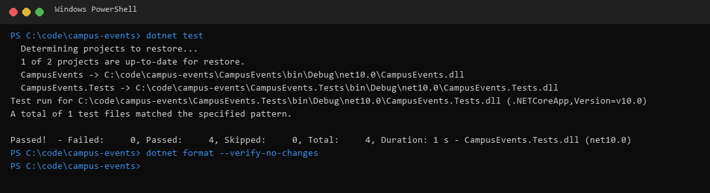

If it reports changes, run `dotnet format` (without the flag) to fix the formatting, and look at the diff to see what it changed. **Do not commit yet** — in section D the tests and the CI workflow go to `main` together, through your first pull request.

> **📤 Return from this section:** Nothing to return yet. The tests go into your first pull request in section D.

</details>

---

## Guided section D — The CI workflow

<details>
<summary><strong>Show section</strong></summary>


### Why this step?

CI answers one question on every pull request: *"is this change safe to merge?"* — by building, linting, and testing in a clean environment that has none of your machine's lucky accidents.

### Step 8: ci.yml

Create `.github/workflows/ci.yml`:

```yaml
name: CI

on:
  pull_request:
    branches: [main]
  push:
    branches: [main]

jobs:
  build-and-test:
    runs-on: ubuntu-latest

    steps:
      - name: Checkout code
        uses: actions/checkout@v5

      - name: Setup .NET
        uses: actions/setup-dotnet@v5
        with:
          dotnet-version: '10.0.x'

      - name: Restore dependencies
        run: dotnet restore

      - name: Format check (lint gate)
        run: dotnet format --verify-no-changes --no-restore

      - name: Build
        run: dotnet build --configuration Release --no-restore

      - name: Test
        run: dotnet test --configuration Release --no-build
```

**Reading the file:**

| Line | Meaning |
|------|---------|
| `on: pull_request / push: main` | Gates every PR *and* re-verifies main after merge |
| `runs-on: ubuntu-latest` | A fresh Linux VM per run — "works on my machine" is not an argument here |
| `dotnet format --verify-no-changes` | Fails the job if formatting is off — style debates end here |
| `--no-restore` / `--no-build` | Each step builds on the previous one; no wasted work |
| Job name `build-and-test` | Remember it — branch protection refers to checks by this name |

### Step 9: See it run

Put the tests and the workflow on a branch — this is your first gated change:

```powershell
git checkout -b ci-pipeline
git add .
git commit -m "Add integration tests and CI workflow"
git push -u origin ci-pipeline
```

Open a **pull request** on GitHub. Watch the **Checks** tab: the workflow runs, all steps green. Do not merge yet — the gate is not *mandatory* until section E.

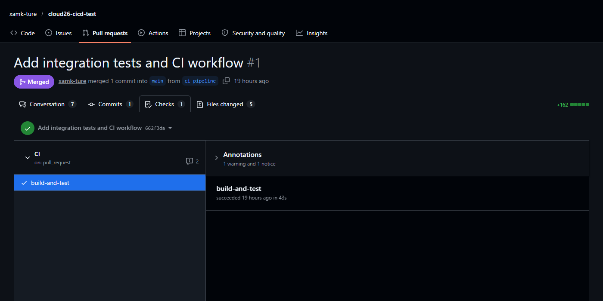

Click the job to see every step of `ci.yml` as its own line — this is where you will read the log when a step goes red:

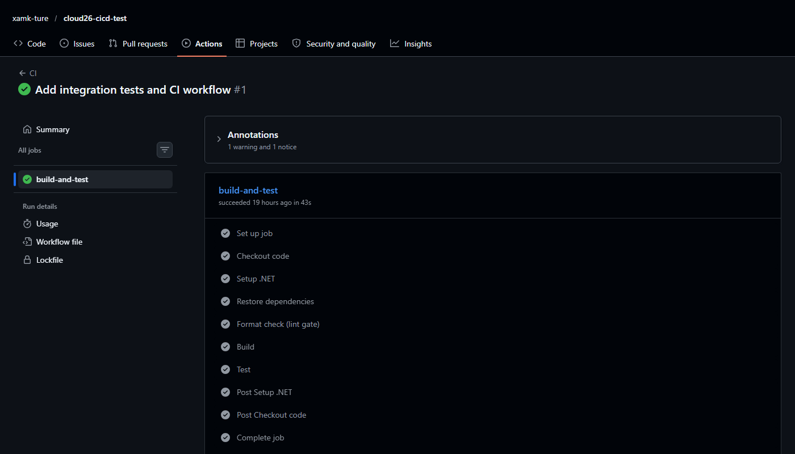

> **📤 Return from this section:** Nothing to return yet. Keep this PR open — in section E you screenshot it with the AI review on it.

</details>

---

## Guided section E — Make the gates mandatory: branch protection + AI review

<details>
<summary><strong>Show section</strong></summary>


### Why this step?

Right now the checks are decorative — you could merge a red PR, or push to main directly. Branch protection turns the checks into a **wall**. And since the course plan requires AI review on every PR, we wire that in as part of the same wall.

### Step 10: Branch protection rule

GitHub → your repo → **Settings → Branches → Add branch protection rule**:

| Setting | Value |
|---------|-------|
| Branch name pattern | `main` |
| ✅ Require a pull request before merging | on |
| ✅ Require status checks to pass before merging | on — and select **`build-and-test`** |
| ✅ Require branches to be up to date before merging | on |
| ✅ Do not allow bypassing the above settings | on — the rule applies to *you* too |

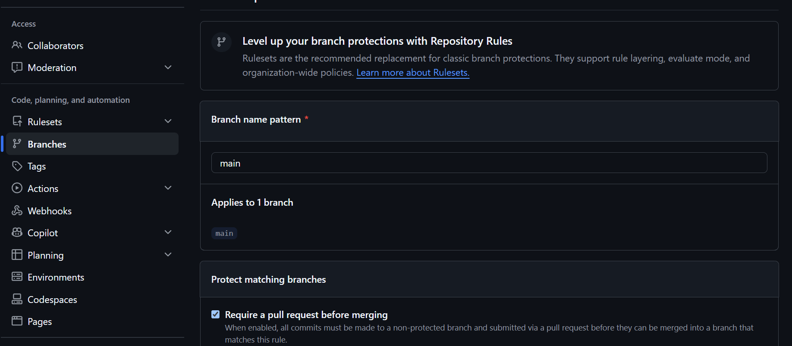

The status check appears in the search box only after it has run at least once — that is why the PR from Step 9 came first. Type `build` and pick **build-and-test**:

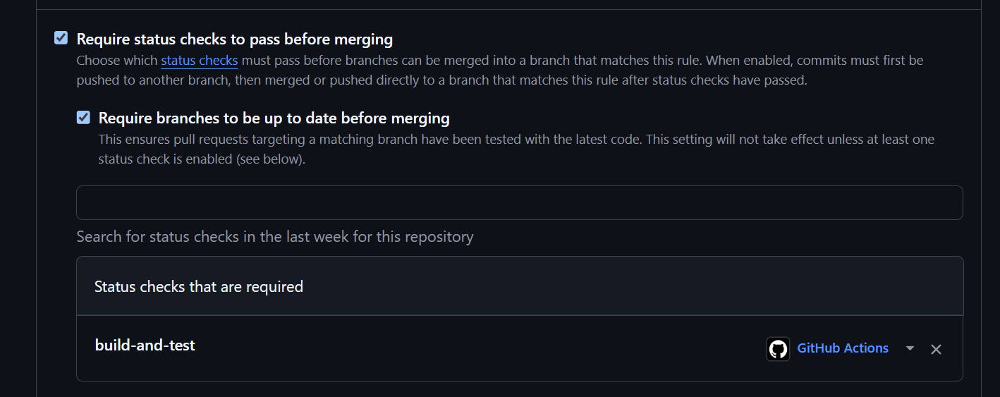

(GitHub shows a banner recommending **Rulesets** instead. Classic rules are enough for this course; the optional Copilot ruleset in Step 11 is the one place you would use them.)

> Private repo and the settings are greyed out? You need GitHub Pro — activate the [Student Developer Pack](https://education.github.com/pack), or make the repo public.

Test the wall immediately:

```powershell
git checkout main
git pull
# make any trivial edit, then:
git commit -am "test direct push"
git push
```

Expected: **rejected** (`protected branch hook declined`).

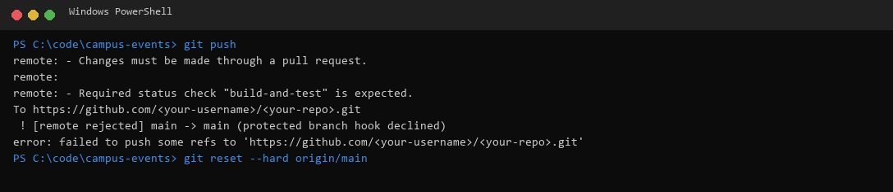

Undo the local commit (`git reset --hard origin/main`). This rejection is the whole point — from now on, the *only* road to main is a green PR.

### Step 11: AI code review on the PR

Enable Copilot code review for your PRs (requires Copilot — free for students via the Student Pack):

1. Open your `ci-pipeline` PR → **Reviewers** → select **Copilot**
2. Wait 1–2 minutes; Copilot leaves review comments on the diff

**Copilot not in the Reviewers list, or nothing happens?** Copilot is not active on your account (the request fails silently). Use the fallback: give the PR diff (`gh pr diff`, or the **Files changed** tab) to your own AI tool, post its findings as review comments on the lines they concern, and name the tool in the review summary. Then continue with Step 12 exactly as with Copilot.

(Optional, recommended: repo **Settings → Rules → Rulesets** can request a Copilot review *automatically* on every PR, so you never forget to ask.)

### Step 12: React to every AI comment — fix or justify

This is the course's standing rule for AI review, and it is graded: **every AI comment gets a human decision.**

| AI comment type | Your move |
|-----------------|-----------|
| Real find (bug, missed edge case) | Fix it, push — the PR re-runs the gates |
| Valid but out of scope | Reply: *why* it is out of scope, and where it is tracked (e.g. "known limitation, Assignment 3 §B") |
| Wrong or irrelevant | Reply with the reason it is wrong — one sentence is fine |

Write your reactions as PR comment replies — they become part of the change's history, which is exactly where review reasoning belongs.

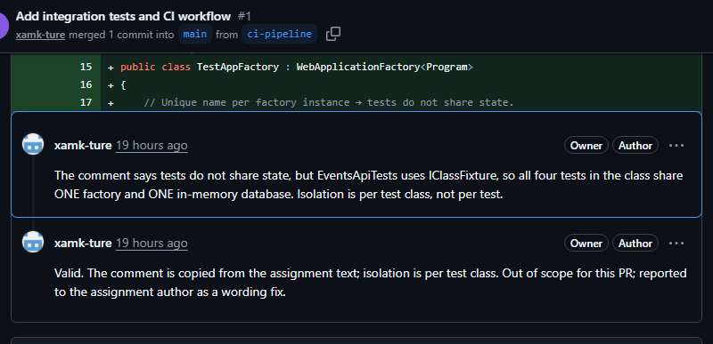

Then merge the PR (it should be green). Your first gated change is in main.

> **Reminder — AI review is a gate assistant, not a gatekeeper:** it reliably catches mechanical issues and it never gets tired. But it does not know your context, your course constraints, or your architecture decisions — you saw it over-flag severity in Assignment 3. The human owns the merge.

> **📤 Return from this section:** Two screenshots: (1) the **rejected direct push** to `main` (Step 10); (2) the PR with the `build-and-test` check green **and the AI review comments visible** (Steps 11–12). In your answers document: your reaction to every AI comment — fix or justify.

</details>

---

## Guided section F — OIDC: the pipeline gets Azure access, no secrets involved

<details>
<summary><strong>Show section</strong></summary>


### Why this step?

The deploy workflow needs to run `az deployment group create` — which means authenticating to Azure from GitHub's servers. The lazy way is storing a service principal password or publish profile in GitHub Secrets: a **long-lived secret** that never expires and works from anywhere if it leaks. The right way is **OIDC / federated identity**: GitHub proves *"this run is from repo X, branch main"* with a short-lived token, and Azure has been told to trust exactly that claim. Nothing to leak, nothing to rotate.

### Step 13: An identity for the pipeline

Keep one PowerShell session (same names as Assignment 4):

```powershell
$YourName      = "<your-name>"
$ResourceGroup = "rg-cloud26-$YourName-dev"
$AppName       = "app-cloud26-$YourName-dev"
$PgServer      = "pg-cloud26-$YourName-dev"
$BaseUrl       = "https://$AppName.azurewebsites.net"
$Identity      = "id-github-cloud26-$YourName"
```

The pipeline needs an identity of its own in Azure. We use a **user-assigned managed identity**: an ordinary Azure resource that lives in your resource group, like the web app.

```powershell
az identity create `
  --name $Identity `
  --resource-group $ResourceGroup `
  --tags Course=cloud26 Environment=dev

$ClientId    = az identity show --name $Identity --resource-group $ResourceGroup --query clientId --output tsv
$PrincipalId = az identity show --name $Identity --resource-group $ResourceGroup --query principalId --output tsv
```

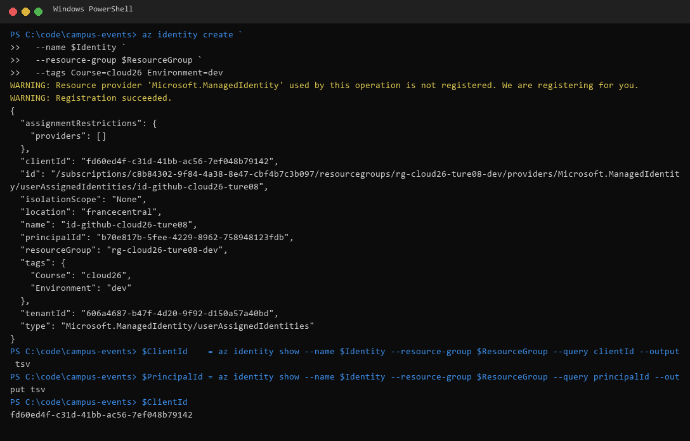

Two IDs, two jobs: `clientId` is what the workflow logs in *as* (Step 16), `principalId` is what Azure grants rights *to* (Step 14).

> **Why not an app registration?** Many OIDC guides use `az ad app create`. That creates an object in the organisation's Entra ID directory — and school tenants, including ours, do not let students do that (`Insufficient privileges`). A managed identity is created with your *subscription* rights instead, and GitHub OIDC works with it exactly the same way. Deleting the resource group deletes it too. The [wiki](https://github.com/xamk-mire/Xamk-wiki/blob/main/Development-guidelines/CI-CD.md#azure-kirjautuminen-putkessa-oidc) compares the two.

### Step 14: Least-privilege role assignment

Contributor — but **only on your resource group**, not the subscription:

```powershell
$SubId = az account show --query id --output tsv

az role assignment create `
  --assignee-object-id $PrincipalId `
  --assignee-principal-type ServicePrincipal `
  --role Contributor `
  --scope "/subscriptions/$SubId/resourceGroups/$ResourceGroup"
```

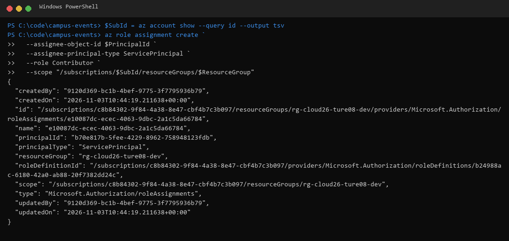

**Why scope it down?** If the pipeline is ever compromised, the blast radius is one resource group. Least privilege is not paranoia; it is the default.

`--assignee-principal-type` tells Azure what kind of identity this is, so the command does not fail while the brand-new identity is still spreading through the directory. Assigning roles requires the **Owner** role on your subscription — Azure for Students gives you that.

**The same in the portal** (if you prefer clicking, or want to check the result): your resource group → **Access control (IAM)** → **Add role assignment**.

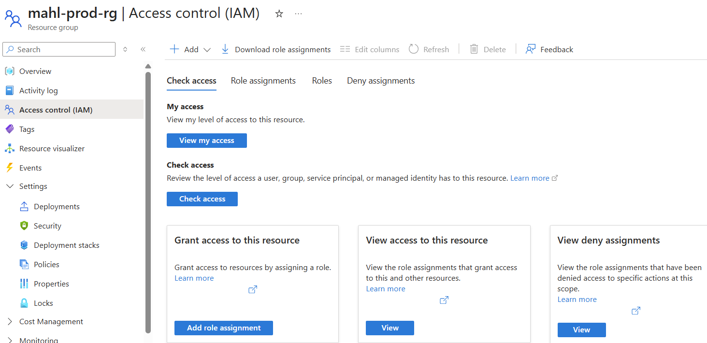

**Contributor** is on the **Privileged administrator roles** tab — select it, then **Next**.

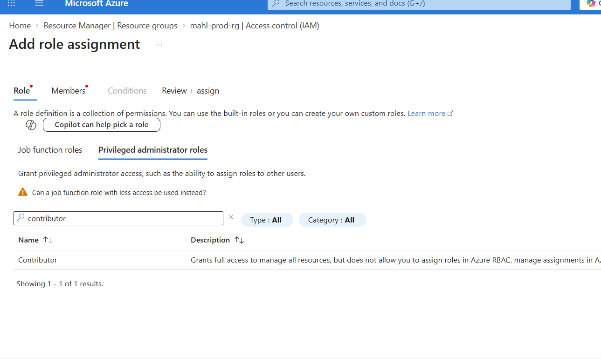

On **Members**, choose **Managed identity** under *Assign access to* (the example picture shows the other option, used for app registrations) → **Select members** → *Managed identity: User-assigned managed identity* → `id-github-cloud26-<your-name>` → **Select** → **Review + assign**.

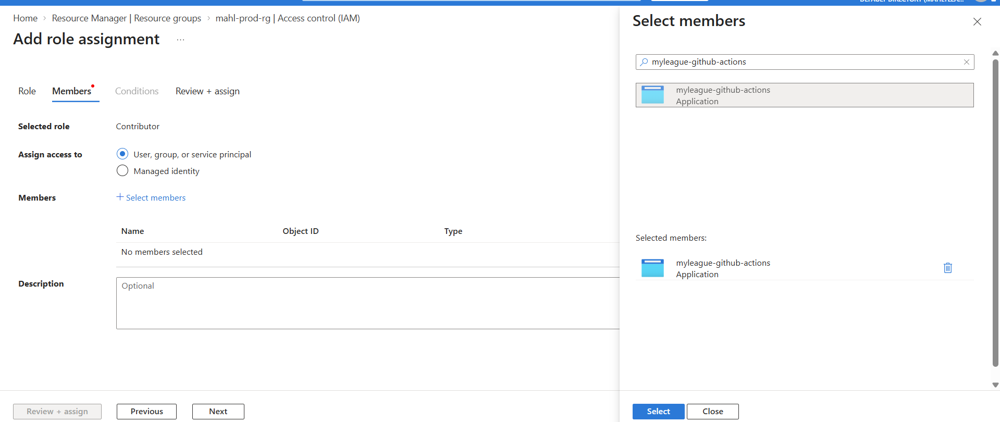

### Step 15: The federated credential — the trust statement

The credential tells Azure *which* GitHub workflow runs to trust. GitHub identifies a run with a **subject** string. For repositories created after July 2026 it looks like this — note the numeric IDs after each `@`:

```
repo:<owner>@<owner-id>/<repo>@<repo-id>:ref:refs/heads/main
```

GitHub added the IDs so that a renamed or re-created repository can never inherit another repository's trust. Ask GitHub for *your* repository's exact prefix with the GitHub CLI (`winget install GitHub.cli`, then `gh auth login`, if you do not have it yet):

```powershell
$Prefix = gh api repos/<your-username>/<your-repo>/actions/oidc/customization/sub --jq .sub_claim_prefix
$Prefix        # → repo:<your-username>@12345678/<your-repo>@987654321
```

> **No GitHub CLI?** The owner ID is at `https://api.github.com/users/<your-username>` and the repository ID at `https://api.github.com/repos/<your-username>/<your-repo>` (public repositories only). Last resort: run the deploy in section G once — the failed login step prints the exact subject under *Federated token details*, and you create the credential from that.

Now the credential itself:

```powershell
az identity federated-credential create `
  --name github-main `
  --identity-name $Identity `
  --resource-group $ResourceGroup `
  --issuer "https://token.actions.githubusercontent.com" `
  --subject "${Prefix}:ref:refs/heads/main" `
  --audiences "api://AzureADTokenExchange"
```

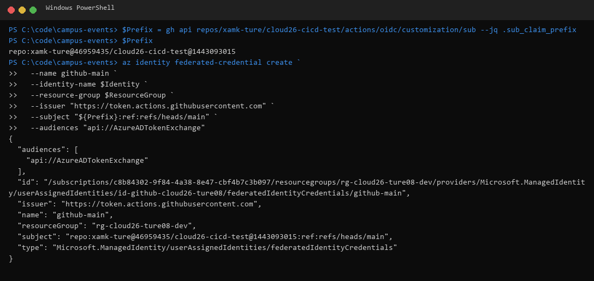

Read the `--subject` line slowly — it is the security boundary: tokens are accepted **only** from workflows running in *your* repository on the *main* branch. A fork, another repo, or a feature branch gets nothing. (This is also why the deploy workflow will trigger on `main` only.)

> **Older tutorials — and Microsoft's own docs — show `repo:<owner>/<repo>:ref:…` without IDs.** That form no longer matches tokens from a new repository: the login fails with `AADSTS700213` and the log shows the subject GitHub actually sent. We found this out the hard way while writing this lab.

### Step 16: GitHub secrets and variables

Repo → **Settings → Secrets and variables → Actions**:

**Secrets** (New repository secret):

| Name | Value | Actually secret? |
|------|-------|------------------|
| `AZURE_CLIENT_ID` | the `$ClientId` from Step 13 | No — an identifier; stored here by convention |
| `AZURE_TENANT_ID` | `az account show --query tenantId -o tsv` | No — an identifier |
| `AZURE_SUBSCRIPTION_ID` | `az account show --query id -o tsv` | No — an identifier |
| `PG_PASSWORD` | your PostgreSQL admin password | **Yes** — the one real secret, needed by the Bicep deployment |

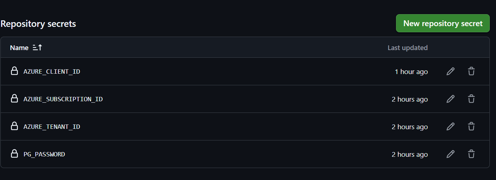

**Variables** (Variables tab):

| Name | Value |
|------|-------|
| `YOUR_NAME` | your name as used in resource names (e.g. `matti`) |

> **Reminder — where does `PG_PASSWORD` sit on the secrets ladder?** GitHub Secrets is the pipeline's equivalent of App Service Application Settings: out of code, masked in logs, but readable by repo admins. The rung above — the pipeline fetching secrets from Key Vault, or Managed Identity removing the password entirely — comes later on this course. One real secret is our current honest minimum.

> **📤 Return from this section:** Screenshot: the repository **Secrets** page (Step 16) — four names, `PG_PASSWORD` the only real secret, no publish profile or service principal password.

</details>

---

## Guided section G — The deploy workflow

<details>
<summary><strong>Show section</strong></summary>


### Why this step?

This is the destination: merge to main → infrastructure verified and deployed (Bicep, Assignment 4) → app published and deployed → **smoke test** proves `/health` answers. Each stage gates the next.

**Start your database first** (`az postgres flexible-server start --resource-group $ResourceGroup --name $PgServer`) — the smoke test will honestly fail against a stopped database, which is a feature, but not the one we want right now.

> **Reminder — regions:** the pipeline deploys to whatever region your resource group (or `param location` in `dev.bicepparam`) says. On student and brand-new subscriptions some regions refuse a free App Service plan (quota 0), are closed to new customers, or have no capacity for the Burstable PostgreSQL tier — and the error names the resource, not the reason. For this course **any region that works is fine**: add `param location = '<region>'` to `infra/dev.bicepparam`, deploy, and move on (while writing this lab we ended up in France Central after three other regions said no). In a real project the region is a deliberate decision — data residency (GDPR), latency to your users, price differences and which services exist there — never "whatever happened to be free that day".

### Step 17: deploy.yml

Create `.github/workflows/deploy.yml`:

```yaml
name: Deploy

on:
  push:
    branches: [main]
  workflow_dispatch:   # manual trigger — used in the failure demo
    inputs:
      deploy_infra:
        description: 'Run the infra job (Bicep what-if + deploy)'
        type: boolean
        default: true

permissions:
  id-token: write      # required for OIDC
  contents: read

concurrency:
  group: deploy-dev    # two merges close together → runs queue, never overlap
  cancel-in-progress: false

env:
  RESOURCE_GROUP: rg-cloud26-${{ vars.YOUR_NAME }}-dev
  APP_NAME: app-cloud26-${{ vars.YOUR_NAME }}-dev

jobs:
  infra:
    # A manual run can skip this job (failure demo, Step 21)
    if: github.event_name != 'workflow_dispatch' || inputs.deploy_infra
    runs-on: ubuntu-latest
    env:
      POSTGRES_ADMIN_PASSWORD: ${{ secrets.PG_PASSWORD }}   # dev.bicepparam reads this
    steps:
      - name: Checkout code
        uses: actions/checkout@v5

      - name: Azure login (OIDC)
        uses: azure/login@v3
        with:
          client-id: ${{ secrets.AZURE_CLIENT_ID }}
          tenant-id: ${{ secrets.AZURE_TENANT_ID }}
          subscription-id: ${{ secrets.AZURE_SUBSCRIPTION_ID }}

      - name: What-if (readable in the run log)
        run: |
          az deployment group what-if \
            --resource-group "$RESOURCE_GROUP" \
            --template-file infra/main.bicep \
            --parameters infra/dev.bicepparam

      - name: Deploy infrastructure
        run: |
          az deployment group create \
            --resource-group "$RESOURCE_GROUP" \
            --template-file infra/main.bicep \
            --parameters infra/dev.bicepparam

  app:
    needs: infra       # app deploys only onto verified infrastructure
    if: ${{ !cancelled() && needs.infra.result != 'failure' }}   # ...or when infra was skipped on purpose
    runs-on: ubuntu-latest
    steps:
      - name: Checkout code
        uses: actions/checkout@v5

      - name: Setup .NET
        uses: actions/setup-dotnet@v5
        with:
          dotnet-version: '10.0.x'

      - name: Publish
        run: dotnet publish CampusEvents/CampusEvents.csproj --configuration Release --output ./publish

      - name: Azure login (OIDC)
        uses: azure/login@v3
        with:
          client-id: ${{ secrets.AZURE_CLIENT_ID }}
          tenant-id: ${{ secrets.AZURE_TENANT_ID }}
          subscription-id: ${{ secrets.AZURE_SUBSCRIPTION_ID }}

      - name: Deploy to App Service
        uses: azure/webapps-deploy@v3
        with:
          app-name: ${{ env.APP_NAME }}
          package: ./publish

      - name: Smoke test — is the app actually alive?
        run: |
          echo "Polling https://$APP_NAME.azurewebsites.net/health ..."
          for i in $(seq 1 10); do
            status=$(curl -s -o /dev/null -w "%{http_code}" --max-time 30 "https://$APP_NAME.azurewebsites.net/health" || true)
            echo "Attempt $i: /health -> $status"
            if [ "$status" = "200" ]; then
              echo "Smoke test passed."
              exit 0
            fi
            sleep 15
          done
          echo "Smoke test FAILED — the deployment is not healthy."
          exit 1
```

**Reading the file:**

| Piece | Why it is there |
|-------|-----------------|
| `permissions: id-token: write` | Without it the OIDC token is never issued and `azure/login` fails |
| `concurrency` | Two quick merges must not deploy on top of each other — the second waits |
| `what-if` before `create` | Assignment 4's discipline, preserved: the diff is in the run log for anyone to read |
| `needs: infra` | Ordering: app code lands only after infrastructure is in its declared state |
| `deploy_infra` input + the two `if:` lines | **Run workflow** gets a checkbox. Unticked, the `infra` job is skipped and `app` still runs (without the `if:` on `app`, a skipped dependency would skip `app` too). Step 21 needs this: Bicep against a *stopped* PostgreSQL server does not fail — it waits, for 30+ minutes |
| `webapps-deploy@v3` after `azure/login` | The action reuses the OIDC session — no publish profile anywhere |
| `env: POSTGRES_ADMIN_PASSWORD` on the `infra` job | `dev.bicepparam` reads the password with `readEnvironmentVariable` — the same way as on your laptop in Assignment 4. The runner has no such variable unless the job sets it from the secret; without it Bicep stops with error `BCP427` |
| The smoke test loop | "Deploy succeeded" is not "app works". `/health` checks the app *and* its database (Assignment 3). Retries cover the app's cold start; `--max-time 30` stops one hanging request from stalling the whole run, and `\|\| true` turns a timed-out curl into a failed *attempt* instead of aborting the step (GitHub runs `bash -e`: any failing command ends the step) |

### Step 18: First automated deployment

Commit the workflow on a branch, open a PR, let the gates run, react to the AI review, merge. Then watch the **Actions** tab: `infra` runs (what-if visible in the log — read it), then `app`, then the smoke test polls until `200`. The first attempts often answer `404` or `503` while App Service starts the new code — that is exactly what the retry loop is for.

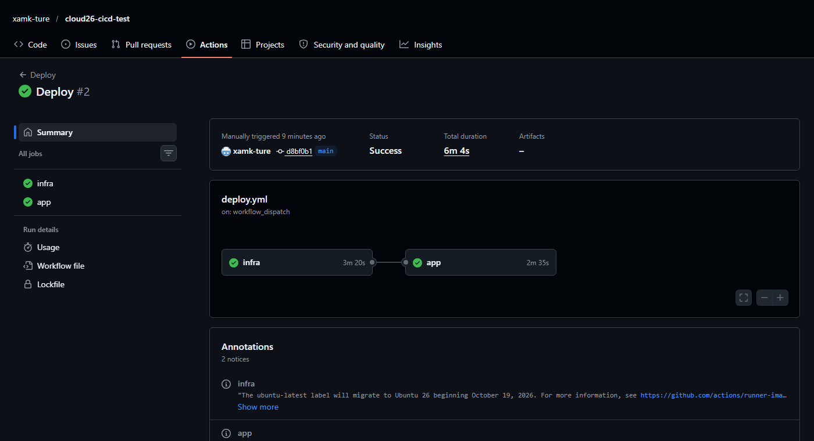

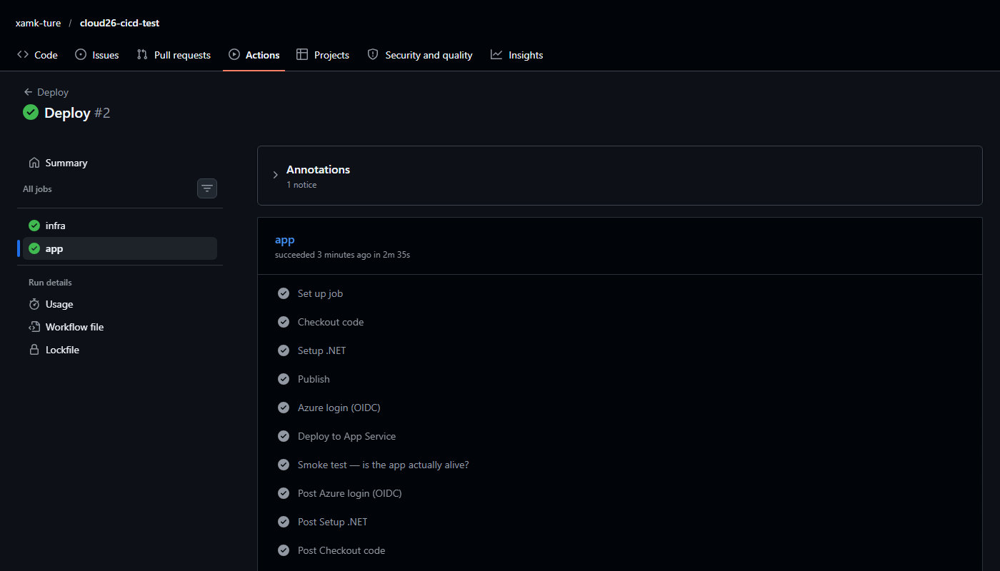

Open the **What-if** step in the `infra` job and read it. On a repeat run most lines are `=` (no change) or `~` (modify — often what-if noise, as in Assignment 4); the identity shows as `*` ignored because Bicep does not manage it:

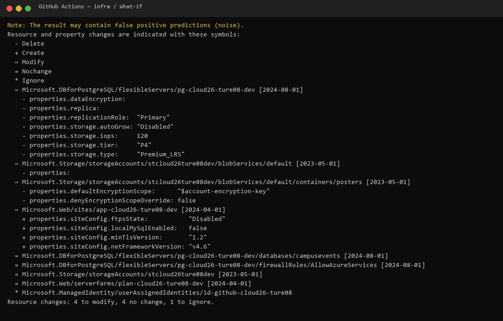

And the smoke test step — the two 404s are the app starting up:

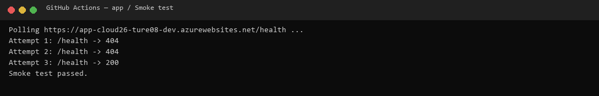

Verify from outside the pipeline:

```powershell
curl.exe -s "$BaseUrl/health"
```

You did not run a single deploy command. That is the last time this sentence needs saying — it is simply how the environment works now.

> **📤 Return from this section:** Screenshot: a **green Deploy run** (Step 18) — `infra` and `app` jobs green, and the smoke test log showing `200`.

</details>

---

## Guided section H — The full chain, and the failure path

<details>
<summary><strong>Show section</strong></summary>


### Why this step?

The course outcome is a *demonstrable* chain: change → gates → auto-deploy → verified live, and fault → email. Run both directions now, deliberately, so you know what they look like before the final demo.

### Step 19: The happy path, end to end

Make a small visible change — add the app version to `/info` in `Program.cs`:

```csharp
app.MapGet("/info", () => Results.Json(new
{
    application = "CampusEvents",
    version = "1.1.0", // ← new field
    environment = app.Environment.EnvironmentName,
    machine = Environment.MachineName,
    framework = Environment.Version.ToString(),
    timeUtc = DateTime.UtcNow
}));
```

Then the full ritual: branch → commit → push → PR → gates green + Copilot review reacted to → merge → **Actions tab: deploy runs** → verify:

```powershell
curl.exe -s "$BaseUrl/info"
```

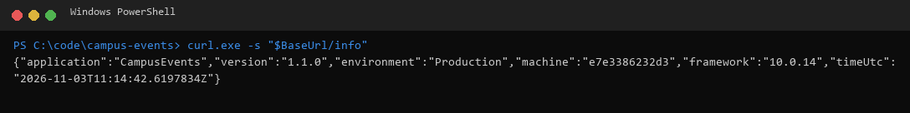

Expected: `"version": "1.1.0"` — your change is live, and no human touched Azure. Collect screenshots along the way (PR checks, review comments, deploy run, live response) — this sequence is a submission item and the backbone of your final demo.

### Step 20: Turn on failure emails

GitHub → your profile → **Settings → Notifications → Actions**: enable notifications and select **Only notify for failed workflows**.

### Step 21: Break it — and receive the email

The most realistic failure: the app deploys fine but cannot serve. Stop the database:

```powershell
az postgres flexible-server stop `
  --resource-group $ResourceGroup `
  --name $PgServer
```

Wait until the command returns (stopping takes about two minutes). Then trigger the deploy manually: **Actions → Deploy → Run workflow** — and **untick *Run the infra job*** (this is why `workflow_dispatch` has the `deploy_infra` input).

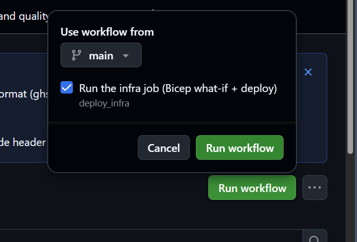 Watch: `infra` is skipped, `app` publishes and deploys fine, and then the **smoke test fails** — `/health` answers 503 (or times out, shown as `000`) ten times, and the job goes red.

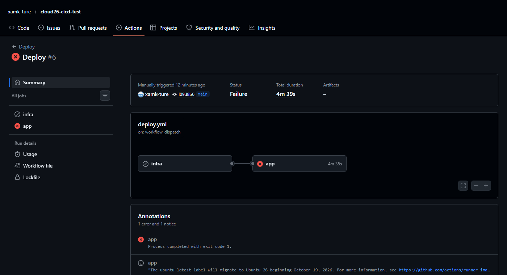

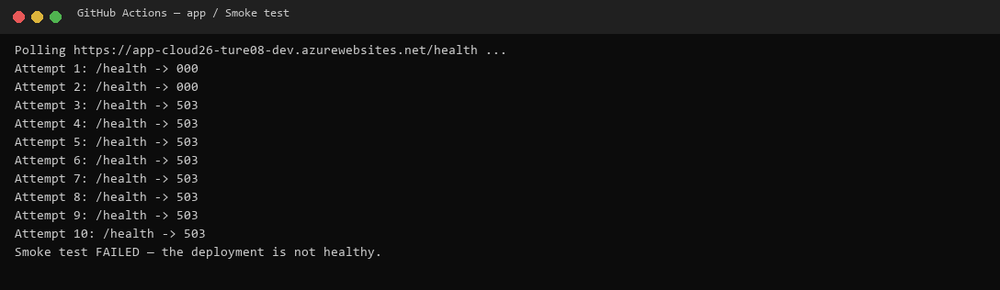

Look at the 503 more closely (`curl.exe -s "$BaseUrl/health"`): it is App Service's *Application Error* page, not the app's own `{"status":"Unhealthy"}` JSON. The deploy restarted the app, and `Program.cs` touches the database on startup (`EnsureCreated` + seeding) — with the server stopped, the process never comes up. "Deploy succeeded" is true; "the app runs" is false. That gap is exactly what the smoke test exists for.

**Why skip infra?** Because a Bicep deployment against a *stopped* PostgreSQL server neither succeeds nor fails — Azure keeps waiting for the server (30+ minutes in our test). With the infra job in the run, the demo would hang instead of failing. Real-world lesson: "the resource exists" and "the resource can be updated" are different things, and a pipeline must fail *fast and loud*, not wait quietly.

Check your inbox: **a failure email from GitHub Actions** (sender `notifications@github.com`, usually within a couple of minutes of the run ending — look in junk mail if it is not there). Screenshot it.

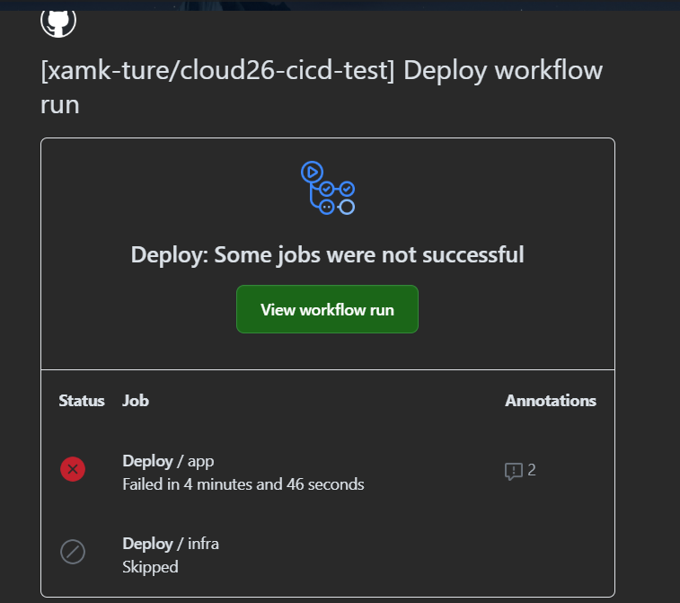 This is the course outcome "the pipeline notifies you about faults". Later on this course you can add Azure-side monitoring alerts for faults that happen *between* deployments.

Clean up: start the database, run the workflow again (this time with the infra job ticked), confirm green.

```powershell
az postgres flexible-server start `
  --resource-group $ResourceGroup `
  --name $PgServer
```

> **Reminder — the meter:** the database has been running since section G. Apply the Assignment 3 discipline now if you are stopping for the day — but note what you just learned: with a stopped database every future deploy's smoke test fails *by design* — and a merge to main (which always runs `infra`) hangs in the infra job until you cancel it. Start the database before you work, stop it after.

> **📤 Return from this section:** Two screenshots: (1) `/info` answering `"version": "1.1.0"` after the automated deploy (Step 19) — put the URL in your answers document; (2) the **failed run** with the red smoke test **and the GitHub failure e-mail** (Step 21).

</details>

---

## In a real project: MyLeague

<details>
<summary><strong>Show section</strong></summary>


Everything in this lab is used in production by [MyLeague](https://github.com/xamkfi/myleague-app), a sports league management app built at Xamk (ASP.NET Core backend + web frontend on Azure). Its pipelines are public — open them next to your own `ci.yml` and `deploy.yml` and look for the same building blocks, scaled up:

| This lab | In MyLeague | Where to look |
|----------|-------------|---------------|
| CI gate on every PR (`build-and-test`) | Build + tests on PRs to `development` and `master`, plus a vulnerable-package check, a Docker build check, and a startup test against a **real PostgreSQL** service container (the step beyond our in-memory tests) | [backend-ci.yaml](https://github.com/xamkfi/myleague-app/blob/development/.github/workflows/backend-ci.yaml) |
| NuGet cache (Exercise 3) | `actions/cache@v5` keyed on the `.csproj` hashes — the same snippet | [backend-ci.yaml](https://github.com/xamkfi/myleague-app/blob/development/.github/workflows/backend-ci.yaml) |
| OIDC login, no stored Azure password | `permissions: id-token: write` + `azure/login` with `client-id` / `tenant-id` / `subscription-id` | [deploy-backend.yml](https://github.com/xamkfi/myleague-app/blob/development/.github/workflows/deploy-backend.yml) |
| Infra before app, what-if before deploy | Bicep what-if and deploy for backend and frontend, then app deploys | [release-production.yml](https://github.com/xamkfi/myleague-app/blob/development/.github/workflows/release-production.yml) |
| What-if on PRs (Exercise 1) | PRs touching `infra/**` first **compile** every Bicep file (no Azure login needed), then run what-if against staging — only for PRs from the same repo, because forks cannot get the OIDC token | [infra-deploy.yml](https://github.com/xamkfi/myleague-app/blob/development/.github/workflows/infra-deploy.yml) |
| Delivery vs. Deployment (Exercise 2) | **Both at once:** merges to `development` deploy to **staging** automatically (Continuous Deployment); production runs from `master` and waits for an approval on the `prod` environment (Continuous Delivery) | [deploy-backend.yml](https://github.com/xamkfi/myleague-app/blob/development/.github/workflows/deploy-backend.yml), [release-production.yml](https://github.com/xamkfi/myleague-app/blob/development/.github/workflows/release-production.yml) |
| Smoke test on `/health` | Polls `/health/ready` with `--max-time`, then a separate smoke-test job calls several live endpoints and checks that admin endpoints **still reject** anonymous calls | [deploy-backend.yml](https://github.com/xamkfi/myleague-app/blob/development/.github/workflows/deploy-backend.yml) |
| `concurrency: deploy-dev` | One concurrency group per environment, so a staging deploy never waits for production | [deploy-backend.yml](https://github.com/xamkfi/myleague-app/blob/development/.github/workflows/deploy-backend.yml) |
| Branch protection on `main` | Branch protection on `master`, plus a workflow that fails any PR into `master` that does not come from `development` | [protect-master.yml](https://github.com/xamkfi/myleague-app/blob/development/.github/workflows/protect-master.yml) |

Two differences worth noticing:

- MyLeague runs in its own Azure tenant, so its pipeline identity is an **app registration** — the alternative Step 13 mentions. The workflow side (`azure/login` + `client-id`) is identical; only the Azure object behind the `client-id` differs.
- Its deploy jobs use GitHub **environments** (`staging`, `prod`), each with its own secrets. Because of `environment:`, their OIDC subject is `…:environment:staging` / `…:environment:prod` — the same case you handle in Exercise 2.

**Reading tip:** start from one trigger and follow it. A merge to `development` → *Backend CI* runs → when it succeeds, `deploy-backend.yml` starts (`workflow_run`) → deploys to staging → health check → smoke tests. That chain is your `deploy.yml`, split into reusable pieces.

> **📤 Return from this section:** Nothing to return from this section.

</details>

---

# Independent exercises

## Exercise 1: What-if as a PR comment gate

<details>
<summary><strong>Show section</strong></summary>


Infra changes deserve review *before* merge, not after. Create `.github/workflows/infra-preview.yml` that runs **only** `what-if` (no deploy) when a PR touches `infra/**`:

1. Trigger: `pull_request` with `paths: ['infra/**']`
2. It needs its own federated credential — the `subject` for PR runs is `${Prefix}:pull_request` (same `$Prefix` as in Step 15; add a second credential to the same identity with `az identity federated-credential create`)
3. Test it: open a PR that changes a tag value in `main.bicep`, and find the what-if diff in the check's log

   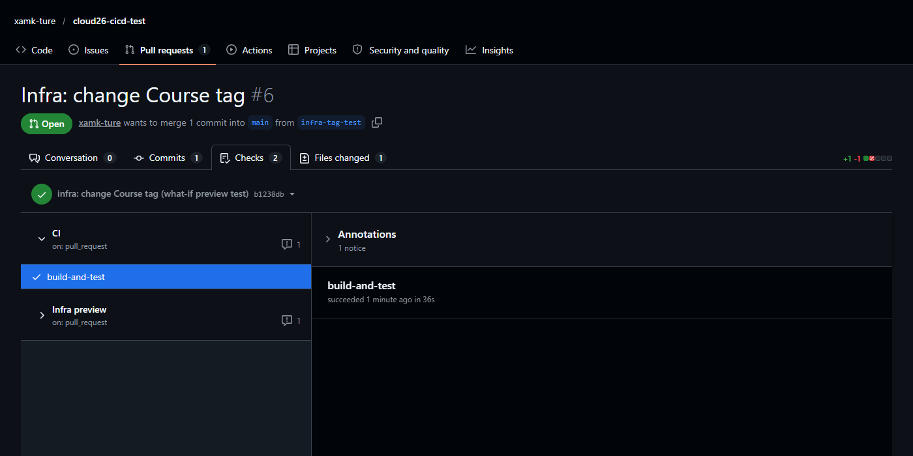

   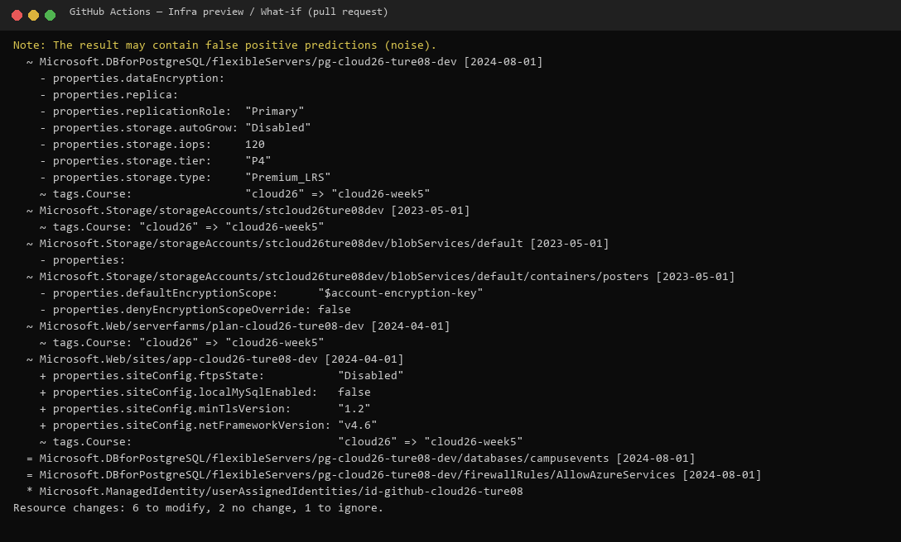

4. Bonus: make the workflow post the what-if output as a PR comment (search: `actions/github-script` or `gh pr comment`)

**Example prompt** (review the YAML and the extra federated-credential command before you run anything):

```
Write .github/workflows/infra-preview.yml for a student Azure lab.

It must:
1. Trigger only on pull_request to main, and only when files under infra/** change.
2. Log in to Azure with OIDC (azure/login@v3) using the same AZURE_CLIENT_ID / TENANT_ID / SUBSCRIPTION_ID secrets as deploy.yml.
3. Run az deployment group what-if against infra/main.bicep and infra/dev.bicepparam. dev.bicepparam reads the password with readEnvironmentVariable('POSTGRES_ADMIN_PASSWORD'), so set that environment variable on the job from secrets.PG_PASSWORD. Print the output.
4. NEVER run az deployment group create or any other mutating Azure command.
5. permissions: id-token: write and contents: read.

Also give me the az identity federated-credential create command (PowerShell, user-assigned managed identity id-github-cloud26-<my-name> in resource group rg-cloud26-<my-name>-dev) for a SECOND credential named github-pull-request. The subject must be "<my subject prefix>:pull_request" — my prefix is repo:<my-github-user>@<owner-id>/<my-repo>@<repo-id> (the new GitHub format with IDs) — not ref:refs/heads/main. Explain in a comment why the main-branch credential is not enough for PR runs.

I will review every command and the YAML before I run or merge them.
```

> **📤 Return from this section:** Screenshot: a PR with the what-if check green and its log showing your tag change.

</details>

## Exercise 2: Continuous Delivery vs. Deployment — feel the difference

<details>
<summary><strong>Show section</strong></summary>


1. Create a GitHub **Environment** named `production` (repo **Settings → Environments → New environment**)

   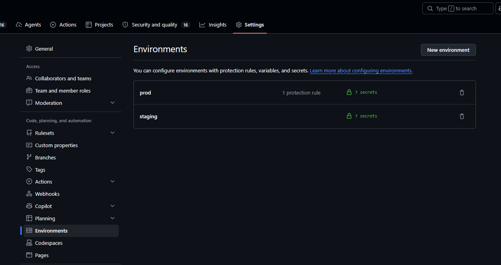

2. In the environment, tick **Required reviewers** and add yourself. Leave **Prevent self-review** off — otherwise you cannot approve your own run. **Save protection rules.**

   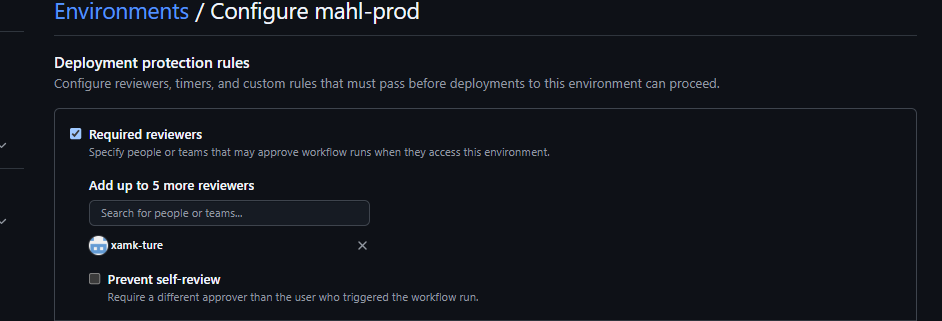

3. A job that uses an environment presents a **different OIDC subject** to Azure: `…:environment:production` instead of `…:ref:refs/heads/main`. Your Step 15 credential does not match it, so add a third one (same command as Step 15, new name and subject):

   ```powershell
   az identity federated-credential create `
     --name github-env-production `
     --identity-name $Identity `
     --resource-group $ResourceGroup `
     --issuer "https://token.actions.githubusercontent.com" `
     --subject "${Prefix}:environment:production" `
     --audiences "api://AzureADTokenExchange"
   ```

4. Add `environment: production` to the `app` job in `deploy.yml` (the `infra` job stays as it is — it still logs in with the `main` credential)
5. Merge any small change: the pipeline now **pauses** before the app deploy until you approve it in the UI — this is Continuous *Delivery*

   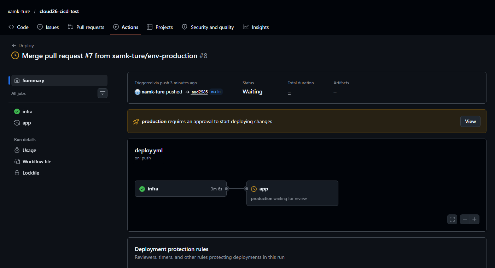

   GitHub also e-mails the reviewer, so nobody has to sit on the Actions tab:

   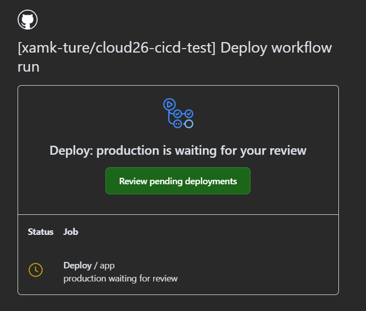

6. Approve it (**Review deployments** on the run page), verify the deploy completes, then **remove** the required reviewer to restore Continuous *Deployment*
7. Write 3–5 sentences: for Campus Events, which mode is right and why? Name one system where you would insist on the manual gate

> **📤 Return from this section:** Screenshot: a run paused at *production waiting for review*. In your answers document: the 3–5 sentence Delivery vs. Deployment write-up.

</details>

## Exercise 3: Speed up the pipeline

<details>
<summary><strong>Show section</strong></summary>


Every CI run downloads all NuGet packages from scratch. Add caching:

1. Add `actions/cache@v5` for `~/.nuget/packages`, keyed on the hash of your `.csproj` files (the [wiki page](https://github.com/xamk-mire/Xamk-wiki/blob/main/Development-guidelines/CI-CD.md) has the snippet)
2. Compare run times before and after (Actions tab shows durations) and report the numbers. Do not expect miracles on Campus Events: in our test the *Restore dependencies* step went from 8 s to 4 s on the first run (cache miss — it still had to download, then saved the cache) and 2 s on the second (cache hit), and the whole job from 37 s to about 30 s. A solution with hundreds of packages saves minutes, not seconds — the mechanism is the same
3. One sentence: why is pipeline speed a *quality* concern, not just convenience? (Hint: what do people do with slow gates?)

> **📤 Return from this section:** In your answers document: the before/after durations and your one-sentence answer.

</details>

## Exercise 4: Theory questions

<details>
<summary><strong>Show section</strong></summary>


Read the questions in [questions.md](questions.md) and answer them **in your own words first**. **Do not submit the answers** — they are not part of the Learn return. They are training for the exam, and they are useful knowledge in the software industry. Similar questions will appear in the exam. You will be asked to explain OIDC vs. a stored password, and why the smoke test failed with a stopped database. When you have tried, compare with [example-answers.md](example-answers.md). The lab text and the Additional material links are enough to answer every question.

> **📤 Return from this section:** Nothing to return. The theory answers are exam training, not part of the Learn submission.

</details>

---

# Summary — what did we learn?

| Concept | What we learned |
|--------|--------------|
| **Gates before automation** | Tests, lint, and review make "safe to merge" machine-checkable — only then is auto-deploy sane |
| **Integration tests** | `WebApplicationFactory` boots the real app; EF InMemory removes the PostgreSQL dependency in CI |
| **CI workflow** | Format + build + test on every PR, in a clean runner |
| **Branch protection** | Green checks are mandatory; main is PR-only — even for you |
| **AI review in PRs** | An AI reviewer (Copilot, or your own tool) comments every change; every comment gets a human decision: fix or justify |
| **OIDC** | Short-lived tokens instead of stored credentials; a managed identity on the Azure side; the `subject` claim (with repo IDs) pins repo + branch; least-privilege scope |
| **Deploy pipeline** | what-if → infra → app → smoke test, each stage gating the next; concurrency prevents overlaps |
| **Smoke test** | "Deploy succeeded" ≠ "app works" — `/health` (with its database check) is the difference |
| **Failure notifications** | A red run emails you; you triggered one on purpose and read the email |
| **Delivery vs. Deployment** | The approval button is a design choice — you tried both |

---

## Submission

<details>
<summary><strong>Show section</strong></summary>


**All returns go to the Learn platform.** Submit only the items below — screenshots plus one short answers document. Do not upload workflow or code files. (Keep the repository intact — the final demo runs from it.) Each item proves one outcome of the assignment:

**Gates (sections C–E)**

- [ ] Screenshot: a PR with the gates green — the `build-and-test` check and the AI review comments visible — and, in your answers document, your reaction to every AI comment (fix or justify)
- [ ] Screenshot: the rejected direct push to `main` (Step 10) — proof that the protection applies to you too

**Pipeline (sections F–H)**

- [ ] Screenshot: the repository **Secrets** page (Step 16) — four names, `PG_PASSWORD` the only real secret, no publish profile or service principal password anywhere
- [ ] Screenshot: a green Deploy run (Step 18) — `infra` and `app` jobs green, and the smoke test log showing `200`
- [ ] Screenshot: `/info` answering `"version": "1.1.0"` after the automated deploy (Step 19); put the URL in your answers document
- [ ] Screenshot: the failed run with the red smoke test **and** the GitHub failure e-mail (Step 21)

**Exercises**

- [ ] Exercise 1: screenshot of a PR with the what-if check green and its log showing your tag change
- [ ] Exercise 2: screenshot of a run paused at *production waiting for review*, plus the 3–5 sentence Delivery vs. Deployment write-up in your answers document
- [ ] Exercise 3: before/after durations and your one-sentence answer in your answers document

The same list is in the *What do you return?* section near the top of this file. Theory questions in [questions.md](questions.md) are **not submitted** — exam training and industry knowledge (try first, then [example-answers.md](example-answers.md)).

**Checklist before submitting:**

- [ ] `main` is protected; a red PR cannot merge and direct pushes are rejected
- [ ] No long-lived Azure credentials anywhere: no publish profile, no service principal password — `PG_PASSWORD` is the only real secret in GitHub
- [ ] The pipeline is green on the latest main
- [ ] Database stopped — and you know the consequence: the smoke test, and `/info` once App Service recycles the app, fail until you start it again (the final demo starts with `az postgres flexible-server start`)
- [ ] You can narrate the whole chain from `git push` to the smoke test — the final demo is exactly this

</details>

---

## Support and troubleshooting

<details>
<summary><strong>Show section</strong></summary>


If you need help:
1. Open the failed step in the Actions log — the real error is almost always in the last 20 lines
2. Paste the failing step's log to AI *together with* the workflow YAML — it is good at spotting mismatched names and missing permissions
3. Ask classmates or the teacher

**Common problems:**

| Problem | Solution |
|---------|----------|
| `azure/login` fails: `AADSTS700213: No matching federated identity record found for presented assertion subject '…'` | The error prints the subject GitHub sent — compare it character by character with `az identity federated-credential list --identity-name $Identity --resource-group $ResourceGroup`. Usual causes: the credential lacks the numeric IDs (`repo:<owner>@<id>/<repo>@<id>:…`, Step 15); the run is not on `main`; PR runs need their own credential (Exercise 1); a job with `environment:` needs one too (Exercise 2) |
| `azure/login` fails: OIDC token missing | `permissions: id-token: write` missing from the workflow |
| `dotnet format` fails in CI but not locally | Different SDK version — check `dotnet --version` locally vs. `dotnet-version` in YAML; run `dotnet format` locally and commit |
| Tests pass locally, fail in CI with DB errors | Something still resolves the Npgsql provider — confirm both `RemoveAll` lines in `TestAppFactory` (EF Core 9+ also registers `IDbContextOptionsConfiguration`) |
| Test client gets 307 responses | Use the `https://localhost` BaseAddress from Step 6 — the app redirects http→https outside Production |
| `build-and-test` not listed in branch protection | The check appears in the list only after it has run at least once — open a PR first, then add the rule |
| Deploy job: `RESOURCE_GROUP` empty | Repo **variable** `YOUR_NAME` not set (Variables tab, not Secrets) |
| Smoke test fails, deploy steps green | 9 times out of 10 the database is stopped and the app could not start (`EnsureCreated` fails) — start it, re-run; otherwise same triage as Assignment 3 (connection string, firewall) |
| `infra` job runs for 10+ minutes in *Deploy infrastructure* | The PostgreSQL server is **stopped** — Bicep waits for it instead of failing. Cancel the run (**Cancel workflow**), start the server, re-run |
| Copilot not available as reviewer | Copilot subscription missing — activate the Student Pack, or do the review with your AI tool manually and document it in PR comments |
| What-if step is very slow | Normal — what-if on a Flexible Server takes a minute or two; it is still worth the log |
| What-if / deploy step: `BCP427: Environment variable "POSTGRES_ADMIN_PASSWORD" does not exist` | The `infra` job is missing `env: POSTGRES_ADMIN_PASSWORD: ${{ secrets.PG_PASSWORD }}` (Step 17), or the `PG_PASSWORD` secret is not set |
| `az ad app create`: `Insufficient privileges` | You are following an app registration guide — school tenants block that. Use the managed identity from Step 13 |
| `az role assignment create`: `AuthorizationFailed` | You are not **Owner** of the subscription (e.g. a subscription someone else manages). Use your Azure for Students subscription, or ask the teacher to run Step 14 for you |
| `MissingSubscriptionRegistration` for `Microsoft.ManagedIdentity` (or another provider) | A fresh subscription has no resource providers enabled. The CLI normally registers one for you on first use (you will see `We are registering for you`), and a Bicep deployment registers what the template needs. If it still fails: `az provider register --namespace Microsoft.ManagedIdentity`, wait until `az provider show --namespace Microsoft.ManagedIdentity --query registrationState` says `Registered`, retry. Portal: Subscription → **Resource providers** (picture below) |
| Infra job / Bicep: `Operation cannot be completed without additional quota … (F1 App Service instances): 0` or `RequestDisallowedByAzure: The selected region is currently not accepting new customers` | Your subscription has no free-tier quota in that region (a fresh pay-as-you-go subscription had F1 = 0 in North Europe and West Europe closed to new customers; Sweden Central worked). Add `param location = 'swedencentral'` to `infra/dev.bicepparam` — resources may live in a different region than the resource group — and deploy again |
| First deploy into an empty resource group: `ResourceNotFound` or `StorageAccountIsNotProvisioned` for the storage account, everything else created | A timing issue in Azure — the web app's `listKeys()` ran before the brand-new storage account was fully visible. Run the deployment again; the second run passes (seen three times out of three while writing this lab) |
| Bicep: `ServerNameAlreadyExists` / `StorageAccountAlreadyTaken` | PostgreSQL server and storage account names are **global**. Someone else has the name — possibly your own old environment that is still being deleted (deletion takes minutes). Wait and retry, or change `yourName` |
| Bicep: `InvalidResourceLocation: The resource 'pg-…' already exists in location '…'` although nothing is listed in the resource group | A PostgreSQL server that failed or was deleted a moment ago still occupies its name in Azure's cache, and the new region does not match. Waiting did not clear it within 15 minutes in our test — the quick fix is a new `yourName` (new resource group, identity and credentials too, since the names derive from it) |

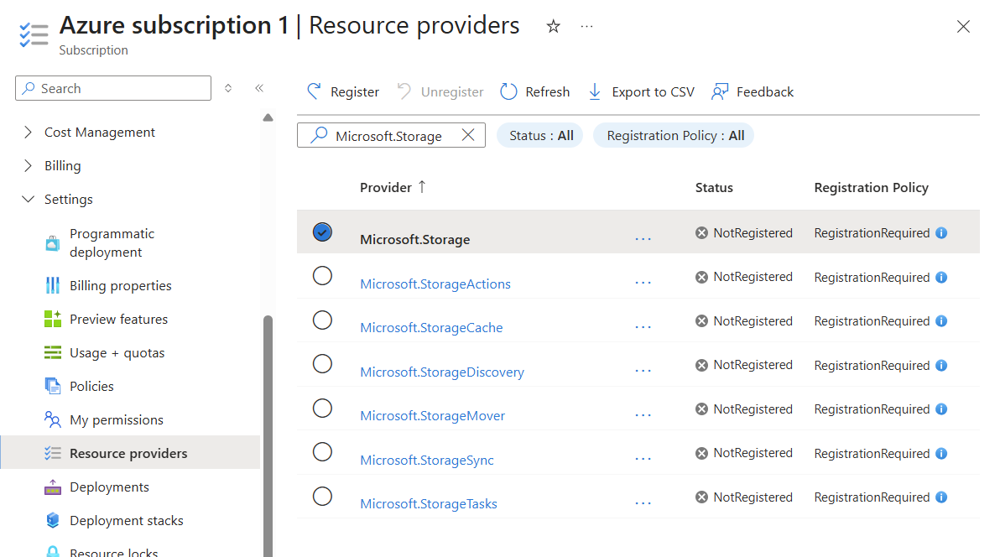

**Wiki materials:**
- [CI/CD — Continuous Integration and Delivery](https://github.com/xamk-mire/Xamk-wiki/blob/main/Development-guidelines/CI-CD.md)
- [Infrastructure as Code](https://github.com/xamk-mire/Xamk-wiki/blob/main/Cloud%20technologies/Azure/Infrastructure-as-Code.md)
- [Azure App Service](https://github.com/xamk-mire/Xamk-wiki/blob/main/Cloud%20technologies/Azure/App-Service.md)

**External links:**
- [GitHub Actions documentation](https://docs.github.com/en/actions)
- [Azure login with OIDC](https://learn.microsoft.com/en-us/azure/developer/github/connect-from-azure-openid-connect)
- [Integration tests in ASP.NET Core](https://learn.microsoft.com/en-us/aspnet/core/test/integration-tests)
- [GitHub Copilot code review](https://docs.github.com/en/copilot/using-github-copilot/code-review)

</details>
