# Assignment 6: Monitoring and alerts — the app tells you when it hurts

Welcome to the sixth assignment! Your pipeline already emails you when a *deployment* fails. But most faults happen **between** deployments: the database goes down at 2 AM, response times creep up, errors spike under load. This assignment wires **Application Insights** into Campus Events, teaches you to read its telemetry with **KQL**, and builds **alerts that actually send you email** — which you will prove by breaking the app on purpose and doing a root-cause analysis from the logs, AI at your side.

The exercise proceeds **step by step**: observability theory, monitoring infrastructure (through your pipeline, of course), telemetry in the app, KQL, alerts, and finally the fault drill. Type everything **yourself** — every step is explained: what it does and why.

> **Note:** This assignment builds on [Assignment 5](../05-CI-CD/README.md): all infra and code changes go through your **pipeline** — branch, PR, gates, merge, auto-deploy. That is not ceremony; it is how you work now.

> **Cost note:** New costs are tiny but real: Log Analytics ingestion (first 5 GB/month free — a course app produces megabytes), the metric alert rules (the first ten monitored time series are free), and one availability test — whose *list price* is per execution: five locations every five minutes would add up to roughly €25/month if billed at list. The course staff's first bill showed no such line, so check yours. Assignment 7 puts that line next to the others and lets you decide; until then, it is the price of being paged. The **database must be running** throughout this assignment — telemetry from a stopped app teaches nothing. Usual discipline afterwards.

---

## Additional material

<details>
<summary><strong>Show section</strong></summary>

**Theory materials** (Finnish, with an English version linked at the top of each page):
- [Azure Monitor and Application Insights](https://github.com/xamk-mire/Xamk-wiki/blob/main/Cloud%20technologies/Azure/Monitoring-and-Application-Insights.md) ([🇬🇧 English](https://github.com/xamk-mire/Xamk-wiki/blob/main/Cloud%20technologies/eng/Azure/Monitoring-and-Application-Insights.md)) - Observability, KQL, alerts, logging practices — **read this first**
- [CI/CD](https://github.com/xamk-mire/Xamk-wiki/blob/main/Development-guidelines/CI-CD.md) ([🇬🇧 English](https://github.com/xamk-mire/Xamk-wiki/blob/main/Development-guidelines/eng/CI-CD.md)) - The pipeline you deliver through
- [Infrastructure as Code](https://github.com/xamk-mire/Xamk-wiki/blob/main/Cloud%20technologies/Azure/Infrastructure-as-Code.md) ([🇬🇧 English](https://github.com/xamk-mire/Xamk-wiki/blob/main/Cloud%20technologies/eng/Azure/Infrastructure-as-Code.md)) - Bicep reference

**External links** (each is also linked from the step where the concept first appears):
- [Application Insights overview](https://learn.microsoft.com/en-us/azure/azure-monitor/app/app-insights-overview)
- [Get started with log queries (KQL tutorial)](https://learn.microsoft.com/en-us/azure/azure-monitor/logs/get-started-queries) and the [KQL quick reference](https://learn.microsoft.com/en-us/azure/data-explorer/kusto/query/kql-quick-reference)
- [Application Insights data model](https://learn.microsoft.com/en-us/azure/azure-monitor/app/data-model-complete) — what each table and column means
- [What is OpenTelemetry?](https://opentelemetry.io/docs/what-is-opentelemetry/)
- [Logging in .NET](https://learn.microsoft.com/en-us/dotnet/core/extensions/logging) — levels, categories, configuration
- [Azure Monitor alerts overview](https://learn.microsoft.com/en-us/azure/azure-monitor/alerts/alerts-overview) and [Metric alerts](https://learn.microsoft.com/en-us/azure/azure-monitor/alerts/alerts-metric-overview)
- [Smart detection: Failure Anomalies](https://learn.microsoft.com/en-us/azure/azure-monitor/alerts/proactive-failure-diagnostics)
- [Availability tests](https://learn.microsoft.com/en-us/azure/azure-monitor/app/availability-overview)
- [Azure dashboards](https://learn.microsoft.com/en-us/azure/azure-portal/azure-portal-dashboards) and [Workbooks](https://learn.microsoft.com/en-us/azure/azure-monitor/visualize/workbooks-overview)
- [Azure mobile app](https://azure.microsoft.com/en-us/get-started/azure-portal/mobile-app/) — alerts in your pocket; see the tip after Step 17

</details>

---

## What do you need?

<details>
<summary><strong>Show section</strong></summary>

- The **Assignment 5 result**: repository with app + infra + working pipeline, branch protection on
- The Azure environment deployed, **database running**
- **Azure CLI**, signed in, as the subscription **Owner** (Step 4 registers resource providers — a subscription-level action your pipeline identity is not allowed to do)
- Your school email inbox open — several messages from `azure-noreply@microsoft.com` are coming

The pictures in this assignment come from the course staff's test run (names `ture08`, region France Central). Yours will show your own names — the *shape* of each screen is what matters. Screenshot **your** Live Metrics, KQL results, dashboard, and alert emails for the return.

</details>

---

## What are we building?

<details>
<summary><strong>Show section</strong></summary>

```
                        ┌────────────────────────────────────────────┐
   Campus Events        │  Log Analytics Workspace                   │
  ┌──────────────┐      │   ┌────────────────────────────────────┐   │
  │ App Insights │─────►│   │ requests / dependencies /          │   │
  │ SDK          │      │   │ exceptions / traces                │   │
  └──────┬───────┘      │   └────────────────────────────────────┘   │
         │              └───────┬───────────────────┬────────────────┘
  ┌──────┴───────┐              │ KQL               │ conditions
  │ PostgreSQL   │              ▼                   ▼
  │ (dependency  │      ┌──────────────┐    ┌──────────────────┐
  │  telemetry)  │      │ You + AI:    │    │ ALERTS            │
  └──────────────┘      │ dashboards,  │    │  Http5xx > 0      │
                        │ root cause   │    │  /health down     │
  Availability test ───►│ analysis     │    └───────┬──────────┘
  (5 locations, /health)└──────────────┘            ▼
                                            ┌──────────────────┐
                                            │ ACTION GROUP      │
                                            │ → EMAIL TO YOU 📧 │
                                            └──────────────────┘
```

> **If a diagram shows as code** (`flowchart …` instead of boxes): the VS Code / Cursor Markdown preview does not draw Mermaid. Open the file on GitHub, or install the **Markdown Preview Mermaid Support** extension and reopen the preview.

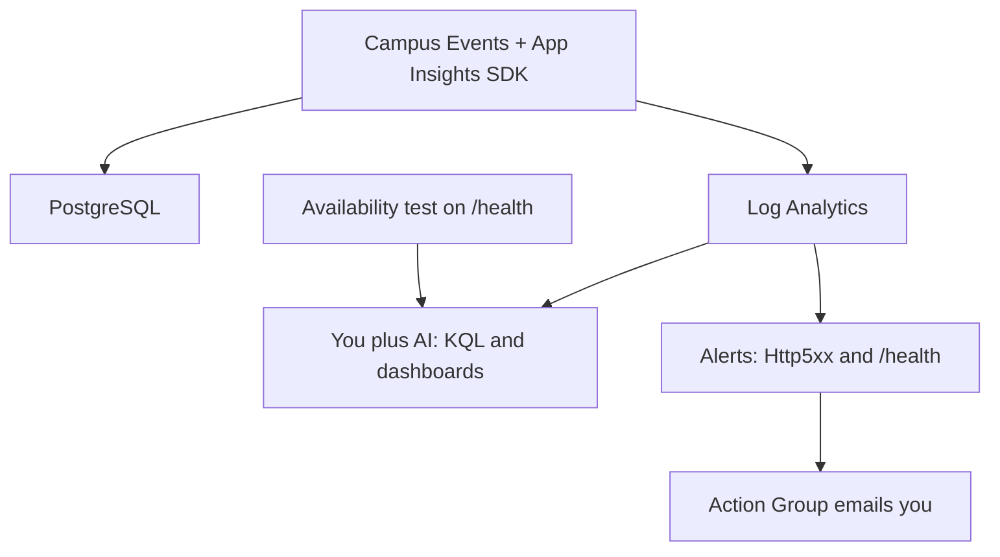

**Target state at the end of the assignment:**

1. Log Analytics + Application Insights exist — **defined in Bicep**, deployed by the pipeline
2. The app sends telemetry: requests, PostgreSQL dependencies, exceptions, and your own **structured logs** (with zero PII)
3. You can answer questions about the running app with **KQL** — hand-written and AI-generated
4. Two alerts email you: **Http5xx > 0** (metric) and **/health unreachable** (availability test)
5. You have **broken the app, received the emails, and traced the root cause** from telemetry
6. Failures, response times, and availability are pinned to a **dashboard**

</details>

---

## What do you return?

<details>
<summary><strong>Show section</strong></summary>

**All returns go to the Learn platform.** Submit only screenshots plus one short answers document — no code, no Bicep, no workflow files. Collect the items as you go; the same list is repeated under *Submission* at the end.

The screenshot list is also in [questions.md](questions.md) under **What to return**. Theory questions in that file are **not submitted** — exam training and industry knowledge (try first, then [example-answers.md](example-answers.md)).

**Through the pipeline (sections B–C)**

- [ ] Screenshot: the merged monitoring PR — gates green, the what-if check showing the two new resources, AI review reacted to (Step 4)

**Telemetry (sections D–E)**

- [ ] Screenshot: one end-to-end transaction in Transaction search — your `POST …/registrations` request, the `postgresql` dependency under it, and your `Registration … created` trace (Step 9)
- [ ] Screenshots: your three hand-written KQL queries **with** their results (Step 10)
- [ ] In your answers document: the AI-generated KQL + your verification notes — which column names you checked and against what (Step 11)

**The incident (sections F–H)**

- [ ] Screenshot: both **Fired** e-mails (`alert-cloud26-http5xx` and `avail-health`) and both **Resolved** e-mails, timestamps visible (Steps 17, 19)
- [ ] In your answers document: root-cause write-up (Step 18) — timeline from the first e-mail to the confirmed cause, the exception you pasted, the AI's hypothesis, and the CLI command that confirmed it
- [ ] Screenshot: dashboard with the incident visible in the charts (Step 20)

**Exercises**

- [ ] Exercise 1: screenshot of the pipeline's what-if log for the alerts PR (`2 to create`) and of the next run's what-if (no change) — idempotence proven
- [ ] Exercise 1: your one-sentence answer on the availability test, in your answers document
- [ ] Exercise 2: in your answers document — log hygiene findings: fixes, justifications, AI false positives, and your decision on EF Core's SQL logging

Theory questions in [questions.md](questions.md) are **not** submitted — they are exam training (try first, then [example-answers.md](example-answers.md)).

</details>

---

# Guided section

## Guided section A — Observability in four tables

<details>
<summary><strong>Show section</strong></summary>

### Why this step?

Monitoring vocabulary is small but load-bearing. Four tables to anchor everything that follows — depth in the [wiki page](https://github.com/xamk-mire/Xamk-wiki/blob/main/Cloud%20technologies/Azure/Monitoring-and-Application-Insights.md) ([🇬🇧 English](https://github.com/xamk-mire/Xamk-wiki/blob/main/Cloud%20technologies/eng/Azure/Monitoring-and-Application-Insights.md)). Every term is also explained again, briefly, at the step where you first *use* it; this section is the map you come back to.

**The three pillars:**

| Pillar | Answers | Campus Events example |
|--------|---------|------------------------|
| **Logs** | What happened? | "Registration created for event X" |
| **Metrics** | How much, how fast? | 5xx count/min, response time |
| **Traces** | Where in the chain? | HTTP request → PostgreSQL query, as one tree |

**The Azure pieces:**

| Piece | Role |
|-------|------|
| Log Analytics Workspace | One store for all telemetry; the thing KQL queries |
| Application Insights | The app-level collector (SDK) that writes into the workspace |
| Platform metrics | Azure's free per-resource numbers (e.g. App Service `Http5xx`) — exist without any SDK |
| Alert rule + Action Group | *What to watch* + *whom to tell* — configured separately, connected together |

**Who notices a fault, before this assignment vs. after:**

| Fault | Before | After |
|-------|--------|-------|
| Deploy breaks the app | Pipeline smoke test → email (Assignment 5) | Same |
| Database dies at night | The next user (or nobody, for days) | Availability + 5xx alerts → email in minutes |
| Response times degrade | Nobody, until users complain | Performance view; you can add a metric alert if you want |
| A specific request fails | Nobody | Failures view, exception with stack trace, correlated to the request |

**The vocabulary, one line each** — the terms the rest of this assignment uses without stopping:

| Term | One line | Depth |
|------|----------|-------|
| **Log Analytics workspace** | The database where all telemetry rows land; the thing KQL queries | [wiki](https://github.com/xamk-mire/Xamk-wiki/blob/main/Cloud%20technologies/Azure/Monitoring-and-Application-Insights.md#azure-monitor--kokonaisuus) ([🇬🇧](https://github.com/xamk-mire/Xamk-wiki/blob/main/Cloud%20technologies/eng/Azure/Monitoring-and-Application-Insights.md#the-azure-monitor-family)) |
| **Application Insights** | The collector: an SDK in your app + a resource in Azure that writes into the workspace | [wiki](https://github.com/xamk-mire/Xamk-wiki/blob/main/Cloud%20technologies/Azure/Monitoring-and-Application-Insights.md#application-insights) ([🇬🇧](https://github.com/xamk-mire/Xamk-wiki/blob/main/Cloud%20technologies/eng/Azure/Monitoring-and-Application-Insights.md#application-insights)) |
| **Telemetry types** | `requests`, `dependencies` (SQL, HTTP calls out), `exceptions`, `traces` (your `ILogger` lines) — one table each | [wiki](https://github.com/xamk-mire/Xamk-wiki/blob/main/Cloud%20technologies/Azure/Monitoring-and-Application-Insights.md#taulut-ja-sarakkeet) ([🇬🇧](https://github.com/xamk-mire/Xamk-wiki/blob/main/Cloud%20technologies/eng/Azure/Monitoring-and-Application-Insights.md#tables-and-columns)) |
| **Correlation / `operation_Id`** | One id per incoming request, stamped on everything it caused — how the end-to-end tree is built | [wiki](https://github.com/xamk-mire/Xamk-wiki/blob/main/Cloud%20technologies/Azure/Monitoring-and-Application-Insights.md#korrelaatio-operation_id) ([🇬🇧](https://github.com/xamk-mire/Xamk-wiki/blob/main/Cloud%20technologies/eng/Azure/Monitoring-and-Application-Insights.md#correlation-operation_id)) |
| **KQL** | The query language of the workspace: `table \| where \| summarize \| order by` | [wiki](https://github.com/xamk-mire/Xamk-wiki/blob/main/Cloud%20technologies/Azure/Monitoring-and-Application-Insights.md#kql--kyselyt-telemetriaan) ([🇬🇧](https://github.com/xamk-mire/Xamk-wiki/blob/main/Cloud%20technologies/eng/Azure/Monitoring-and-Application-Insights.md#kql--asking-the-telemetry-questions)) |
| **Platform metric** | A number Azure records about a resource for free, SDK or not (`Http5xx`, CPU) | [wiki](https://github.com/xamk-mire/Xamk-wiki/blob/main/Cloud%20technologies/Azure/Monitoring-and-Application-Insights.md#azure-monitor--kokonaisuus) ([🇬🇧](https://github.com/xamk-mire/Xamk-wiki/blob/main/Cloud%20technologies/eng/Azure/Monitoring-and-Application-Insights.md#the-azure-monitor-family)) |
| **Metric alert** | A rule that evaluates a metric over a window and fires when a threshold is crossed; a *log alert* does the same with a KQL query | [wiki](https://github.com/xamk-mire/Xamk-wiki/blob/main/Cloud%20technologies/Azure/Monitoring-and-Application-Insights.md#metric-alert-vs-log-alert) ([🇬🇧](https://github.com/xamk-mire/Xamk-wiki/blob/main/Cloud%20technologies/eng/Azure/Monitoring-and-Application-Insights.md#metric-alert-vs-log-alert)) |
| **Action Group** | *Whom to tell* when a rule fires — e-mail, SMS, push, webhook; reused by many rules | [wiki](https://github.com/xamk-mire/Xamk-wiki/blob/main/Cloud%20technologies/Azure/Monitoring-and-Application-Insights.md#hälytykset-ja-action-groupit) ([🇬🇧](https://github.com/xamk-mire/Xamk-wiki/blob/main/Cloud%20technologies/eng/Azure/Monitoring-and-Application-Insights.md#alerts-and-action-groups)) |
| **Severity** | A label 0 (critical) … 4 (verbose) you give a rule; it sorts, it does not act | [wiki](https://github.com/xamk-mire/Xamk-wiki/blob/main/Cloud%20technologies/Azure/Monitoring-and-Application-Insights.md#luonti-clillä) ([🇬🇧](https://github.com/xamk-mire/Xamk-wiki/blob/main/Cloud%20technologies/eng/Azure/Monitoring-and-Application-Insights.md#creating-them-with-the-cli)) |
| **Availability test** | Azure calls your URL from several locations every few minutes and alerts when X of Y fail | [wiki](https://github.com/xamk-mire/Xamk-wiki/blob/main/Cloud%20technologies/Azure/Monitoring-and-Application-Insights.md#availability-testit) ([🇬🇧](https://github.com/xamk-mire/Xamk-wiki/blob/main/Cloud%20technologies/eng/Azure/Monitoring-and-Application-Insights.md#availability-tests)) |
| **Smart detection** | An alert rule Azure creates for you (*Failure Anomalies*) that learns the normal failure rate | [wiki](https://github.com/xamk-mire/Xamk-wiki/blob/main/Cloud%20technologies/Azure/Monitoring-and-Application-Insights.md#smart-detection-failure-anomalies) ([🇬🇧](https://github.com/xamk-mire/Xamk-wiki/blob/main/Cloud%20technologies/eng/Azure/Monitoring-and-Application-Insights.md#smart-detection-failure-anomalies)) |
| **Sampling** | At high volume the SDK keeps a sample of rows; `itemCount` says how many each row stands for | [wiki](https://github.com/xamk-mire/Xamk-wiki/blob/main/Cloud%20technologies/Azure/Monitoring-and-Application-Insights.md#kustannukset) ([🇬🇧](https://github.com/xamk-mire/Xamk-wiki/blob/main/Cloud%20technologies/eng/Azure/Monitoring-and-Application-Insights.md#costs)) |
| **Dashboard** | Pinned tiles answering "is everything OK?"; a *workbook* is a parameterised report | [wiki](https://github.com/xamk-mire/Xamk-wiki/blob/main/Cloud%20technologies/Azure/Monitoring-and-Application-Insights.md#dashboardit-ja-workbookit) ([🇬🇧](https://github.com/xamk-mire/Xamk-wiki/blob/main/Cloud%20technologies/eng/Azure/Monitoring-and-Application-Insights.md#dashboards-and-workbooks)) |

</details>

---

## Guided section B — Monitoring infrastructure, through the pipeline

<details>
<summary><strong>Show section</strong></summary>

### Why this step?

Log Analytics and Application Insights are resources like any other — so they are **Bicep**, and they arrive via a **pull request**, like everything from now on.

### Step 1: Branch

```powershell
git checkout main
git pull
git checkout -b monitoring-infra
```

### Step 2: modules/monitoring.bicep

Create `infra/modules/monitoring.bicep`:

```bicep
param location string
param logAnalyticsName string
param appInsightsName string
param tags object = {}

// --- Log Analytics Workspace: one store for all telemetry ---

resource logAnalytics 'Microsoft.OperationalInsights/workspaces@2023-09-01' = {
  name: logAnalyticsName
  location: location
  properties: {
    sku: {
      name: 'PerGB2018' // pay per ingested GB (first 5 GB/month free)
    }
    retentionInDays: 30
  }
  tags: tags
}

// --- Application Insights (workspace-based) ---

resource appInsights 'Microsoft.Insights/components@2020-02-02' = {
  name: appInsightsName
  location: location
  kind: 'web'
  properties: {
    Application_Type: 'web'
    WorkspaceResourceId: logAnalytics.id
  }
  tags: tags
}

output connectionString string = appInsights.properties.ConnectionString
output appInsightsId string = appInsights.id
```

**Two resources, two jobs.** The **Log Analytics workspace** is storage: every telemetry row ends up as a row in one of its tables, kept for `retentionInDays` (30 here; the first 31 days are free), and it is the thing you query with KQL in section E. **Application Insights** is the collector: the resource is little more than a connection string and a pointer to the workspace, and the SDK in your app (section C) sends everything to it. Platform metrics such as `Http5xx` exist *without* either — Azure records them for every App Service — which is why section F's first alert works before any SDK.

**Why workspace-based?** Older App Insights stored data in its own silo. Workspace-based (the only supported model for new resources) writes everything into Log Analytics — one KQL surface for all data, which section E relies on.

📖 **Theory:** [Azure Monitor family](https://github.com/xamk-mire/Xamk-wiki/blob/main/Cloud%20technologies/Azure/Monitoring-and-Application-Insights.md#azure-monitor--kokonaisuus) ([🇬🇧](https://github.com/xamk-mire/Xamk-wiki/blob/main/Cloud%20technologies/eng/Azure/Monitoring-and-Application-Insights.md#the-azure-monitor-family)) · [Bicep setup](https://github.com/xamk-mire/Xamk-wiki/blob/main/Cloud%20technologies/Azure/Monitoring-and-Application-Insights.md#1-infrastruktuuri-bicep) ([🇬🇧](https://github.com/xamk-mire/Xamk-wiki/blob/main/Cloud%20technologies/eng/Azure/Monitoring-and-Application-Insights.md#1-infrastructure-bicep)) · [App Insights overview](https://learn.microsoft.com/en-us/azure/azure-monitor/app/app-insights-overview)

### Step 3: Wire it into main.bicep

Add the names near your other `var`s:

```bicep
var logAnalyticsName = 'log-cloud26-${yourName}-${environment}'
var appInsightsName  = 'appi-cloud26-${yourName}-${environment}'
```

Add the module (next to the postgres module):

```bicep
// --- Monitoring (module) ---

module monitoring 'modules/monitoring.bicep' = {
  name: 'monitoringDeployment'
  params: {
    location: location
    logAnalyticsName: logAnalyticsName
    appInsightsName: appInsightsName
    tags: tags
  }
}
```

And in the web app's `appSettings` array, add the connection string **next to** the database connection string:

```bicep
        {
          name: 'APPLICATIONINSIGHTS_CONNECTION_STRING'
          value: monitoring.outputs.connectionString
        }
```

**The pattern should feel familiar:** exactly like the database in Assignment 4, the app finds its monitoring backend through **configuration derived from a module output**. Same code everywhere; the environment injects the wiring. (Backing services, third appearance.)

### Step 4: PR, gates, merge, deploy

Keep one PowerShell session (same names as Assignments 4–5):

```powershell
$YourName      = "<your-name>"
$YourEmail     = "<your.email@edu.xamk.fi>"
$ResourceGroup = "rg-cloud26-$YourName-dev"
$AppName       = "app-cloud26-$YourName-dev"
$PgServer      = "pg-cloud26-$YourName-dev"
$BaseUrl       = "https://$AppName.azurewebsites.net"
$ActionGroup   = "ag-cloud26-$YourName-email"
$SubscriptionId = az account show --query id --output tsv
```

**First, register the resource providers — once per subscription.** Every Azure resource type belongs to a *resource provider* (`Microsoft.Web`, `Microsoft.DBforPostgreSQL`, …), and a subscription uses a provider only after it has been **registered** for it. Registering is a subscription-level action. Your pipeline identity has Contributor on the resource group only, so if the subscription has never used Log Analytics, Application Insights or alerts, the pipeline's Bicep deploy fails with `MissingSubscriptionRegistration` — it cannot register the provider for you. You, as the subscription owner, can:

```powershell
az provider register --namespace Microsoft.OperationalInsights --wait
az provider register --namespace Microsoft.Insights --wait
az provider register --namespace Microsoft.AlertsManagement --wait
```

`--wait` blocks until the state is `Registered` (usually under a minute). Check:

```powershell
"Microsoft.OperationalInsights", "Microsoft.Insights", "Microsoft.AlertsManagement" | ForEach-Object {
    "$_ : " + (az provider show --namespace $_ --query registrationState --output tsv)
}
```

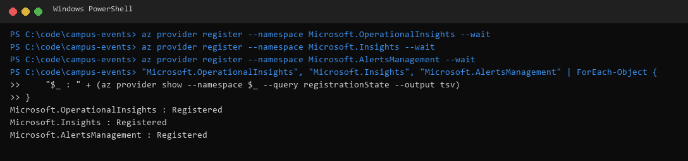

(Assignments 3–4 did not need this step because you deployed from your own CLI as Owner, and ARM registers providers for Owners on the fly. The pipeline identity is not an Owner — on purpose.)

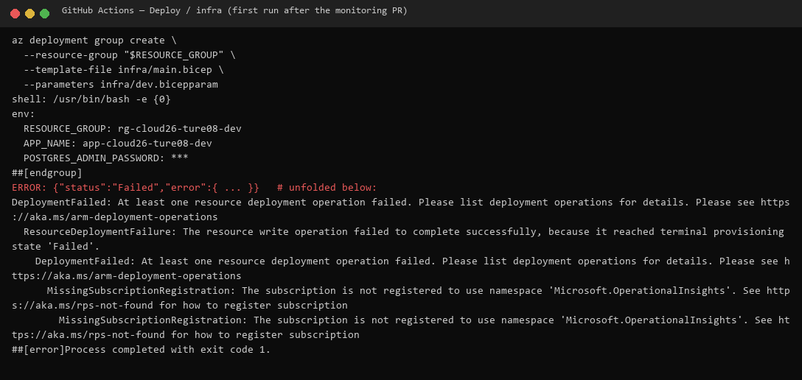

Now ship the Bicep:

```powershell
git add infra/
git commit -m "Add Log Analytics + Application Insights via Bicep"
git push -u origin monitoring-infra
```

Open the PR. Note what your gates do with an infra-only change: CI still runs (nothing broke), and if you built Assignment 5's Exercise 1, the **what-if check shows exactly two new resources** — read it in the PR before merging. (The `~ Modify` lines under the web app are what-if noise: properties Azure fills with defaults. You saw the same in Assignment 4.)

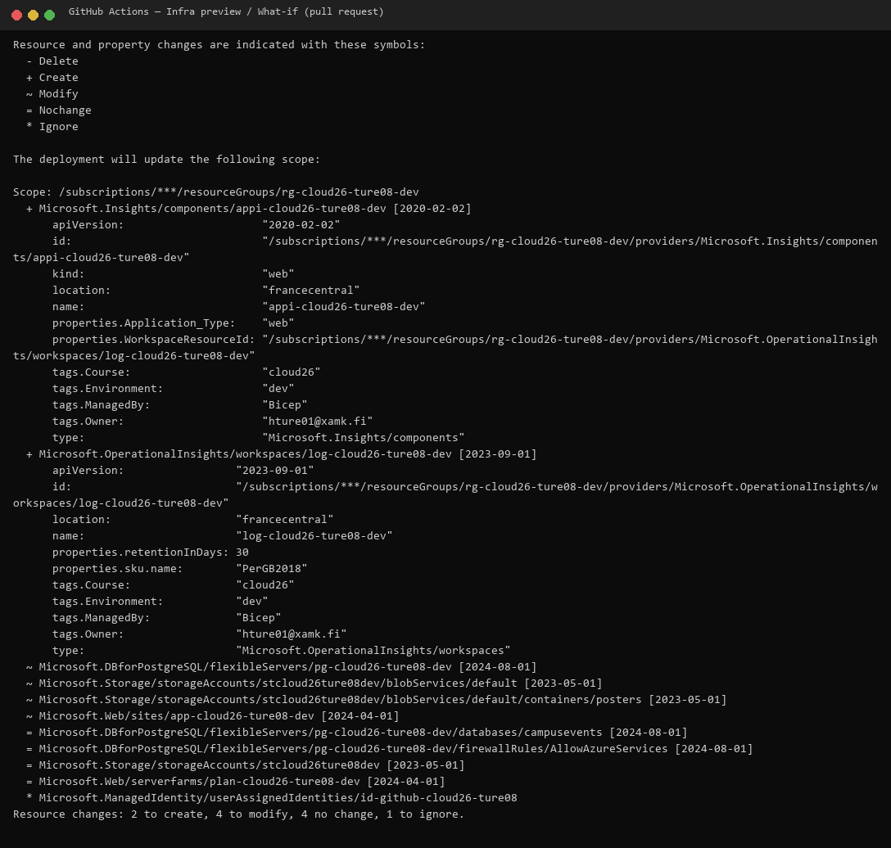

React to the AI review, merge, and watch the pipeline deploy.

Verify:

```powershell
az resource list `
  --resource-group $ResourceGroup `
  --query "[?contains(name, 'log-') || contains(name, 'appi-')].{name:name, type:type}" `
  --output table
```

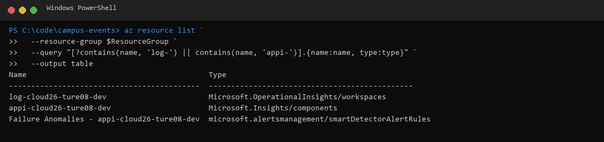

Expected: the workspace and the App Insights component — plus a third row, `Failure Anomalies - appi-…`, which you did not write.

**What is Smart detection?** Azure creates one alert rule with every App Insights resource: *Failure Anomalies*. Instead of a threshold you set, it learns your app's normal failure rate and fires when the share of failed requests jumps away from it. It comes with its own Action Group (*Application Insights Smart Detection*, aimed at the subscription owner), it is free, and it may send one extra e-mail during section G. It is not one of *your* alerts — your own rules in section F say exactly what and whom — and because Bicep did not create it, every what-if from now on lists it under `* Ignore`. Leave it.

📖 **Theory:** [Smart detection](https://github.com/xamk-mire/Xamk-wiki/blob/main/Cloud%20technologies/Azure/Monitoring-and-Application-Insights.md#smart-detection-failure-anomalies) ([🇬🇧](https://github.com/xamk-mire/Xamk-wiki/blob/main/Cloud%20technologies/eng/Azure/Monitoring-and-Application-Insights.md#smart-detection-failure-anomalies)) · [Failure Anomalies](https://learn.microsoft.com/en-us/azure/azure-monitor/alerts/proactive-failure-diagnostics)

</details>

---

## Guided section C — Telemetry from the app: SDK + structured logs

<details>
<summary><strong>Show section</strong></summary>

### Why this step?

Platform metrics see the app from outside (status codes, CPU). The SDK sees it from **inside**: every request, every PostgreSQL query, every exception, correlated. Plus your own log lines — written properly.

### Step 5: Add the SDK

**What the SDK sends.** Once registered, the SDK turns what happens in your process into rows of four kinds, one table each in the workspace: every incoming HTTP request (`requests`: path, status, duration), every call *out* of the app (`dependencies`: here each PostgreSQL statement), every unhandled exception with its stack (`exceptions`), and every `ILogger` line you or a library writes (`traces`). All four carry the same `operation_Id` for one request, which is what makes them one story instead of four logs. The SDK finds its destination through one setting, `APPLICATIONINSIGHTS_CONNECTION_STRING` — the one your Bicep just added — so the same build runs locally without telemetry and in Azure with it.

📖 **Theory:** [telemetry types](https://github.com/xamk-mire/Xamk-wiki/blob/main/Cloud%20technologies/Azure/Monitoring-and-Application-Insights.md#application-insights) ([🇬🇧](https://github.com/xamk-mire/Xamk-wiki/blob/main/Cloud%20technologies/eng/Azure/Monitoring-and-Application-Insights.md#application-insights)) · [connection string](https://github.com/xamk-mire/Xamk-wiki/blob/main/Cloud%20technologies/Azure/Monitoring-and-Application-Insights.md#2-sovellus-liitetään-konfiguraatiolla) ([🇬🇧](https://github.com/xamk-mire/Xamk-wiki/blob/main/Cloud%20technologies/eng/Azure/Monitoring-and-Application-Insights.md#2-the-application-is-wired-up-through-configuration)) · [data model](https://learn.microsoft.com/en-us/azure/azure-monitor/app/data-model-complete)

On a new branch, in the repo root:

```powershell
git checkout main
git pull
git checkout -b monitoring-app
dotnet add CampusEvents package Microsoft.ApplicationInsights.AspNetCore
```

In `Program.cs`, add `using OpenTelemetry.Trace;` to the usings at the top, and right after `var builder = ...`:

```csharp
// Application Insights: only when the environment provides a connection string
// (Azure does, via Bicep). Locally and in tests the SDK is not registered at all.
if (builder.Configuration["APPLICATIONINSIGHTS_CONNECTION_STRING"] is not null)
{
    builder.Services.AddApplicationInsightsTelemetry();

    // The SDK listens to ASP.NET Core, HttpClient and SqlClient by default.
    // Npgsql publishes its own traces under the "Npgsql" source — subscribe to
    // it so every PostgreSQL command shows up as a dependency.
    builder.Services.ConfigureOpenTelemetryTracerProvider(tracing => tracing.AddSource("Npgsql"));
}
```

**What do these lines buy?** `AddApplicationInsightsTelemetry()` collects every request and every exception, and routes all `ILogger` output into App Insights. The SDK (version 3) reads `APPLICATIONINSIGHTS_CONNECTION_STRING` from configuration — which your Bicep just set in Azure.

**Why the `if`?** Without a connection string the SDK does not stay quiet — it throws `A connection string was not found` at startup, which would break `dotnet run` locally *and* all four integration tests (try it: remove the `if`, run `dotnet test`). So the SDK is registered only when the environment provides the string — the same pattern `Program.cs` already uses for the storage client (`if (storageConnectionString is not null)`).

**Why the Npgsql line?** This is where **OpenTelemetry** shows through. OpenTelemetry is the vendor-neutral standard for producing telemetry: libraries create an *activity* for each operation and publish it under a named *source*; a collector *subscribes* to the sources it wants. SDK version 3 is built on it. Out of the box it subscribes to ASP.NET Core requests, outgoing HTTP calls and SqlClient (SQL Server) — PostgreSQL is not on that list. Npgsql publishes its activities under the source name `Npgsql`, and one `AddSource` call subscribes to them. Without it nothing fails: the `dependencies` table just stays empty and you never see the database inside a transaction — the course staff's test run found exactly that.

📖 **Theory:** [SDK + OpenTelemetry](https://github.com/xamk-mire/Xamk-wiki/blob/main/Cloud%20technologies/Azure/Monitoring-and-Application-Insights.md#3-sdk-sovellukseen) ([🇬🇧](https://github.com/xamk-mire/Xamk-wiki/blob/main/Cloud%20technologies/eng/Azure/Monitoring-and-Application-Insights.md#3-the-sdk-in-the-application)) · [What is OpenTelemetry?](https://opentelemetry.io/docs/what-is-opentelemetry/)

### Step 6: Structured logging — the registration endpoint

**`ILogger` in one paragraph.** `ILogger<T>` is .NET's built-in logging interface; dependency injection hands one to any endpoint or class that asks for it, and `T` becomes the line's *category* (`Program` here). Each call has a **level** — `LogInformation` for a normal event, `LogWarning` for an expected-but-notable one, `LogError` for something a human must fix — and a **message template** with `{Placeholders}` that are stored as separate fields, not pasted into text. The SDK from Step 5 forwards every line to the `traces` table; which levels get through is decided by configuration (`appsettings.json` → `Logging:LogLevel`, per category), not by the code — Exercise 2 uses that dial.

📖 **Theory:** [structured logging](https://github.com/xamk-mire/Xamk-wiki/blob/main/Cloud%20technologies/Azure/Monitoring-and-Application-Insights.md#rakenteinen-loki-structured-logging) ([🇬🇧](https://github.com/xamk-mire/Xamk-wiki/blob/main/Cloud%20technologies/eng/Azure/Monitoring-and-Application-Insights.md#structured-logging)) · [log levels](https://github.com/xamk-mire/Xamk-wiki/blob/main/Cloud%20technologies/Azure/Monitoring-and-Application-Insights.md#lokitasot) ([🇬🇧](https://github.com/xamk-mire/Xamk-wiki/blob/main/Cloud%20technologies/eng/Azure/Monitoring-and-Application-Insights.md#log-levels)) · [levels in appsettings](https://github.com/xamk-mire/Xamk-wiki/blob/main/Cloud%20technologies/Azure/Monitoring-and-Application-Insights.md#lokitasot-konfiguraatiossa-appsettings) ([🇬🇧](https://github.com/xamk-mire/Xamk-wiki/blob/main/Cloud%20technologies/eng/Azure/Monitoring-and-Application-Insights.md#log-levels-in-configuration-appsettings)) · [Logging in .NET](https://learn.microsoft.com/en-us/dotnet/core/extensions/logging)

The registration flow is the app's most interesting business event, so it gets deliberate log lines. Update the POST endpoint in `Program.cs` (note the new `ILogger<Program> logger` parameter — DI provides it):

```csharp
app.MapPost("/api/events/{id:guid}/registrations",
    (Guid id, RegisterRequest request, IEventStore store, ILogger<Program> logger) =>
{
    if (!TryValidate(request, out Dictionary<string, string[]> errors))
    {
        return Results.ValidationProblem(errors);
    }

    (RegistrationResponse? registration, string? error) = store.Register(id, request);

    if (error == "Event not found.")
    {
        logger.LogWarning("Registration rejected: event {EventId} not found", id);
        return Results.NotFound(new { error });
    }

    if (error is not null)
    {
        logger.LogWarning("Registration rejected for event {EventId}: {Reason}", id, error);
        return Results.Conflict(new { error });
    }

    logger.LogInformation("Registration {RegistrationId} created for event {EventId}",
        registration!.Id, id);

    return Results.Created($"/api/events/{id}/registrations/{registration.Id}", registration);
});
```

**Two rules are being demonstrated — check them off while typing:**

| Rule | In the code |
|------|-------------|
| **Message templates, not interpolation** | `"... event {EventId} ..."`, `id` as an argument — `EventId` becomes a queryable field in KQL. `$"... {id}"` would produce dead text |
| **No PII in logs** | We log `registration.Id` and `id` — **not** `AttendeeName` or `AttendeeEmail`. The person can be found from the database when genuinely needed; telemetry storage is broader-accessed, longer-lived, and not built for GDPR erasure |

Note also what we do **not** log: no "request received" lines — the `requests` telemetry already covers that automatically. Log *business events and decisions*, not traffic.

You will also meet log lines you did *not* write: EF Core logs every SQL command at Information level (`Executed DbCommand (3ms) … SELECT e."Id", …`, category `Microsoft.EntityFrameworkCore.Database.Command`). Parameter values are masked as `'?'`, so no PII leaks — but it is by far the noisiest category in your telemetry (77 of 80 trace rows in the test run). Exercise 2 decides its fate — the dial is one line in `appsettings.json` ([levels in appsettings](https://github.com/xamk-mire/Xamk-wiki/blob/main/Cloud%20technologies/Azure/Monitoring-and-Application-Insights.md#lokitasot-konfiguraatiossa-appsettings) ([🇬🇧](https://github.com/xamk-mire/Xamk-wiki/blob/main/Cloud%20technologies/eng/Azure/Monitoring-and-Application-Insights.md#log-levels-in-configuration-appsettings))).

### Step 7: Ship it through the pipeline

```powershell
dotnet test          # gates will run this anyway — fail fast locally
dotnet format
git add .
git commit -m "Add Application Insights SDK and structured registration logging"
git push -u origin monitoring-app
```

PR → gates → AI review reaction → merge → pipeline deploys → smoke test green.

</details>

---

## Guided section D — See your app from the inside

<details>
<summary><strong>Show section</strong></summary>

### Why this step?

Telemetry only becomes intuition once you have *watched it flow*. Generate traffic and tour the four views you will use for the rest of your career.

### Step 8: Live Metrics + traffic

Portal → your `appi-cloud26-...` resource → **Live Metrics**. Keep it open, then generate traffic from a terminal:

```powershell
1..50 | ForEach-Object {
    Invoke-RestMethod "$BaseUrl/api/events" | Out-Null
    Invoke-RestMethod "$BaseUrl/api/events/22222222-2222-2222-2222-222222222222" | Out-Null
    Start-Sleep -Milliseconds 300
}
```

Watch the request rate and durations move in real time (~1 s latency). Also register someone and reject a duplicate — you know how by now — so your new log lines exist in the data.

**Why is this one instant?** Live Metrics is a stream straight from the SDK to your browser; nothing is stored. Every other view (Failures, Performance, Transaction search, Logs) reads from the workspace, and the SDK batches and ships telemetry every few minutes — so:

> Everything *except* Live Metrics lags a few minutes — telemetry is batched. If a view looks empty, wait 2–5 minutes before concluding anything. (This matters again in section G.)

📖 **Theory:** [the Portal views](https://github.com/xamk-mire/Xamk-wiki/blob/main/Cloud%20technologies/Azure/Monitoring-and-Application-Insights.md#keskeiset-näkymät-portaalissa) ([🇬🇧](https://github.com/xamk-mire/Xamk-wiki/blob/main/Cloud%20technologies/eng/Azure/Monitoring-and-Application-Insights.md#key-views-in-the-portal))

### Step 9: The tour

| View (App Insights left menu) | Do this | What you should notice |
|-------------------------------|---------|--------------------------|
| **Transaction search** | Find a `POST .../registrations` request, open it | The **end-to-end tree**: your request, the PostgreSQL `dependencies` under it, and your `Registration ... created` trace attached — correlation, not three separate logs |
| **Performance** | Sort operations by duration | `/api/events` vs. `/health`; expand to see time spent in PostgreSQL vs. app code |
| **Failures** | Look at the (mostly empty) view | This is where section G's fault will appear — note the *grouping by exception type* |
| **Application map** | One look, optional | Your app as a box, PostgreSQL as a box, the arrow between them with call count and failure rate — the same data as a picture |
| **Logs** | Open — next section lives here | |

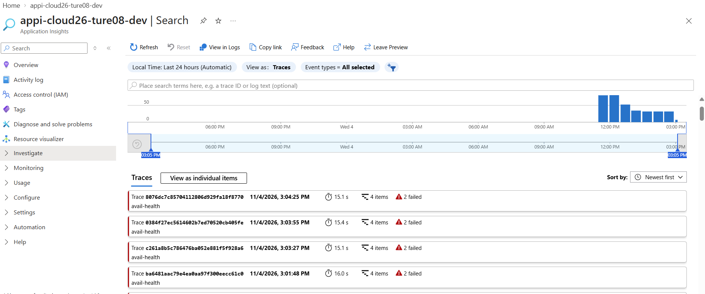

**What makes it a tree?** One column. When a request arrives the SDK gives it an `operation_Id` and stamps that id on every `dependencies`, `traces` and `exceptions` row the request produces. The end-to-end view is simply all four tables filtered by one `operation_Id` — and when you write KQL that joins tables in section E, that column is the key.

📖 **Theory:** [correlation](https://github.com/xamk-mire/Xamk-wiki/blob/main/Cloud%20technologies/Azure/Monitoring-and-Application-Insights.md#korrelaatio-operation_id) ([🇬🇧](https://github.com/xamk-mire/Xamk-wiki/blob/main/Cloud%20technologies/eng/Azure/Monitoring-and-Application-Insights.md#correlation-operation_id))

Transaction search lists one row per *operation* (a request and everything it caused). Set the time range to **Last 24 hours** first — the default 30 minutes is often empty — and filter **Event types** down to *Request* so the availability test's own `/health` rows (they appear after Step 14, every 5 minutes from five locations) do not bury your registration. The screenshot above was taken with the database stopped, which is why every row is red; a healthy POST registration looks the same minus the failures.

Two kinds of rows you did not write will show up in the tree and in `traces`: EF Core's `Executed DbCommand` lines (Step 6) and Npgsql's `received-first-response` events (the moment the first byte came back from PostgreSQL). Both are correct and both are noise for this course — learn to read past them.

Take a screenshot of one end-to-end transaction showing the PostgreSQL dependency — submission item.

</details>

---

## Guided section E — KQL: ask the telemetry questions

<details>
<summary><strong>Show section</strong></summary>

### Why this step?

Views answer predefined questions. Real investigations need arbitrary ones — that is KQL. You will write three queries by hand (to learn the shape), then use AI (to go fast), then verify AI's work (to stay honest).

**KQL in one paragraph.** Kusto Query Language is the query language of the workspace. A query is a **pipeline**: start with a table (`requests`, `traces`, `dependencies`, `exceptions` — the telemetry types from Step 5), then each `|` line takes the rows so far and does one thing: `where` filters, `summarize … by` groups and counts, `project` picks columns, `order by` sorts, `take` limits. `ago(1h)` means "one hour before now". The result is a table — or a chart, if the last line is `render timechart`. Read every query top to bottom and ask at each `|`: what rows are flowing through here now? Column names are the only part you cannot guess; when in doubt, `requests | take 1` shows a raw row.

📖 **Theory:** [KQL](https://github.com/xamk-mire/Xamk-wiki/blob/main/Cloud%20technologies/Azure/Monitoring-and-Application-Insights.md#kql--kyselyt-telemetriaan) ([🇬🇧](https://github.com/xamk-mire/Xamk-wiki/blob/main/Cloud%20technologies/eng/Azure/Monitoring-and-Application-Insights.md#kql--asking-the-telemetry-questions)) · [tables and columns](https://github.com/xamk-mire/Xamk-wiki/blob/main/Cloud%20technologies/Azure/Monitoring-and-Application-Insights.md#taulut-ja-sarakkeet) ([🇬🇧](https://github.com/xamk-mire/Xamk-wiki/blob/main/Cloud%20technologies/eng/Azure/Monitoring-and-Application-Insights.md#tables-and-columns)) · [KQL tutorial](https://learn.microsoft.com/en-us/azure/azure-monitor/logs/get-started-queries) · [quick reference](https://learn.microsoft.com/en-us/azure/data-explorer/kusto/query/kql-quick-reference)

### Step 10: By hand

In **Logs**, run these one at a time — read each result before moving on:

```kusto
// 1. What has been requested, how often, how successfully?
requests
| where timestamp > ago(1h)                                   // only the last hour
| summarize count(), avg(duration) by name, resultCode        // one row per (endpoint, status): how many, how slow
| order by count_ desc                                        // summarize named the columns count_ and avg_duration
```

```kusto
// 2. Your own structured logs — EventId is a FIELD, not text
traces
| where message startswith "Registration"                     // text filter: starts with
| project timestamp, message, customDimensions.EventId        // keep three columns; customDimensions holds the template fields
| order by timestamp desc
```

```kusto
// 3. The database, as the app experiences it — one row per SQL statement
dependencies
| where timestamp > ago(1h)
| summarize count(), avg(duration) by statement = substring(data, 0, 60)   // group by the first 60 chars of the SQL text
| order by avg_duration desc
```

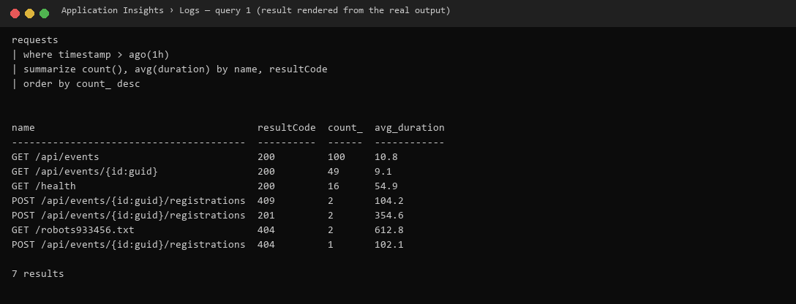

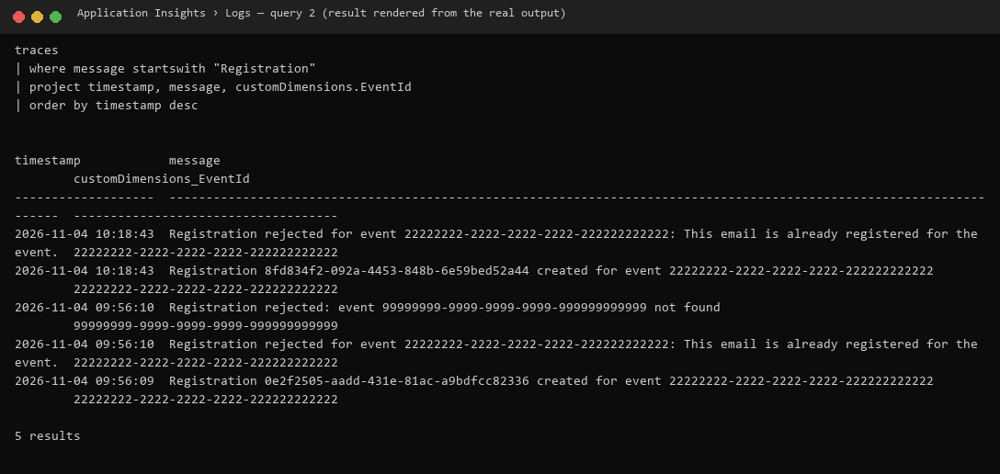

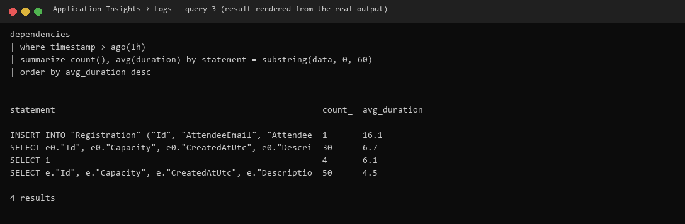

In query 3, why `data` and not `name`? For PostgreSQL the dependency `name` is just `postgresql`, `target` is the server, and the SQL text lives in `data` — look at one raw row (`dependencies | take 1`) to see all columns before you summarize. The `SELECT 1` rows are your `/health` endpoint (`CanConnectAsync`) — the pipeline smoke test and the availability test of section F both call it.

Note in query 2: `customDimensions.EventId` exists **because** you used a message template in Step 6. Interpolated strings would leave you doing `contains` searches over raw text.

Now change `startswith` to `has "Registration"` and run it again. EF Core's `Executed DbCommand` lines appear too — they mention the `Registration` *table* — and their `customDimensions.EventId` reads `20101`. That is `ILogger`'s own numeric event id (EF Core's `CommandExecuted`), which happens to share a name with your `{EventId}` property. Name collisions like this are why query filters are as specific as you can make them — and why some teams prefix their own properties.

> **Reminder — sampling, or why `count()` can lie:** at high volume the SDK keeps only a **sample** of rows (version 3 rate-limits traces per second by default) and marks each kept row with how many it stands for. Fine for "how many 5xx?"; dangerous if you treat Logs as a complete audit of every user's request. Even the small burst in Step 8 (~6 requests/s) tags some requests with a 50 % rate — see it with `requests | summarize count() by tostring(customDimensions['microsoft.sample_rate'])`. In KQL, `count()` counts stored rows; `sum(itemCount)` gives the estimated real number. [wiki: sampling](https://github.com/xamk-mire/Xamk-wiki/blob/main/Cloud%20technologies/Azure/Monitoring-and-Application-Insights.md#kustannukset) ([🇬🇧](https://github.com/xamk-mire/Xamk-wiki/blob/main/Cloud%20technologies/eng/Azure/Monitoring-and-Application-Insights.md#costs))

### Step 11: With AI — generate, then verify

Ask your AI tool:

```
Write a KQL query for Application Insights: from the requests table,
show the count of failed requests (success == false) in 5-minute bins
over the last 24 hours, rendered as a timechart.
```

Run the result. Then a harder one:

```
KQL for Application Insights: for POST requests to /api/events/{id}/registrations,
join each request to the dependencies it triggered (by operation_Id) and
show request duration vs. total dependency duration, last 24 h.
```

Three operators you have not typed yet appear here: `bin(timestamp, 5m)` rounds times into buckets so `summarize` produces a time series, `render timechart` draws it, and `join … on operation_Id` combines two tables on the correlation column from Step 9 ([operator table](https://github.com/xamk-mire/Xamk-wiki/blob/main/Cloud%20technologies/Azure/Monitoring-and-Application-Insights.md#kql--kyselyt-telemetriaan) ([🇬🇧](https://github.com/xamk-mire/Xamk-wiki/blob/main/Cloud%20technologies/eng/Azure/Monitoring-and-Application-Insights.md#kql--asking-the-telemetry-questions))).

**Verify before trusting:** does the query use real column names (`operation_Id`, not an invented `correlationId`)? Does the row count pass a sanity check against Transaction search? AI is a *fast* KQL writer and an *unreliable* schema rememberer — the combination works when you audit the schema parts.

</details>

---

## Guided section F — Alerts: the environment emails you

<details>
<summary><strong>Show section</strong></summary>

### Why this step?

Dashboards are for when you are looking. Alerts are for when you are not. Two alerts cover the course outcome: **the app is erroring** (5xx metric) and **the app is unreachable** (availability test). Both notify through one **Action Group**.

### Step 12: Action Group — whom to tell

Azure splits alerting in two: an **alert rule** says *what* to watch, an **Action Group** says *whom to tell* and *how* (e-mail, SMS, push to the mobile app, a webhook, an Azure Function). They are separate resources on purpose: one group serves every rule, so when the on-call person changes you edit one place. The `--short-name` (12 characters max) is what appears in SMS and push notifications.

📖 **Theory:** [alerts and Action Groups](https://github.com/xamk-mire/Xamk-wiki/blob/main/Cloud%20technologies/Azure/Monitoring-and-Application-Insights.md#hälytykset-ja-action-groupit) ([🇬🇧](https://github.com/xamk-mire/Xamk-wiki/blob/main/Cloud%20technologies/eng/Azure/Monitoring-and-Application-Insights.md#alerts-and-action-groups)) · [Action groups](https://learn.microsoft.com/en-us/azure/azure-monitor/alerts/action-groups)

```powershell
az monitor action-group create `
  --resource-group $ResourceGroup `
  --name $ActionGroup `
  --short-name cl26mail `
  --action email primary-email $YourEmail
```

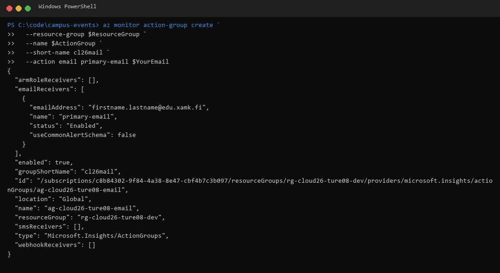

**What does the command do?** Creates a reusable "notification recipe". Alert rules reference it — one place to change when the on-call person changes. (Your Assignment 1 budget alert has its own email wiring; real setups point everything at shared Action Groups.)

**Now check your inbox — this step is not optional.** Within a minute `azure-noreply@microsoft.com` sends *"Verify your email address"* with a one-time code. Click **Verify my email**, enter the code, and wait for *Email verified successfully*. Until you do, the receiver exists but Azure will **not** send it a single alert — section G would fail silently. The code expires in 30 minutes; if it does, remove and re-add the receiver (`az monitor action-group update … --remove-action primary-email` / `--add-action email primary-email $YourEmail`) to get a new one. No mail at all? Check spam now, before anything depends on it.

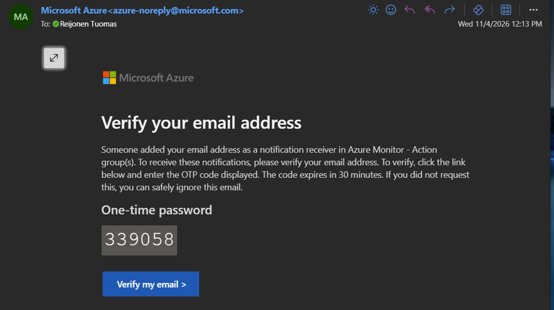

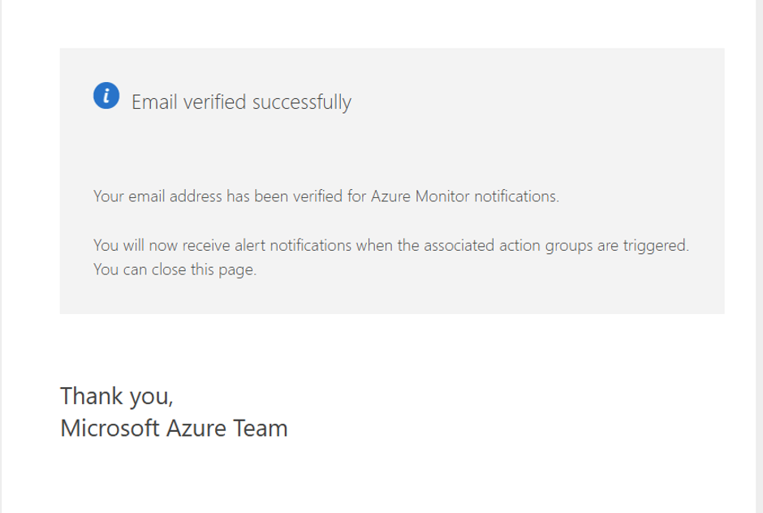

### Step 13: Metric alert — Http5xx > 0

A **metric alert** watches a number over time. The number here is `Http5xx`, a *platform metric* App Service records for free; three settings shape the rule — the **threshold** (`> 0`), the **window** it aggregates over (5 min) and how often it looks (**evaluation frequency**, 1 min). The other kind, a **log alert**, runs a KQL query on a schedule and fires on its row count; it can express anything but lags behind ingestion and costs more, so metric alerts are the default when a metric exists. **Severity** is a label from 0 (critical) to 4 (verbose) that you choose — it sorts alerts in the Portal and the mobile app, it does not change what happens.

📖 **Theory:** [metric vs. log alert](https://github.com/xamk-mire/Xamk-wiki/blob/main/Cloud%20technologies/Azure/Monitoring-and-Application-Insights.md#metric-alert-vs-log-alert) ([🇬🇧](https://github.com/xamk-mire/Xamk-wiki/blob/main/Cloud%20technologies/eng/Azure/Monitoring-and-Application-Insights.md#metric-alert-vs-log-alert)) · [the parameters](https://github.com/xamk-mire/Xamk-wiki/blob/main/Cloud%20technologies/Azure/Monitoring-and-Application-Insights.md#luonti-clillä) ([🇬🇧](https://github.com/xamk-mire/Xamk-wiki/blob/main/Cloud%20technologies/eng/Azure/Monitoring-and-Application-Insights.md#creating-them-with-the-cli)) · [Metric alerts](https://learn.microsoft.com/en-us/azure/azure-monitor/alerts/alerts-metric-overview)

```powershell
$AppId = az webapp show `
  --resource-group $ResourceGroup `
  --name $AppName `
  --query id --output tsv

az monitor metrics alert create `
  --resource-group $ResourceGroup `
  --name alert-cloud26-http5xx `
  --scopes $AppId `
  --condition "total Http5xx > 0" `
  --window-size 5m `
  --evaluation-frequency 1m `
  --severity 2 `
  --action $ActionGroup `
  --description "Campus Events is returning server errors"
```

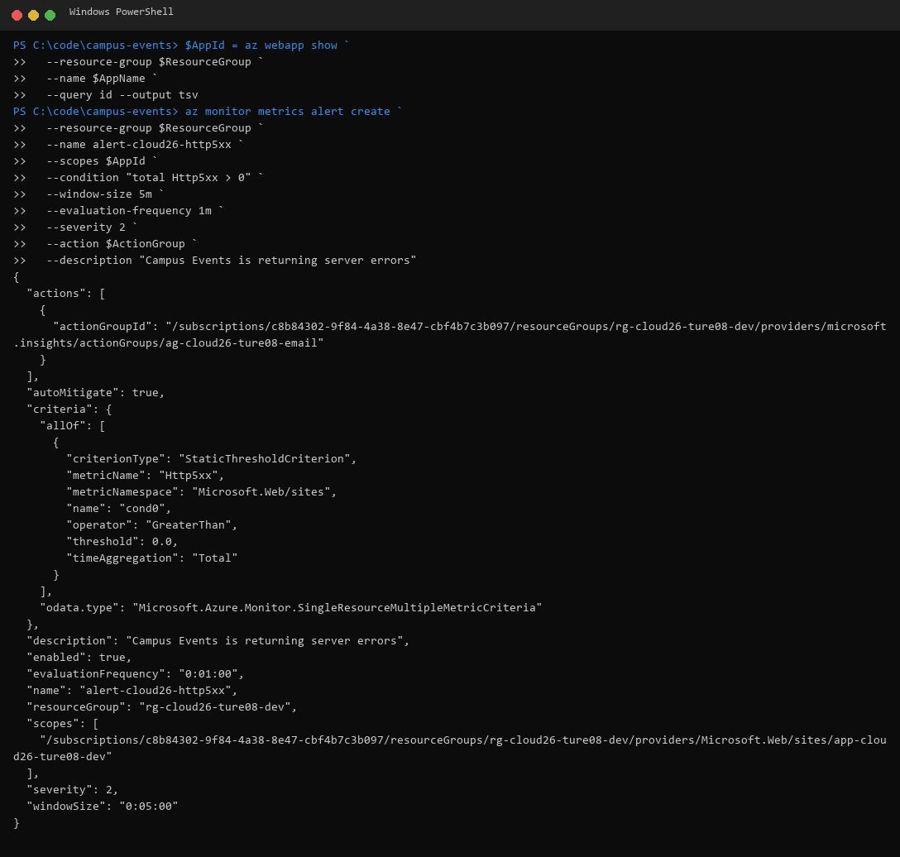

**Reading the rule:** every 1 minute, Azure sums the `Http5xx` platform metric over the last 5 minutes; if the sum exceeds 0, the alert **fires** and the Action Group emails you. When a later evaluation finds 0 again, the alert **resolves** — and emails you again (good news is also news).

> **Reminder — threshold 0 is a course setting:** in production, one 5xx among thousands of requests is noise, and an alert that cries wolf gets ignored (**alert fatigue** — the failure mode of monitoring: so many alerts that people stop reading them, the real one included). Real thresholds come from knowing normal traffic; the dials are the threshold, the window and, for planned outages, an alert processing rule (Assignment 7). Here, *any* 5xx is genuinely interesting. [wiki: alert fatigue](https://github.com/xamk-mire/Xamk-wiki/blob/main/Cloud%20technologies/Azure/Monitoring-and-Application-Insights.md#hälytysväsymys-alert-fatigue-ja-resolved-ilmoitus) ([🇬🇧](https://github.com/xamk-mire/Xamk-wiki/blob/main/Cloud%20technologies/eng/Azure/Monitoring-and-Application-Insights.md#alert-fatigue-and-the-resolved-notification))

### Step 14: Availability test — /health from five continents

An **availability test** is monitoring from *outside*: Azure calls your URL from several of its own data centres every few minutes and records each call as a row in `availabilityResults`. A **Standard test** is a plain HTTP request with a success rule (status 200 by default). It creates its own alert rule whose condition is "**X of Y locations** failed" — several locations matter, because one data centre can fail for network reasons that are not your app's fault, and "2 of 5" tells the two apart. Each run is a billable execution, which is why the frequency and the number of locations are cost settings too.

📖 **Theory:** [availability tests](https://github.com/xamk-mire/Xamk-wiki/blob/main/Cloud%20technologies/Azure/Monitoring-and-Application-Insights.md#availability-testit) ([🇬🇧](https://github.com/xamk-mire/Xamk-wiki/blob/main/Cloud%20technologies/eng/Azure/Monitoring-and-Application-Insights.md#availability-tests)) · [cost](https://github.com/xamk-mire/Xamk-wiki/blob/main/Cloud%20technologies/Azure/Monitoring-and-Application-Insights.md#kustannukset) ([🇬🇧](https://github.com/xamk-mire/Xamk-wiki/blob/main/Cloud%20technologies/eng/Azure/Monitoring-and-Application-Insights.md#costs)) · [Availability tests](https://learn.microsoft.com/en-us/azure/azure-monitor/app/availability-overview)

This one clicks together in the Portal: App Insights resource → **Availability** → **+ Add Standard test**:

| Field | Value |
|-------|-------|
| Test name | `avail-health` |
| URL | `$BaseUrl/health` (the live `https://…azurewebsites.net/health` URL) |
| Test frequency | 5 minutes |
| Test locations | 5 (the default mix is fine) |
| Success criteria | HTTP 200 (default) |
| Alerts | Enabled (default) |

After creating: open the auto-created alert rule (**Alerts → Alert rules** → the one named after your test, `avail-health-appi-cloud26-…`) and **add your Action Group** to it — the rule exists but does not email anyone until you attach the group. Verify from the CLI that both rules now have one action each:

```powershell
az monitor metrics alert list `
  --resource-group $ResourceGroup `
  --query "[].{name:name, enabled:enabled, actions:length(actions)}" `
  --output table
```

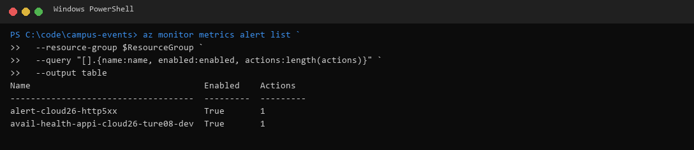

**Why `/health` and not `/`?** Your health endpoint checks the database (Assignment 3). The availability test therefore verifies *the service works*, not merely *the process answers* — a distinction you have already exploited twice, and are about to again.

Within ~10 minutes the Availability view shows green dots from five locations. The app is now watched around the clock from outside Azure's front door.

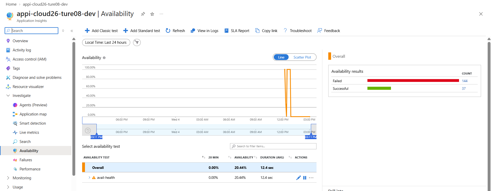

The screenshot is from the course staff's run, taken *after* section G, so the dip is the fault drill and the low 24-hour average comes from stopping the database again at the end. Switch **Line** to **Scatter Plot** to see each location's individual runs — that is the chart you pin in Step 20.

</details>

---

## Guided section G — The fault drill: break, get paged, diagnose

<details>
<summary><strong>Show section</strong></summary>

### Why this step?

An alert that has never fired is a hypothesis, not a safety net. The course outcome is explicit: *cause a fault → receive the email → find the root cause from telemetry*. Drill it now, with a fault you control.

### Step 15: Break the dependency

```powershell
az postgres flexible-server stop `
  --resource-group $ResourceGroup `
  --name $PgServer
```

The app process is still up — but `/health` is now 503 and `/api/events` throws. Exactly the "fault between deployments" this assignment exists for. (The stop takes a couple of minutes; `az postgres flexible-server show … --query state` tells you when it says `Stopped`.)

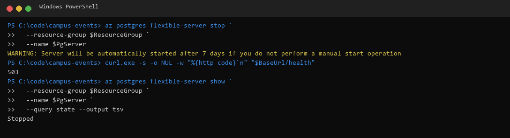

### Step 16: Generate the evidence

Real users would create the failing traffic; you simulate them (`Invoke-RestMethod` would stop at the first error — `curl.exe` keeps going):

```powershell
1..20 | ForEach-Object {
    curl.exe -s -o NUL -w "%{http_code}`n" "$BaseUrl/api/events"
    Start-Sleep -Seconds 2
}
```

Expected output: a column of `500`s — **slowly**. Each request takes about 15 seconds to fail, because the app waits for Npgsql's connection timeout before giving up, so the loop runs for roughly six minutes. Leave it running: the alerts need those minutes anyway, and a steady trickle of 5xx is exactly what real users would produce. Somewhere out there, five availability probes are also starting to fail against `/health`.

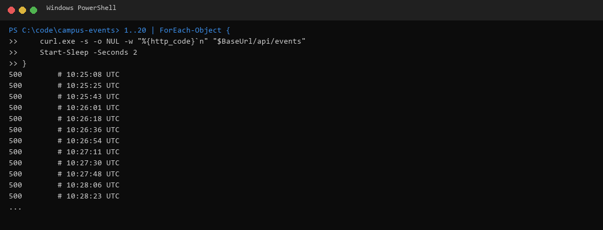

### Step 17: Wait for the pages

This is the realistic part nobody warns you about: **detection takes minutes**, not seconds. The metric alert evaluates every minute over a 5-minute window; the availability test runs every 5 minutes per location; email delivery adds a little. Plan for **5–15 minutes**. (In the course staff's test run: stop command 10:22:58, first `500` 10:25:08, Http5xx alert fired 10:27:00, availability alert 10:27:41 — write *your* timestamps down, you need them for the Step 18 timeline.)

While waiting, watch it happen live: App Insights → **Failures** — the 500s are already piling up there. The Portal's **Alerts** page (or the CLI below) shows the alert state change before the e-mail lands. The column to read is **Monitor condition**: *Fired* while the rule's condition holds, *Resolved* once an evaluation finds it clean again — and each transition sends its own e-mail. (The other column, *Alert state* — New / Acknowledged / Closed — is the human's note, changed by hand in the Portal or the mobile app.)

📖 **Theory:** [Fired, Resolved and why both matter](https://github.com/xamk-mire/Xamk-wiki/blob/main/Cloud%20technologies/Azure/Monitoring-and-Application-Insights.md#hälytysväsymys-alert-fatigue-ja-resolved-ilmoitus) ([🇬🇧](https://github.com/xamk-mire/Xamk-wiki/blob/main/Cloud%20technologies/eng/Azure/Monitoring-and-Application-Insights.md#alert-fatigue-and-the-resolved-notification))

```powershell
az rest --method get `
  --url "https://management.azure.com/subscriptions/$SubscriptionId/providers/Microsoft.AlertsManagement/alerts?api-version=2019-05-05-preview&timeRange=1h" `
  --query "value[].{name:name, severity:properties.essentials.severity, state:properties.essentials.monitorCondition, fired:properties.essentials.startDateTime, signal:properties.essentials.signalType}" `
  --output table
```

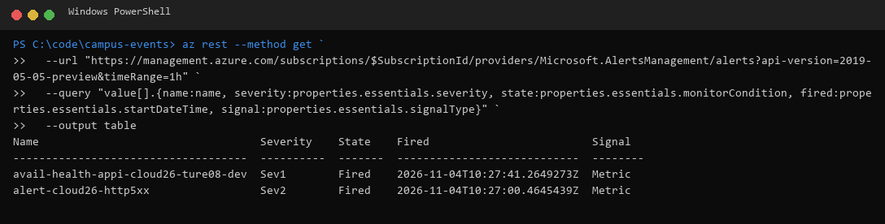

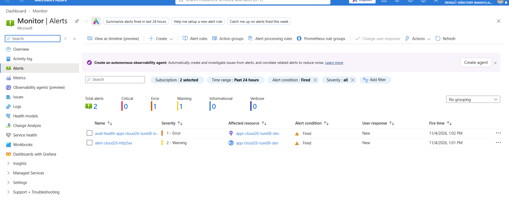

The same list in the Portal: **Monitor → Alerts**, filter *Alert condition = Fired*. Note the **User response** column (*New*): an on-call engineer marks an alert *Acknowledged* when they start working on it and *Closed* when done, so the rest of the team sees who owns the incident. The rule names tell you which signal fired — Sev 1 for the availability test, Sev 2 for the 5xx count — before you open either one.

You should receive (check spam for `azure-noreply@microsoft.com`):

1. **Your Azure Monitor alert was triggered** — `alert-cloud26-http5xx`, the metric alert
2. **An Azure Monitor alert is activated for avail-health** — the availability alert, "failed at 2 locations within the last 5 minutes"

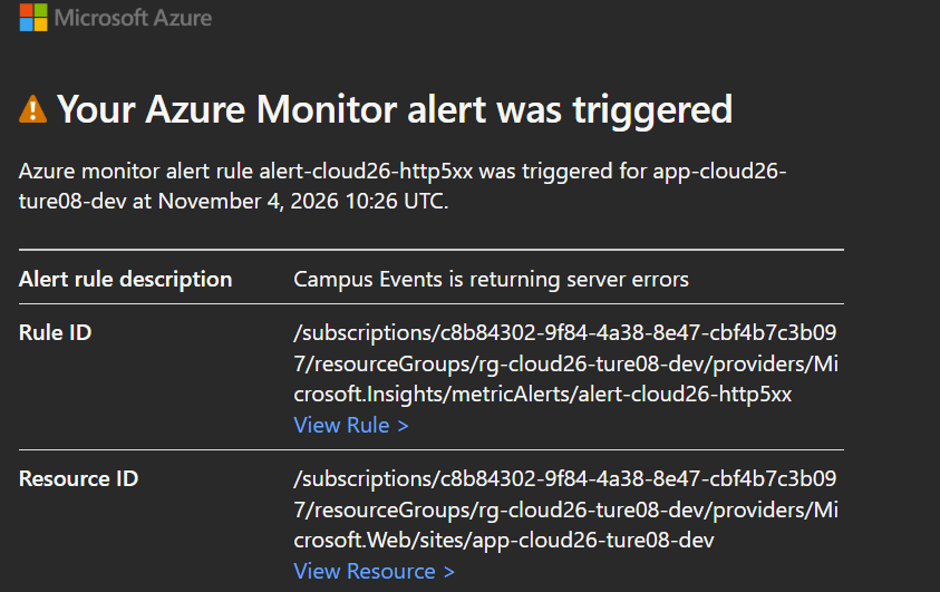

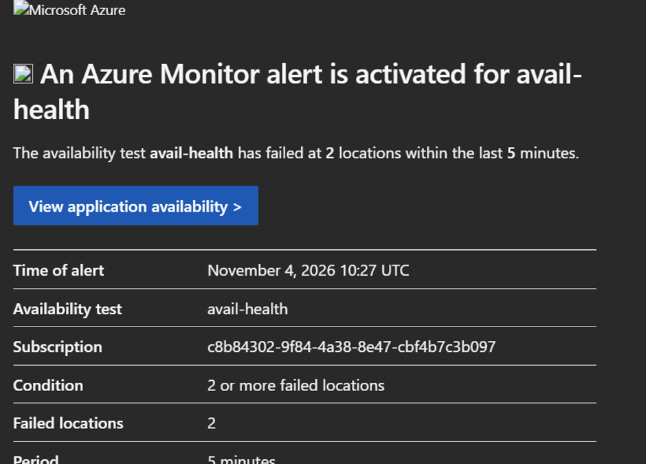

Screenshot both. This inbox view — *the environment telling you it is broken, unprompted* — is the course outcome, second half. (The first half was Assignment 5's pipeline failure email.)

#### Tip: the Azure mobile app

Nobody on call sits in front of a mailbox. Install the **Azure mobile app** ([Android / iOS](https://azure.microsoft.com/en-us/get-started/azure-portal/mobile-app/)), sign in with the same account, and the home screen's **Latest alerts** shows the same two rules — with a push notification the moment they fire:

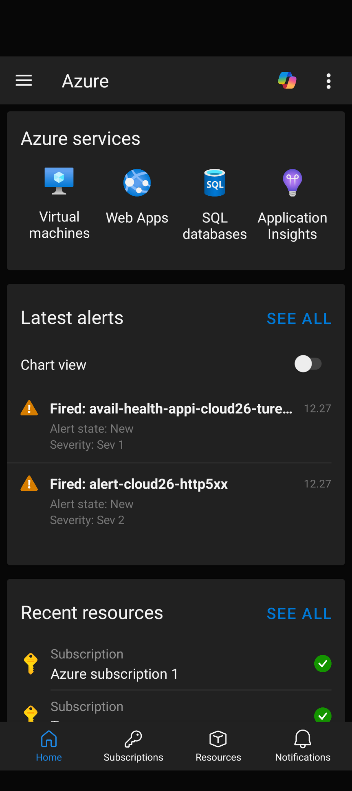

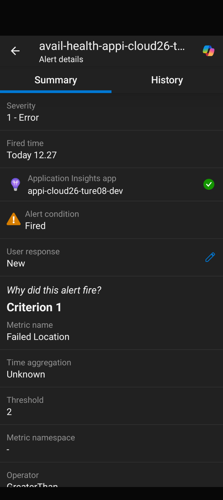

Why it is worth the install, beyond this course:

- **Alerts** — push notifications, the same details as the e-mail, and you can set the user response (Acknowledged / Closed) from the phone
- **Resource state** — see that the PostgreSQL server is *Stopped*, and **start or stop** it from the phone; the same for App Service restarts
- **Cloud Shell** — a terminal with `az` signed in, for the one-line confirm-and-fix commands of Steps 18–19 when you are nowhere near a laptop
- **Service Health** — Azure's own incidents and planned maintenance in your regions, so you know when the problem is not yours
- **Cost** — the current month's spend at a glance (Assignment 4's budget alert shows up here too)

The app is a window, not a replacement: KQL, dashboards and Bicep still happen in the Portal and in the pipeline.

### Step 18: Root cause from telemetry, AI-assisted

Now play the on-call engineer who knows nothing. In **Failures**:


The right-hand panel answers the first three questions without a single click: *what* fails (503 and 500), *why* (NpgsqlException, with TimeoutException and SocketException underneath it) and *where* (the `postgresql` dependency). The 503s outnumber the 500s because the availability test keeps hitting `/health` from five locations while your curl loop produced the 500s. Now dig in:

1. Operations tab: which endpoints are failing? (All of them that touch the DB — `/health` shows 503, the rest 500. Note the durations: ~15 000 ms each, the connection timeout — slowness *is* a symptom)
2. Exceptions tab: open the top exception group (`Npgsql.NpgsqlException`), open an instance, copy the full exception text. The same text is one KQL query away in **Logs** — `exceptions | take 1 | project outerMessage, details[0].rawStack` (the `exceptions` table keeps the type in `type`, the message in `outerMessage` / `innermostMessage`, and the stack inside the `details` array — [columns](https://github.com/xamk-mire/Xamk-wiki/blob/main/Cloud%20technologies/Azure/Monitoring-and-Application-Insights.md#taulut-ja-sarakkeet) ([🇬🇧](https://github.com/xamk-mire/Xamk-wiki/blob/main/Cloud%20technologies/eng/Azure/Monitoring-and-Application-Insights.md#tables-and-columns))):

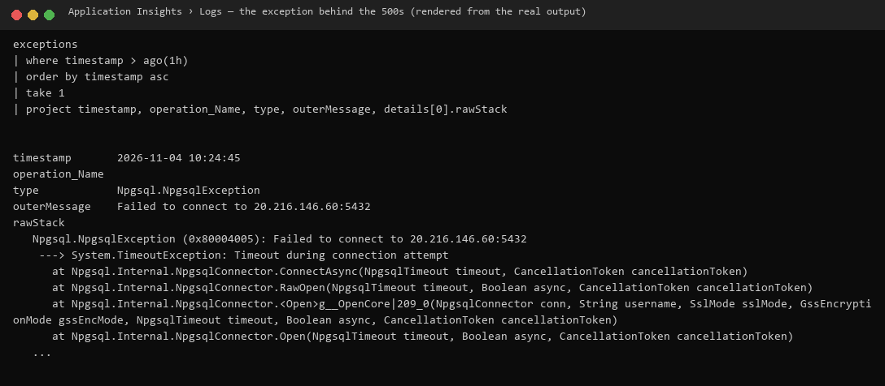

Paste it to your AI tool:

```
I got alerted at <time> that my ASP.NET Core app on Azure App Service is
returning 5xx. Application Insights shows this exception on all failing
requests: <paste the full exception>.
The app uses Azure Database for PostgreSQL Flexible Server.
What is the most likely root cause, how do I confirm it with one CLI
command, and what is the fix?
```

A good answer distinguishes *connection refused / timeout* (server unreachable — stopped, firewall, DNS) from *authentication failed* (wrong credentials) — the same fork as Assignment 3. Confirm the diagnosis:

```powershell
az postgres flexible-server show `
  --resource-group $ResourceGroup `
  --name $PgServer `
  --query state --output tsv
```

`Stopped`. Root cause confirmed with evidence — not because you happened to know (you did, you broke it), but through the loop you will use when you *do not* know: **alert → failures → exception → hypothesis → verify → fix**.

### Step 19: Fix, recover, and read the good news

```powershell
az postgres flexible-server start `
  --resource-group $ResourceGroup `
  --name $PgServer
```

After a few minutes: `/health` back to 200, Failures view goes quiet, availability dots turn green — and two **Resolved** emails arrive. They are slower than the Fired ones: a resolution needs a *clean* 5-minute window, and the window only starts after your last failing request. In the test run `/health` was back at 10:31:25, the availability alert resolved at 10:38:46 and the Http5xx alert at 10:40:58. The full incident lifecycle, end to end: fired → diagnosed → fixed → resolved, with timestamps in your inbox for the write-up.

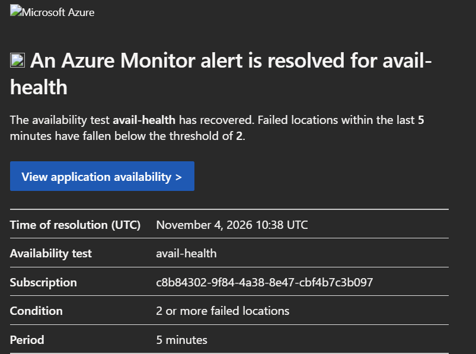

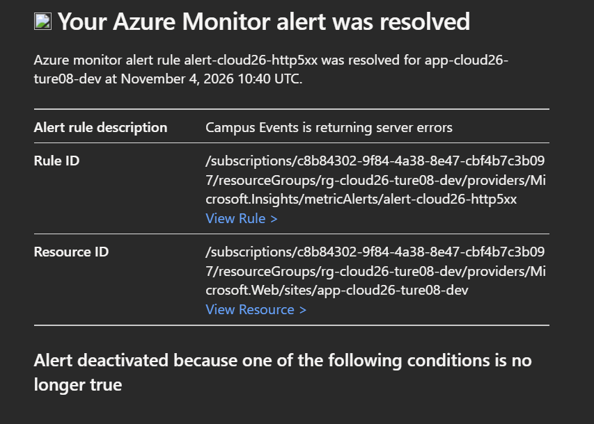

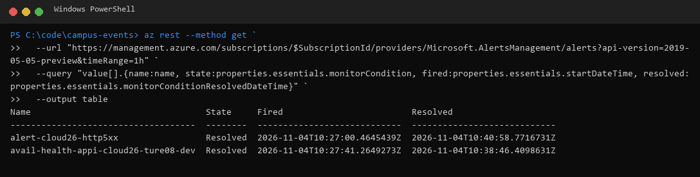

</details>

---

## Guided section H — Pin the picture: a dashboard

<details>
<summary><strong>Show section</strong></summary>

### Why this step?

During an incident you do not want to compose KQL from memory. A **dashboard** is the pre-built answer to "is everything OK?" — a grid of tiles pinned from Portal views, one screen, shared by the whole team. Its sibling, a **workbook**, is a parameterised report (time range, environment) with text and KQL charts in one document — the tool for a weekly review or a post mortem rather than a glance. This step builds the dashboard; know that the workbook exists.

📖 **Theory:** [dashboards and workbooks](https://github.com/xamk-mire/Xamk-wiki/blob/main/Cloud%20technologies/Azure/Monitoring-and-Application-Insights.md#dashboardit-ja-workbookit) ([🇬🇧](https://github.com/xamk-mire/Xamk-wiki/blob/main/Cloud%20technologies/eng/Azure/Monitoring-and-Application-Insights.md#dashboards-and-workbooks)) · [Azure dashboards](https://learn.microsoft.com/en-us/azure/azure-portal/azure-portal-dashboards)

### Step 20: Build it

1. In App Insights → **Failures**, click the pin icon (top right) → **Create new** dashboard, name it `cloud26-` plus your name
2. In **Performance**, pin the server response time chart to the same dashboard
3. In **Availability**, pin the availability scatter plot
4. Run your Step 11 timechart (failed requests over time) in **Logs** and pin that too
5. Portal menu → **Dashboard** → open yours, arrange the tiles

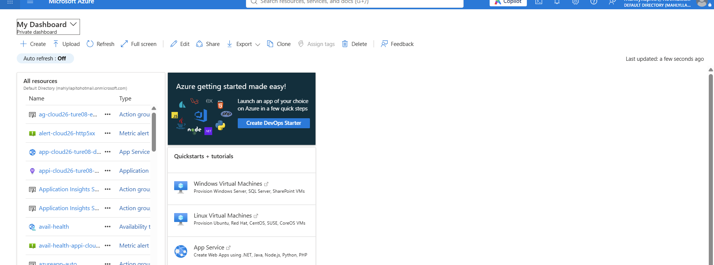

The Portal's **Dashboard** menu opens the default *My Dashboard* first — its *All resources* tile is a useful inventory of everything sections B–F created (two action groups named *Application Insights Smart Detection* among them — the Failure Anomalies rule's own, see Step 4 and Exercise 1). Your own dashboard is in the dropdown next to the name; **Edit** lets you resize and drag the tiles, and **Share** publishes it to the resource group so a teammate sees the same screen.

Screenshot the finished dashboard — with the section G incident still visible in the charts, it tells the whole story of this assignment in one image. Submission item and final-demo material.

</details>

---

# Independent exercises

## Exercise 1: Alerts as code

<details>
<summary><strong>Show section</strong></summary>

Section F clicked and typed alerts into existence — Assignment 4 taught you better. Move them to Bicep:

1. Write `infra/modules/alerts.bicep`: the Action Group (`Microsoft.Insights/actionGroups@2023-01-01`) and the Http5xx metric alert (`Microsoft.Insights/metricAlerts@2018-03-01`) — the web app's resource id comes in as a parameter
2. Wire it into `main.bicep` (the e-mail as a parameter — the existing `ownerEmail` will do if it is your real inbox), then **delete the hand-made versions** (`az monitor metrics alert delete`, `az monitor action-group delete`) and let the pipeline recreate them
3. Run what-if twice to prove idempotence: the PR's what-if check (or the first pipeline run) says `2 to create`; the next pipeline run (Actions → Deploy → Run workflow) says nothing to create or modify for the alerts
4. A model solution is in [Solution/](Solution/) — write yours first
5. One sentence: why is the availability test harder to move to Bicep than the metric alert? (Look at what the Portal created for you)

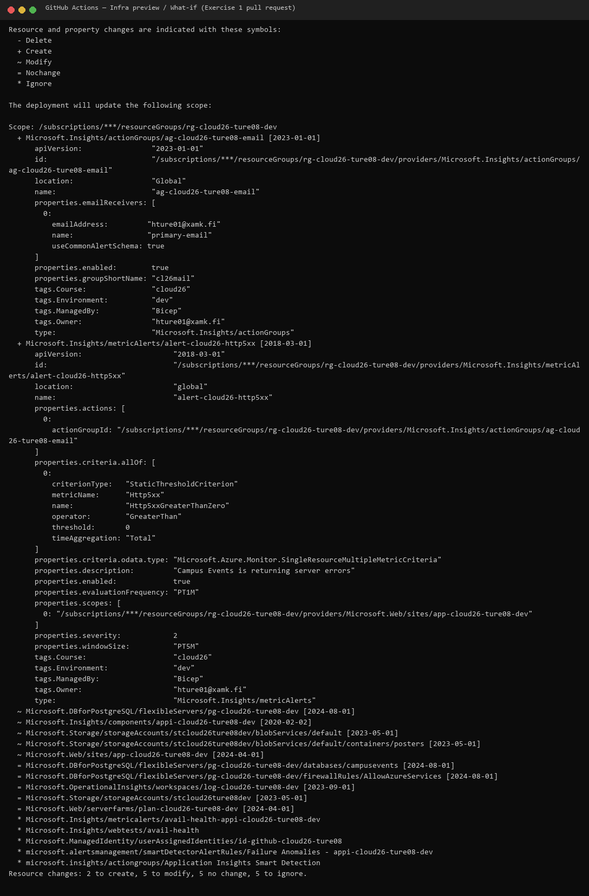

Read the `* Ignore` lines at the bottom of that what-if: `webtests/avail-health`, its alert rule, the Failure Anomalies rule and its *Smart Detection* action group. They exist in the resource group but not in your template — what-if neither creates nor deletes them, it just tells you they are outside your code. That list is the answer to question 5 starting to form.

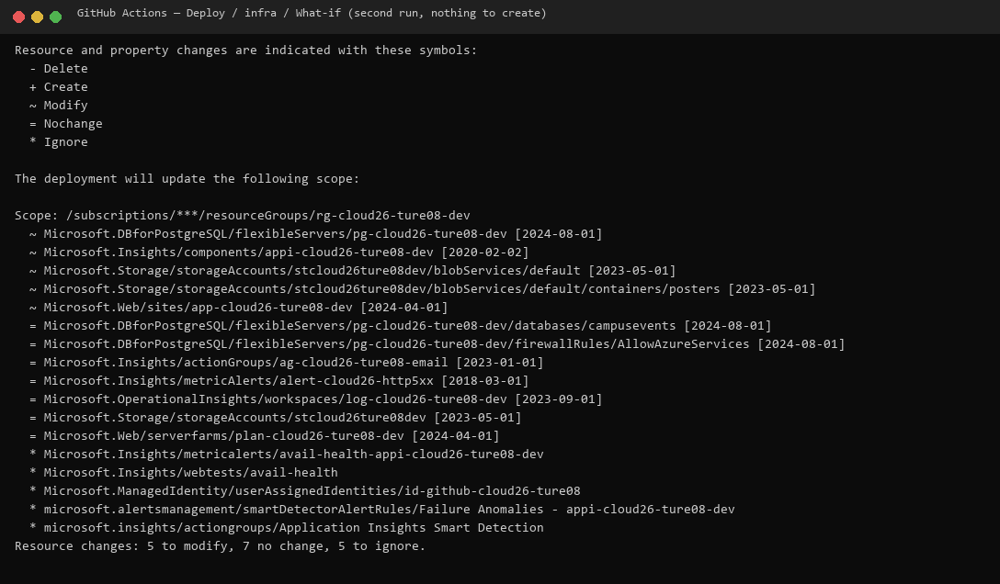

The second run is your idempotence proof: both alert resources moved from `+ Create` to `= Nochange`. (The `~ Modify` lines on the web app, the App Insights component and the storage sub-resources are the same what-if noise as before — properties Azure reports differently than Bicep writes them.)

Two things you will notice on the way. Deleting the Action Group leaves the Portal-made availability alert rule pointing at a resource id that no longer exists — `az monitor metrics alert list` still shows one action, dangling. Because your Bicep recreates the group with the **same name**, the id is the same and the link works again after the deploy; check the list once more afterwards. And `az monitor action-group list` shows a group called *Application Insights Smart Detection* that you never created — the Failure Anomalies rule's own group (Step 4, [wiki](https://github.com/xamk-mire/Xamk-wiki/blob/main/Cloud%20technologies/Azure/Monitoring-and-Application-Insights.md#smart-detection-failure-anomalies) ([🇬🇧](https://github.com/xamk-mire/Xamk-wiki/blob/main/Cloud%20technologies/eng/Azure/Monitoring-and-Application-Insights.md#smart-detection-failure-anomalies))). Leave it alone.

**Example prompt** (review the Bicep and the delete commands before you run anything):

```
Write infra/modules/alerts.bicep for a student Azure lab.

Parameters: alertEmail, webAppId, actionGroupName, tags.
Resources:
1. Microsoft.Insights/actionGroups@2023-01-01 — location Global, short name cl26mail (max 12 chars), one email receiver (alertEmail).
2. Microsoft.Insights/metricAlerts@2018-03-01 — name alert-cloud26-http5xx, location global, scope = webAppId, condition Total Http5xx > 0, window PT5M, evaluate PT1M, severity 2, action = the action group.

Then show the module call to add in main.bicep (email as a new @secure() or ordinary parameter — say which and why).

Do NOT include an availability / webtest resource. Add a comment explaining why that one stays in the Portal for this course.

I will review every file and every az delete / deploy command before I run them.
```

</details>

---

## Exercise 2: Log hygiene review, AI-assisted

<details>
<summary><strong>Show section</strong></summary>

Audit your whole app's logging like a privacy officer:

1. Collect every `Log*` call and the `/info` endpoint's output into one paste
2. Ask AI to review it against: no PII, no secrets, message templates everywhere, correct levels (Information vs. Warning vs. Error)
3. As always: fix or justify each finding — and this time also catch AI's **false positives** (does it flag `EventId` as PII? Is it right?)
4. Then audit what you did **not** write: run `traces | where timestamp > ago(1d) | summarize count() by tostring(customDimensions.CategoryName)` and decide the fate of EF Core's `Executed DbCommand` lines (Step 6). Are they PII? Are they cost? What would `"Microsoft.EntityFrameworkCore": "Warning"` in `appsettings.json` change ([how category filters work](https://github.com/xamk-mire/Xamk-wiki/blob/main/Cloud%20technologies/Azure/Monitoring-and-Application-Insights.md#lokitasot-konfiguraatiossa-appsettings) ([🇬🇧](https://github.com/xamk-mire/Xamk-wiki/blob/main/Cloud%20technologies/eng/Azure/Monitoring-and-Application-Insights.md#log-levels-in-configuration-appsettings))) — and what would you lose in an incident?
5. Ship any real fixes through the pipeline

**Example prompt:**

```
Review these ASP.NET Core log calls and the /info JSON for a student campus-events API.

Rules: no PII, no secrets, message templates (not string interpolation), correct levels (Information vs Warning vs Error).

List findings as: real issue / false positive / ok. If you flag EventId as PII, say whether that is correct and why.
Also: EF Core logs every SQL statement at Information level with parameters masked as '?'.
Should I lower Microsoft.EntityFrameworkCore to Warning? Give the trade-off (cost/noise vs. what an incident investigation loses).

I will fix or justify each item myself.

<paste every Log* call and the /info payload>
```

</details>

---

## Exercise 3: Theory questions

<details>
<summary><strong>Show section</strong></summary>

Read the questions in [questions.md](questions.md) and answer them **in your own words first**. **Do not submit the answers** — they are not part of the Learn return. They are training for the exam, and they are useful knowledge in the software industry. Similar questions will appear in the exam. You will be asked which observability pillar detected the stopped database vs. which one explained it, and why the resolved email matters. When you have tried, compare with [example-answers.md](example-answers.md). The lab text and the Additional material links are enough to answer every question.

</details>

---

## In a real project: MyLeague

<details>
<summary><strong>Show section</strong></summary>

Everything in this lab runs in production in [MyLeague](https://github.com/xamkfi/myleague-app), the sports league app built at Xamk (Assignment 5 showed you its pipelines). Its monitoring is public — open these files next to yours and look for the same pieces, scaled to a real workload:

| In this lab | In MyLeague | Where |
|---|---|---|
| Log Analytics + App Insights in Bicep (Step 2) | Same two resources in one module — plus a **daily ingestion cap** (`dailyQuotaGb`, 0.2 GB by default) so a log storm cannot run up the bill | [application-insights.bicep](https://github.com/xamkfi/myleague-app/blob/development/infra/provision/modules/application-insights.bicep) |
| `if (connection string exists) AddApplicationInsightsTelemetry()` (Step 5) | The same guard — and the SDK is **pinned to 2.23.0** with a comment explaining exactly the 3.x behaviour you met in Step 5. A real project chooses *when* to take a breaking upgrade | [Program.cs](https://github.com/xamkfi/myleague-app/blob/development/src/backend/WebAPI/Program.cs), [WebAPI.csproj](https://github.com/xamkfi/myleague-app/blob/development/src/backend/WebAPI/WebAPI.csproj) |
| "Log business events, not traffic" (Step 6) | Taken one step further: a **telemetry processor drops successful `/health` probes** before they are sent. The availability test and App Service health check call `/health` thousands of times a day, and every stored request costs ingestion. Failed probes are kept | [HealthCheckTelemetryFilter.cs](https://github.com/xamkfi/myleague-app/blob/development/src/backend/WebAPI/Telemetry/HealthCheckTelemetryFilter.cs) |
| Structured logging with `ILogger` | Serilog with the same message-template rule, sinks to console, file and App Insights | [Program.cs](https://github.com/xamkfi/myleague-app/blob/development/src/backend/WebAPI/Program.cs) |
| One Action Group, two alerts (Steps 12–14) | One Action Group, **eleven metric alerts**: health check status, 5xx, response time, plan CPU and memory, PostgreSQL CPU, CPU credits, memory, storage and failed connections, App Insights exceptions — all in one Bicep module (Exercise 1 at scale) | [monitoring-alerts.bicep](https://github.com/xamkfi/myleague-app/blob/development/infra/provision/modules/monitoring-alerts.bicep) |
| `Http5xx > 0` every minute (Step 13) | `Http5xx > 10` over 5 minutes, response time > 5 s over 15 minutes, PostgreSQL storage > 80 % over 30 minutes — thresholds and windows chosen per signal, from knowing normal traffic (the alert-fatigue reminder, applied) | same file |
| Availability test clicked in the Portal (Step 14) | The web test **is** in Bicep (`Microsoft.Insights/webtests`), but behind `enableAvailabilityTest = false` by default: enabled for production only, because each test costs money (Exercise 1, question 5 — now you know it can be done) | same file |
| Failure Anomalies left alone (Step 4) | The smart-detection rule is **routed to the same Action Group**, so its e-mails reach the on-call person too | same file |
| Cost note at the top of this assignment | A monthly **cost budget** with e-mails at 80 % and 100 % lives in the same alerts module — monitoring the bill is monitoring | same file |

The difference between the lab and MyLeague is not the tools: it is that every number — thresholds, windows, the ingestion cap, which probes to drop — is a decision someone made after watching the real system for a while. That watching starts with the views and queries you used in sections D and E.

</details>

---

# Summary — what did we learn?

| Concept | What we learned |
|--------|--------------|
| **Observability** | Logs, metrics, traces — three views, one goal: infer the inside from the outside |
| **The Azure stack** | Log Analytics (store) + App Insights (collector) + platform metrics + alerts, all as Bicep through the pipeline |
| **Correlation** | One request, its DB calls, logs, and exceptions as a single tree — the end of guess-driven debugging |
| **Structured logging** | Message templates make fields queryable; PII stays out of telemetry, period |
| **KQL** | Tables → `where` → `summarize`; AI drafts fast, you audit schemas |
| **Alerts + Action Groups** | *What to watch* and *whom to tell*, separated; fired **and** resolved both notify |
| **Availability tests** | Outside-in verification of `/health` — the service, not the process |
| **The fault drill** | Break → get paged (minutes, not seconds) → Failures → exception → AI hypothesis → CLI verify → fix → resolved |
| **Alert fatigue** | Threshold 0 is for the course; real thresholds come from knowing normal |
| **Dashboards** | The pre-built "is everything OK?" screen |
| **On call is mobile** | The Azure mobile app pushes the same alerts to your phone, shows resource state, and starts a stopped server — the inbox is not where incidents are noticed |
| **Least privilege meets reality** | The pipeline identity could not register a resource provider — a human did it once, instead of making the robot an Owner |
| **Read the SDK you install** | Version 3 is OpenTelemetry: it throws without a connection string and does not know Npgsql until you subscribe to it |

---

## Submission

<details>
<summary><strong>Show section</strong></summary>

**All returns go to the Learn platform.** Submit only the items below — relevant screenshots and written notes. Do not upload code or Bicep files; screenshots are enough.

The screenshot list is also in [questions.md](questions.md) under **What to return**. Theory questions in that file are **not submitted** — exam training and industry knowledge (try first, then [example-answers.md](example-answers.md)).

**Through the pipeline (sections B–C)**

- [ ] Screenshot: the merged monitoring PR — gates green, the what-if check showing the two new resources, AI review reacted to (Step 4)

**Telemetry (sections D–E)**

- [ ] Screenshot: one end-to-end transaction in Transaction search — your `POST …/registrations` request, the `postgresql` dependency under it, and your `Registration … created` trace (Step 9)
- [ ] Screenshots: your three hand-written KQL queries **with** their results (Step 10)
- [ ] In your answers document: the AI-generated KQL + your verification notes — which column names you checked and against what (Step 11)

**The incident (sections F–H)**

- [ ] Screenshot: both **Fired** e-mails (`alert-cloud26-http5xx` and `avail-health`) and both **Resolved** e-mails, timestamps visible (Steps 17, 19)
- [ ] In your answers document: root-cause write-up (Step 18) — timeline from the first e-mail to the confirmed cause, the exception you pasted, the AI's hypothesis, and the CLI command that confirmed it
- [ ] Screenshot: dashboard with the incident visible in the charts (Step 20)

**Exercises**

- [ ] Exercise 1: screenshot of the pipeline's what-if log for the alerts PR (`2 to create`) and of the next run's what-if (no change) — idempotence proven
- [ ] Exercise 1: your one-sentence answer on the availability test, in your answers document
- [ ] Exercise 2: in your answers document — log hygiene findings: fixes, justifications, AI false positives, and your decision on EF Core's SQL logging

**Checklist before submitting:**

- [ ] All changes went through PRs — `git log main` shows no direct commits
- [ ] No PII in any log statement (Exercise 2 confirms)
- [ ] Alerts are attached to the Action Group and have fired at least once for real
- [ ] Database stopped afterwards — and you know both alerts will fire if traffic hits the app while it is stopped (you built exactly that)

</details>

---

## Support and troubleshooting

<details>
<summary><strong>Show section</strong></summary>

If you need help:
1. Telemetry lag is the #1 confusion: wait 2–5 minutes before deciding data is missing
2. Alert did not fire? Check the alert rule's **History** in the Portal — it shows every evaluation
3. Paste exceptions to AI *complete and unedited* — the interesting part is often the inner exception at the bottom
4. Ask classmates or the teacher

**Common problems:**

| Problem | Solution |
|---------|----------|
| Pipeline infra job fails: `MissingSubscriptionRegistration … Microsoft.OperationalInsights` (or `Microsoft.Insights`) | The subscription has never used that provider and the pipeline identity may not register it. Run the three `az provider register … --wait` commands from Step 4 as yourself, then re-run the Deploy workflow (Actions → Deploy → Run workflow) |
| `dotnet run` / `dotnet test` throws `A connection string was not found. Please set your connection string.` | SDK version 3 refuses to start without `APPLICATIONINSIGHTS_CONNECTION_STRING`. Wrap the registration in the `if` from Step 5 |
| No telemetry at all | `APPLICATIONINSIGHTS_CONNECTION_STRING` missing in App Service → check app settings; did the Bicep PR actually deploy? |
| `requests` and `traces` fill up, `dependencies` stays empty | The Npgsql trace source is not subscribed — the `ConfigureOpenTelemetryTracerProvider(… AddSource("Npgsql"))` line from Step 5 is missing or outside the `if` |
| An e-mail titled *Failure Anomalies* that you never configured | Smart detection (Step 4 verify) reacting to your fault drill. Informational; not one of the two alerts you must screenshot |
| Live Metrics works, Logs empty | Normal for the first minutes — batching. Wait 5 minutes |
| No alert email | 1) Did you **verify the address** (Step 12)? An unverified receiver gets nothing, and the alert still shows *Fired* in the Portal. 2) Check spam (`azure-noreply@microsoft.com`), 3) Action Group attached to the rule? (esp. the availability rule, Step 14), 4) alert History shows evaluations? |
| Alert fired but no Resolved mail | Resolution needs a clean 5-min window — wait; also confirm traffic is hitting the app so the metric has data |
| `traces` missing your log lines | Default level filters: `Information` from your categories passes, but check `Logging:LogLevel` in appsettings hasn't been raised to `Warning` |
| `customDimensions.EventId` empty in KQL | The log call interpolated (`$"..."`) instead of using a template — Step 6 rule 1 |
| Availability test failing from one location only | Transient network noise — the default "2 of 5 locations" alert condition exists precisely for this |
| Step 16 prints `503` and the browser shows an *Application Error* page instead of `500` | The app process restarted while the database was stopped and crashed at startup (`EnsureCreated` needs the DB). Both alerts still fire (503 is a 5xx), but there is no exception for Step 18 because the process is not running. Start the DB, wait for `/health` = 200, stop it again, and generate the traffic within a few minutes |
| 500s but Failures view empty | Wrong App Insights resource open, or SDK PR not deployed — verify `/api/events` telemetry appears in Transaction search first |

**Wiki materials:**
- [Azure Monitor and Application Insights](https://github.com/xamk-mire/Xamk-wiki/blob/main/Cloud%20technologies/Azure/Monitoring-and-Application-Insights.md)
- [CI/CD](https://github.com/xamk-mire/Xamk-wiki/blob/main/Development-guidelines/CI-CD.md)
- [Infrastructure as Code](https://github.com/xamk-mire/Xamk-wiki/blob/main/Cloud%20technologies/Azure/Infrastructure-as-Code.md)

**External links:**
- [Application Insights overview](https://learn.microsoft.com/en-us/azure/azure-monitor/app/app-insights-overview)
- [KQL quick reference](https://learn.microsoft.com/en-us/azure/data-explorer/kusto/query/kql-quick-reference)
- [Metric alerts](https://learn.microsoft.com/en-us/azure/azure-monitor/alerts/alerts-metric-overview)
- [Availability tests](https://learn.microsoft.com/en-us/azure/azure-monitor/app/availability-overview)

</details>
